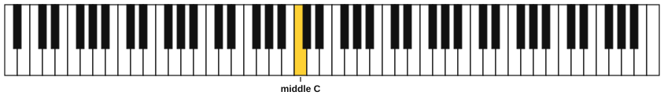
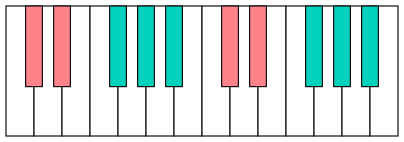
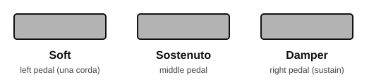
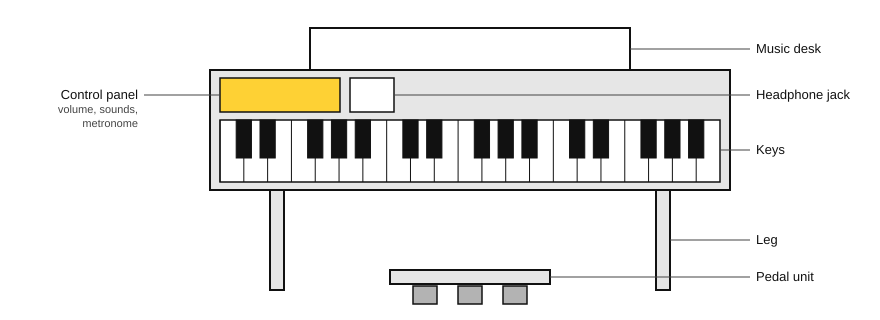

# Meet your piano

Piano

After this lesson you can name the kind of piano you own, say what its keys, action, touch sensitivity, polyphony and three pedals do, and find its volume, headphone jack and metronome.

Before this: [How to practise](../01-first-sounds/01-how-to-practise.md). You need: your piano, and its manual (or the model name so you can look it up).

## The idea

### Kinds of piano

All pianos play a note when you press a key. They differ in how the sound is made.

| Kind | How it makes sound | Notes |
|---|---|---|
| Acoustic grand piano | Pressing a key swings a felt hammer against a string | Strings lie flat in a large case; the heaviest and most expensive kind |
| Upright piano | Same, with the strings standing upright | Takes less room; found in homes and schools |
| Digital piano | Plays recorded piano sounds through speakers or headphones | Usually 88 keys with a piano-like feel; needs no tuning |
| Stage piano | A digital piano built for performing | Often has no built-in speakers, plays through an amplifier, and has many extra sounds |
| Keyboard | A light electronic instrument with many sounds | Often 61 keys or fewer, and the keys are usually light |
| MIDI controller | Only the keys, knobs and pads | Makes no sound itself; it sends **MIDI** (note messages) to a computer or app that does |

You own a digital piano. It has the same layout of keys as every other piano on the list, so everything in this book transfers.

### The keys

A full piano has 88 keys: 52 white and 36 black. The figure shows all 88, with the key near the middle marked in yellow. That key is **middle C**, and lesson 4 explains the name.

Black keys come in groups of two and three, with a gap between the groups. The pattern repeats across the whole piano and is how you find your place. The figure marks groups of two in salmon and groups of three in teal.

Smaller keyboards have 76, 61 or 49 keys, with keys cut from the ends. Your 88 keys give you every note this book uses.

### How the keys feel: action

The **action** is the mechanism under the key. It decides how heavy the key feels and how it springs back.

| Action | What it feels like |
|---|---|
| Weighted | Each key has a weight in it, so it feels like an acoustic piano |
| Hammer action | Weighted keys that also move a small hammer, as in an acoustic piano |
| Graded hammer action | A hammer action in which the keys in the low part are heavier and those in the high part are lighter, as on an acoustic piano |
| Semi-weighted | Light weights or springs; lighter than a piano |
| Unweighted | Light plastic keys on springs, as on most keyboards |

A graded hammer action is the closest to an acoustic piano. If you learn on light keys, an acoustic piano will feel heavy when you first sit at one.

### Touch sensitivity and polyphony

A key is **touch sensitive** when the sound changes with how fast you press it: a quick press is loud, a slow press is soft. The speed of the press is called **velocity**. Without touch sensitivity every note has the same volume, and you cannot play softly or loudly on purpose. Most digital pianos let you change the touch curve or switch it off. Leave it on.

**Polyphony** is the number of notes the piano can sound at once. A note that rings after you lift your finger still uses one of those voices, and so does each note you play while the damper pedal is held. When you run out, the piano cuts off the oldest notes. A polyphony of 64 is enough for the early pieces, and 128 or more gives you room for pedalled passages later.

### The three pedals

Most digital pianos have three pedals, like a grand piano. You press the right pedal with your right foot and the other two with your left. [Stage 7](../07-pedal-texture-and-ambient/index.md) teaches how to use them. For now, learn what each one does.

| Pedal | Also called | What it does |
|---|---|---|
| Right | Damper, sustain | Lifts the dampers (felt pads) off all the strings, so notes keep ringing after you lift your fingers |
| Middle | Sostenuto | Holds only the notes whose keys were already down when you pressed it |
| Left | Soft, una corda | Makes the sound softer and a little different in tone |

Some digital pianos give the middle pedal another job, and a few have the damper pedal respond in steps (half-pedalling, covered in stage 7). Your manual says which.

### Headphones, volume and the metronome

A digital piano lets you practise silently. The headphone jack is usually on the front edge or under the left side of the keyboard. The master volume control is usually a dial or a pair of buttons on the left. The built-in metronome is usually a button marked Metronome or Rhythm, with buttons for tempo. Find all three on your piano before the practice routine.

### Check your own piano

Work through this list once and write down the answers.

1. Find the model name on the front, the back or the underside, then find its manual on the maker's website.
2. How many keys does it have? (It should be 88.)
3. What is the key action called? Is it graded?
4. What is the polyphony?
5. Does the damper pedal do half-pedalling?
6. Where are the metronome, the headphone jack and the volume control?

## Try it

Exercise 1. A friend has a device with 61 keys that makes no sound until it is plugged into a laptop. Which kind is it?

Answer

A MIDI controller. A digital piano or keyboard would make its own sound.

Exercise 2. You press a key as slowly and softly as you can, then as fast and hard as you can. The two notes sound the same volume. What feature is off, and where would you look?

Answer

Touch sensitivity (the touch curve) is off or set to fixed. Look in the piano's settings or manual and switch it on.

Exercise 3. How many of the 88 keys are white, and how many are black?

Answer

52 white and 36 black (52 + 36 = 88).

### Practice routine (30 minutes)

| Minutes | What to do | Tempo | Listen for |
|---|---|---|---|
| 5 | Find the volume, headphone jack and metronome. Set a comfortable volume, then try headphones | None | A volume where you hear each note without strain |
| 10 | Touch: with the second finger of one hand, play one key softly five times, then loudly five times, then alternate. Repeat with the other hand | 60 bpm, one press per click | A clear difference between soft and loud |
| 5 | Pedals: play one low key and press each pedal in turn, keeping the key down. Do not worry about technique | None | How the sound changes with each pedal |
| 5 | Look up your model and write down the answers to the "Check your own piano" list | None | Missing answers you still need to find |
| 5 | Guitar: sit with the guitar and pluck one string, then listen to it fade | None | How long the note rings |

Repeat this routine on at least three days. The second and third days build the habit of sitting down, setting the volume and playing with a click.

### Move on when

- [ ] You can say which kind of piano you own and name one thing that separates it from an acoustic piano.
- [ ] You have written down your piano's key count, action, polyphony and whether the damper pedal does half-pedalling.
- [ ] You can turn on the metronome, set 60 bpm and find the headphone jack without searching.
- [ ] You can play one key five times softly and five times loudly, and a friend can hear the difference.
- [ ] You can say what the damper pedal does, in one sentence.

## Common mistakes

Using the pedals as you play. The pedals blur notes together, and a beginner does not yet hear when that helps. Leave your feet flat on the floor until stage 7.

Keeping the volume so low that soft and loud are hard to tell apart. Set the volume so a loud note is comfortable and a soft note is still easy to hear.

Playing with touch sensitivity switched off. Check it in the settings, because an even volume hides how hard you are pressing.

## Key terms

- **Digital piano**: an electronic instrument that plays recorded piano sounds, usually with 88 weighted keys.
- **MIDI**: a standard for sending note messages between instruments and computers.
- **Action**: the mechanism under the keys that sets their weight and feel.
- **Graded hammer action**: weighted keys that are heavier in the low part and lighter in the high part.
- **Touch sensitivity**: the sound changes with how fast you press the key.
- **Velocity**: how fast a key is pressed.
- **Polyphony**: how many notes can sound at once.
- **Damper pedal**: the right pedal; it lets notes keep ringing.
- **Sostenuto pedal**: the middle pedal; it holds only the notes already down.
- **Una corda pedal**: the left pedal; it makes the sound soft.

Next: [Meet your guitar](03-meet-your-guitar.md)
