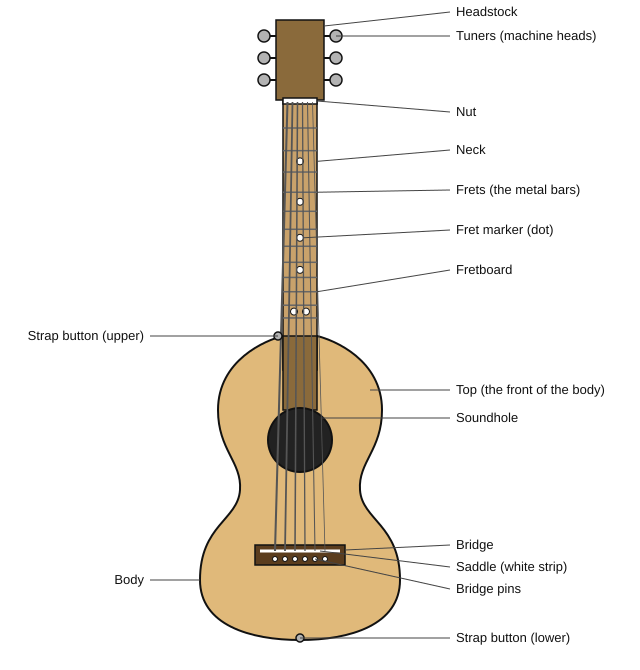
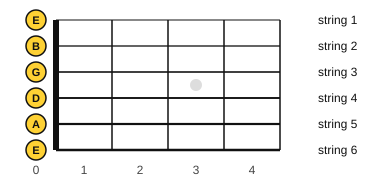

# Meet your guitar

<span class="tag tag-guitar">Guitar</span>

After this lesson you can name the parts of your steel-string guitar, say the name and number of each of its six strings, and care for the strings and the wood.

Before this: [How to practise](../01-first-sounds/01-how-to-practise.md). You need: your guitar.

## The idea

### The parts of the guitar

Your guitar is a right-handed steel-string acoustic. "Acoustic" means the body is hollow and makes the sound louder by itself, with no amplifier. The figure names the parts. Find each one on your own guitar as you read.



Start at the top. The **headstock** holds the **tuners** (also called machine heads), six small knobs that tighten or loosen the strings. The strings pass over the **nut**, a small bar at the end of the neck with a groove for each string.

The **neck** is the long wooden arm. Its front face is the **fretboard**, and the thin metal bars across it are the **frets**. When you press a string down against the fretboard close behind a fret, the string gets shorter and the note gets higher. The dots on the fretboard are **fret markers**; they help you find your place, at the 3rd, 5th, 7th and 9th frets, and a double dot at the 12th.

Below the neck is the hollow **body**. Its front face is the **top**, and the **soundhole** is the round opening in it. At the bottom of the top is the **bridge**, which holds the strings. The **saddle** is the thin white strip in the bridge that the strings rest on, and the **bridge pins** are the small pegs that lock the strings into the bridge. A **strap button** is a small knob where a strap hooks on; there is one at the bottom end of the body and one at the base of the neck or on its back.

### Steel strings and nylon strings

Your guitar has steel strings, which are bright and loud, and fairly tight to press. Classical and flamenco guitars use nylon strings, which are softer to press and sound mellower. Nylon strings can't go on a steel-string guitar: it is built to hold more tension than a nylon-string guitar, and the bridge and neck are made differently. When you buy strings, check the packet says "acoustic" and "steel".

Packets also carry two numbers such as 12-53. That is the string **gauge**: the thickness of the thinnest and thickest string, in thousandths of an inch (0.012 in and 0.053 in). Thinner strings are easier to press, and thicker ones sound fuller. Ask the shop for whatever size your guitar came with if you are unsure.

### The six strings

A guitar has six strings, and the book numbers them 1 to 6. String 1 is the thinnest and highest, and string 6 is the thickest and lowest. As you look down at the guitar in playing position, string 6 is the one closest to your face.

Each string has a letter name. From the thickest (6) to the thinnest (1), they are E, A, D, G, B and E. A saying that helps: Eddie Ate Dynamite, Good Bye Eddie.



| String | Name |
|---|---|
| 6 (thickest) | E |
| 5 | A |
| 4 | D |
| 3 | G |
| 2 | B |
| 1 (thinnest) | E |

The two E strings sound the same note, one higher than the other. Lesson 4 explains this distance, called an octave. Listen to the six open strings, from low to high. They are "open" because no finger is pressing them. The vertical lines are bar lines, explained in lesson 8; each note lasts two beats.

```abc
%%opts tab=guitar
X:1
M:4/4
L:1/4
Q:1/4=60
K:C clef=treble-8
E,2 A,2 | D2 G2 | B2 e2 |]
```

### Caring for the guitar

The strings and the wood both need small, regular care.

Wipe the strings and the back of the neck with a dry cloth after you play. Sweat and oil make strings go dull. Change the strings when they sound dull, look dark or rough, or no longer hold their tuning. Lesson 6 covers tuning. Changing strings is a task for a shop or a video the first time; it does not need to happen yet.

Wood reacts to dry air, and Ontario winters are dry indoors. Keep the guitar in its case or on a stand away from radiators, vents and windows. If the room feels dry (static, dry skin), keep a humidifier in the case or the room. Never leave the guitar in a hot car or a cold car.

## Try it

Exercise 1. Name the part: the round opening in the front of the body.

<details class="solution" markdown>
<summary>Answer</summary>

The soundhole.

</details>

Exercise 2. Which string is string 3, and which string is the thickest?

<details class="solution" markdown>
<summary>Answer</summary>

String 3 is G. The thickest is string 6, a low E.

</details>

Exercise 3. A packet of strings is marked 11-52. What do the two numbers mean?

<details class="solution" markdown>
<summary>Answer</summary>

The thinnest string is 0.011 inches thick and the thickest is 0.052 inches thick.

</details>

<div class="practice" markdown>

### Practice routine (30 minutes)

| Minutes | What to do | Tempo | Listen for |
|---|---|---|---|
| 5 | Point to and name each part from the figure, on your own guitar | None | Any part you cannot find |
| 10 | Pluck each open string with your thumb, from string 6 down to string 1 and back, saying its number and name aloud | 60 bpm, one string per click | Each note ringing until the next |
| 5 | Care: wipe the strings and neck with a dry cloth, and check where the guitar will live | None | Whether the room is dry or hot |
| 5 | Piano: play one key softly and loudly with each hand | 60 bpm | A clear difference in volume |
| 5 | Say the string names from 6 to 1 along with the metronome, with no guitar in your hands | 60 bpm | Staying with the click |

Repeat this routine on at least three days until you can say the six names without stopping to think.

</div>

<div class="move-on" markdown>

### Move on when

- [ ] You can touch and name 10 parts of your guitar (from the headstock to the strap button) in under a minute.
- [ ] You can say the six string names from 6 to 1 and from 1 to 6, without errors, at 60 bpm.
- [ ] You can point to any string by its number.
- [ ] You know where you will keep the guitar, and what makes the wood unhappy.

</div>

## Common mistakes

Calling string 6 the "first string" because it is at the top as you look down. In this book string 1 is the thinnest, as in tab and in every chord chart.

Twisting a tuner a long way with no tuner to check. A string can snap or go very sharp. Wait for lesson 6.

Leaving the guitar by a radiator or in the car. Heat and dry air crack the top and lift the bridge.

## Key terms

- **Headstock**: the top end of the neck, holding the tuners.
- **Tuner** (machine head): a knob that tightens or loosens a string.
- **Nut**: the small bar where the strings leave the headstock.
- **Neck**: the long arm that carries the fretboard.
- **Fretboard**: the front face of the neck.
- **Fret**: a metal bar across the fretboard.
- **Body**: the hollow part of the guitar.
- **Top**: the front face of the body.
- **Soundhole**: the round opening in the top.
- **Bridge**: the part of the top that anchors the strings.
- **Saddle**: the strip in the bridge that the strings rest on.
- **Open string**: a string played with no finger pressing it.
- **Gauge**: the thickness of a string.

Next: [Pitch and the musical alphabet](04-pitch-and-the-musical-alphabet.md)
