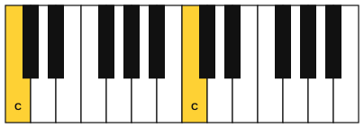
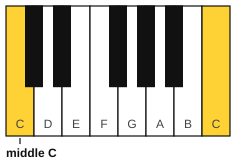
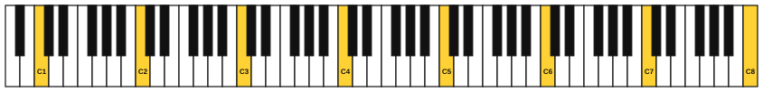

# Pitch and the musical alphabet

<span class="tag tag-theory">Theory</span>

After this lesson you can say whether one note is higher or lower than another, name every white key on the piano, and find middle C.

Before this: [Meet your piano](../01-first-sounds/02-meet-your-piano.md), [Meet your guitar](../01-first-sounds/03-meet-your-guitar.md). You need: your piano and your guitar.

## The idea

### High and low

Play the lowest key on your piano, then the highest. The first sounds deep and the second sounds thin and bright. That quality is **pitch**: how high or low a note sounds.

On the piano, pitch goes up as you move to the right. On the guitar, a thicker string sounds lower than a thinner one, and pressing a string at a higher fret number makes the note higher. Pluck string 6, then string 1, and hear the difference.

Listen to the notes climb and come back down. They are the white keys from C to the next C. The vertical lines are bar lines, which lesson 8 explains.

```abc
X:1
M:4/4
L:1/4
Q:1/4=80
K:C
C D E F | G A B c | c B A G | F E D C |]
```

### The musical alphabet

Music names notes with seven letters: A, B, C, D, E, F and G. After G the pattern starts again at A, so there are no letters past G. The white keys on the piano follow this pattern from left to right, and it repeats the whole way up.

Notes with the same letter sound like the same note, one higher than the other. The gap from one note to the next note with the same letter is an **octave**. It is called an octave because it covers eight letter names, counting both ends: C D E F G A B C.

### Finding C on the piano

The black keys give you landmarks. Look for a group of two black keys. The white key immediately left of that group is C. Every group of two has a C on its left.



Now name the other white keys from C going right:

1. C is left of the group of two.
2. D is between the two black keys.
3. E is right of the group of two.
4. F is left of the group of three.
5. G is between the first and second black keys of the group of three.
6. A is between the second and third black keys of the group of three.
7. B is right of the group of three.
8. The next white key is C again.



The black keys are part of the alphabet too, with names built from these letters. Stage 3 covers them. For now, name white keys only.

### Telling octaves apart

There are eight Cs on an 88-key piano. To tell them apart, each note gets a number, called its octave number, written after the letter. The C near the middle of the keyboard is **middle C**, written C4. The next C up is C5, the next C down is C3. The lowest key on the piano is A0, and the highest is C8.



Octave numbers change at C, not at A. So the keys from C4 up to B4 all have 4 in their name, and the next C is C5. This book calls middle C "C4" and the A above it "A4"; you will see the same names in other books and apps.

## Try it

Exercise 1. Which white key lies between the two black keys of a group of two?

<details class="solution" markdown>
<summary>Answer</summary>

D.

</details>

Exercise 2. Name the white key next to the left of a group of three black keys, and the white key next to the right.

<details class="solution" markdown>
<summary>Answer</summary>

F is on the left and B is on the right.

</details>

Exercise 3. Which letter comes after G in the alphabet of music? Which note is an octave above C4?

<details class="solution" markdown>
<summary>Answer</summary>

A comes after G, and the cycle begins again. C5 is an octave above C4.

</details>

Exercise 4. Which is higher in pitch, A3 or A4?

<details class="solution" markdown>
<summary>Answer</summary>

A4. A higher octave number means a higher pitch.

</details>

<div class="practice" markdown>

### Practice routine (30 minutes)

| Minutes | What to do | Tempo | Listen for |
|---|---|---|---|
| 5 | Find every C on the piano, from the lowest to the highest. Play each, and say its name with its octave number (C1, C2, ...) | 60 bpm, one C per click | The same letter sound at every height |
| 10 | Play and name the white keys from C4 up to C5 and back, one key per click, saying each name aloud | 60 bpm, then 72 | Names in time with the clicks |
| 5 | [Note flashcards](../practice/note-flashcards.md): name keyboard notes shown on screen | Untimed | Fast, no counting |
| 5 | Guitar: pluck the open strings 6 to 1. After each, say "higher" and name the string | 60 bpm | Each string higher than the last |
| 5 | Piano: close your eyes, press a random white key, name it, then check by finding the nearest C | Untimed | Naming it before you open your eyes |

Repeat this routine on at least three days until the names come without counting up from C.

</div>

<div class="move-on" markdown>

### Move on when

- [ ] You can find middle C within 3 seconds, starting from any position, without help.
- [ ] You can name any white key you point to within 3 seconds, ten in a row.
- [ ] You can say the musical alphabet forward from any letter for eight letters, and backward from G.
- [ ] Given two open guitar strings, you can say which is higher.

</div>

## Common mistakes

Looking for C by counting from the left end of the piano. Use the group of two black keys, because it works anywhere on the keyboard.

Mixing up the groups of two and three. Say "C is by the two" aloud for a week.

Thinking a higher octave number means a bigger or thicker note. It only means higher in pitch.

## Key terms

- **Pitch**: how high or low a note sounds.
- **Musical alphabet**: the seven letters A to G, repeating.
- **Octave**: the gap from one note to the next note with the same letter name.
- **Middle C**: the C near the middle of the piano, written C4.
- **Octave number**: the number after a note letter that says which octave it is in, such as the 4 in C4.

Next: [Sitting at the piano and finger numbers](05-sitting-and-finger-numbers.md)
