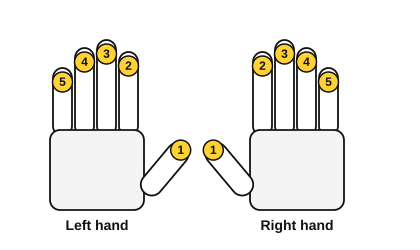
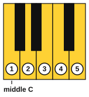

# Sitting at the piano and finger numbers

<span class="tag tag-piano">Piano</span>

After this lesson you can sit at the piano with a relaxed, upright posture, give your hand a curved shape, name your fingers by number, and play one key with each finger using the weight of your arm.

Before this: [Pitch and the musical alphabet](../01-first-sounds/04-pitch-and-the-musical-alphabet.md). You need: your piano and a bench or chair, and your phone to film yourself.

## The idea

How you sit and how your hand is shaped decide how easy everything else will be. Fix them now, while the music is simple.

### Sitting

Follow these steps, in this order.

1. Sit on the front half of the bench, facing the middle of the keyboard, with your hips over the seat.
2. Put your feet flat on the floor. If they do not reach, use a footstool.
3. Set the height so that, with your hands on the keys, your forearms slope very slightly down from the elbow to the wrist, or are level with the floor. A hard chair with a cushion on top works if the bench is too low. Your elbows should be at about the height of the keys.
4. Set the distance so your elbows hang a little in front of your sides and your knees fit under the keyboard. Your arms should be able to move without hitting your body.
5. Sit tall but not stiff, leaning slightly forward from the hips. Let your shoulders drop.

Common mistake at step 3: a bench that is too low pushes your wrists up and your shoulders forward. If your wrists sit higher than your knuckles, raise the seat.

### The hand shape

Let your arm hang by your side, then lift your hand onto the keys. Your fingers are already curved. Keep that shape.

1. The wrist is level with the back of your hand. It does not droop below the keys, and it is not raised above them.
2. Your fingers are curved, as if each hand held a small ball. The last joint of each finger does not collapse flat.
3. Each finger plays with the pad of its fingertip, close to the tip.
4. The thumb plays on its side, near the corner of the nail, not on the flat of the pad.
5. Fingers 2, 3, 4 and 5 hang over the keys, resting on them without pressing.

### Finger numbers

Piano music numbers the fingers the same way for both hands. The thumb is 1, the index finger is 2, the middle finger is 3, the ring finger is 4 and the little finger is 5. RH means right hand and LH means left hand.



Place your right thumb on middle C and let the other fingers fall onto the next white keys to the right. Your fingers cover C, D, E, F and G. Finger 1 plays C4, finger 2 plays D4, finger 3 plays E4, finger 4 plays F4 and finger 5 plays G4.



### Playing with the weight of your arm

A key goes down easily if the arm behind it is heavy and loose. Think of the arm as hanging from the shoulder like a rope, with the finger at the end. To play a note:

1. Rest the finger on the key.
2. Let the weight of your arm sink into the finger, with the wrist loose, until the key goes down.
3. Let the key come back up under the finger. The finger stays curved and does not hit the key from above.

Press each key to the bottom, then release it gently. Hitting from height makes a hard sound and tires your hand.

### One key, each finger

Play C D E F G with fingers 1 2 3 4 5, one key to each beat. The numbers above the notes are the fingers. You will learn to read the staff in lesson 9, so for now follow the letters and the numbers.

```abc
X:1
M:4/4
L:1/4
Q:1/4=60
K:C
!1!C !2!D !3!E !4!F | !5!G !4!F !3!E !2!D | !1!C4 |]
```

Listen for the same volume from every finger. The fourth finger is usually the weakest, so listen for it staying as loud as the others.

If anything hurts, stop. Pain in your hand, wrist, forearm, shoulder or back means something is too tight, too high, too low or too far. Rest, check the sitting steps, and play for shorter times. If the pain returns, see a teacher or a doctor. A bit of tiredness is normal, and pain is not.

## Try it

Exercise 1. Which finger number is the ring finger? Which is the thumb?

<details class="solution" markdown>
<summary>Answer</summary>

The ring finger is 4 and the thumb is 1.

</details>

Exercise 2. With your right thumb on C4, which key does finger 3 play?

<details class="solution" markdown>
<summary>Answer</summary>

E4 (fingers 1 to 5 play C, D, E, F and G).

</details>

Exercise 3. Your wrists sit higher than your knuckles when you play. Which sitting step should you fix?

<details class="solution" markdown>
<summary>Answer</summary>

Step 3: the seat height is too low. Raise it.

</details>

<div class="practice" markdown>

### Practice routine (30 minutes)

| Minutes | What to do | Tempo | Listen for |
|---|---|---|---|
| 5 | Set up the bench with the sitting steps, then film 20 seconds from the side (see "Film yourself") | None | Your elbows, wrists and shoulders |
| 5 | Arm weight: with finger 3 of the right hand on E4, let the arm sink into the key and release, ten times, then the left hand on any white key | 60 bpm | A round sound, not a thump |
| 10 | Five-finger pattern in the example: C D E F G and back, right hand, one note per click, then repeat | 60 bpm | Every finger the same volume |
| 5 | [Note flashcards](../practice/note-flashcards.md): name keyboard notes | Untimed | Naming fast, with no counting |
| 5 | Guitar: pluck the open strings 6 to 1 with your thumb and say each name | 60 bpm | Even volume on every string |

Repeat this routine on at least three days. Your hand shape improves because the movement becomes automatic, and that takes repeats on separate days.

</div>

<div class="move-on" markdown>

### Move on when

- [ ] You can play the five-finger pattern C D E F G and back with the right hand at 60 bpm, three times in a row with no stops.
- [ ] You can say the finger number for any finger when someone points to it, in under 2 seconds.
- [ ] A side-on video shows level wrists, curved fingers and relaxed shoulders.
- [ ] You can sit for the whole 30-minute routine with no pain.

</div>

## Common mistakes

Flat fingers. If the last joint of a finger collapses, the finger plays on its nail side and the sound is thin. Curve the fingers and play from the pad.

Lifted shoulders. Tight shoulders pass tension to the wrists. Take a breath and let your shoulders drop before each exercise.

Pressing with the fingers only, instead of letting the arm help. If the fourth and fifth fingers feel weak, let more of the arm's weight go into them.

## Film yourself

Prop your phone on the side of the piano so it sees you from the right, with your whole arm and back in view, and record the five-finger pattern. Watch it and check:

- Is your back upright, with your shoulders low?
- Are your forearms level, or sloping slightly down?
- Is the wrist level with the back of the hand?
- Are the fingers curved, with the last joint not flat?
- Does the thumb play on its side?

Watch: [Proper Posture At The Piano](https://www.youtube.com/watch?v=E8Do4oxTJ1k) by Pianote (free, on YouTube).

## Key terms

- **Finger numbers**: 1 (thumb) to 5 (little finger) on both hands.
- **RH** and **LH**: right hand and left hand.
- **Curved hand shape**: the fingers curved, the wrist level, as if holding a small ball.
- **Arm weight**: using the weight of the loose arm to press a key.

Next: [Holding the guitar, tuning and the pick](06-holding-tuning-and-the-pick.md)
