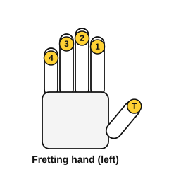
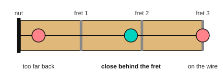

# Holding the guitar, tuning and the pick

<span class="tag tag-guitar">Guitar</span>

After this lesson you can sit with the guitar in a playing position, hold a pick, tune all six strings with a tuner, pluck single strings, and press a string close behind a fret.

Before this: [Meet your guitar](../01-first-sounds/03-meet-your-guitar.md), [Pitch and the musical alphabet](../01-first-sounds/04-pitch-and-the-musical-alphabet.md). You need: your guitar, a pick, and a clip-on tuner or a tuner app on your phone.

## The idea

### Sitting with the guitar

Because you are right-handed, your right hand picks and your left hand presses the strings on the neck. Use a chair without arms.

1. Sit on the front half of the seat with your feet flat on the floor.
2. Rest the waist of the guitar (the narrow part of the body) on your right thigh. The back of the guitar touches your stomach and chest.
3. Point the neck to your left, tilted slightly up so the headstock is a little above the body. Do not let the neck drop.
4. Let your right forearm rest on the top edge of the body, with the hand over the soundhole.
5. Keep your back upright and your shoulders low. Do not hunch over the guitar to see the strings.

### The left hand

1. Put your thumb on the back of the neck, roughly behind your index and middle fingers, not wrapped over the top.
2. Curve your fingers over the strings so you press with the tips, not the flat pads.
3. Number the fingers 1 to 4: index is 1, middle is 2, ring is 3, little is 4. The thumb is T.



### The pick and the right hand

A **pick** (or plectrum) is a small piece of plastic for sounding the strings. Hold it like this:

1. Make a loose fist and open the thumb slightly.
2. Lay the pick on the side of your index finger, near the first joint, with the point sticking out toward your thumb.
3. Place your thumb pad on top, so the pick is pinched between the thumb pad and the side of the finger.
4. Let about 3 mm of the point show past your thumb.
5. Keep the grip firm but not tight: you should be able to move the pick with a gentle pull, but it should not slip.

To pluck a single string, rest the pick on the string, then move it down across that one string (a down stroke) and let it ring. Try strings 6 to 1 in order.

### Tuning

A guitar sounds wrong if the strings are not tuned to their notes. A **tuner** tells you what note the string is playing and whether it is too low (flat) or too high (sharp). A clip-on tuner clips on the headstock and feels the vibration of the guitar, so it works in a noisy room. A tuner app listens through the phone's microphone, so use it in a quiet room.

Listen to the six notes you are aiming for. Use them as a check against the tuner.

```abc
%%opts tab=guitar
X:1
M:4/4
L:1/4
Q:1/4=60
K:C clef=treble-8
E,2 A,2 | D2 G2 | B2 e2 |]
```

Follow these steps for each string, in the order 6, 5, 4, 3, 2, 1.

1. Pluck the open string once and let it ring.
2. Read the tuner. It shows a note name, and a needle or bar that is centred when the string is in tune. The note name must match the string: E, A, D, G, B, E.
3. If the note is too low, turn the tuner slowly so the string tightens, and the pitch rises. If it is too high, loosen it a little and then tighten again. Tune up to the note, not down, because a string tuned up holds better.
4. Pluck again and check. Stop when the needle is centred.

Turn a tuner a little at a time, and stop if the note is not changing, or the string feels very tight. Tuning a thin string far too high can snap it. After tuning all six, play string 6 again, because tightening the other strings changes the neck slightly.

### Fretting a note

To make a higher note, press a string against a fret.

1. Place a fingertip on string 1 in the space between the nut and fret 1, close behind the fret 1 wire.
2. Press down firmly with the fingertip, using only as much force as makes the note ring clean.
3. Pluck the string. The note should be a clear tone, with no buzz.
4. Move to the space behind fret 3, with your third finger, and pluck again.



Common mistake at step 1: pressing in the middle of the space gives a dull, weak sound, and pressing on top of the fret wire gives a buzz or no sound. Close behind the wire is the right place.

Your fingertips will feel sore for the first few weeks and grow harder skin. That soreness is normal. Sharp pain, numbness or tingling in the fingers or hand, aching in the wrist or forearm, or pain in the shoulder or back is a stop sign. Stop, shake your hand out, check how you are holding the guitar, and play for shorter times. If the pain keeps coming back, see a teacher or a doctor.

## Try it

Exercise 1. The tuner reads "A" for string 5, and the needle is to the left of centre (flat). Which way do you adjust the string?

<details class="solution" markdown>
<summary>Answer</summary>

Tighten the string slowly (turn the tuner so the pitch rises) until the needle is centred.

</details>

Exercise 2. In which order should you tune the strings?

<details class="solution" markdown>
<summary>Answer</summary>

6, 5, 4, 3, 2, 1: E, A, D, G, B, E.

</details>

Exercise 3. Which finger presses fret 2 on string 1, if you use the finger with the same number as the fret?

<details class="solution" markdown>
<summary>Answer</summary>

Finger 2, the middle finger.

</details>

<div class="practice" markdown>

### Practice routine (30 minutes)

| Minutes | What to do | Tempo | Listen for |
|---|---|---|---|
| 5 | Tune all six strings with your tuner | None | Needle centred on all six |
| 5 | Pick grip: pluck each open string, 6 down to 1, one down stroke per click | 60 bpm | A steady, clear tone on each string |
| 10 | Fretting: on string 1 play open, then fret 1 with finger 1, then fret 3 with finger 3, then back, one note per click. Repeat on string 2 | 60 bpm | No buzz, and the same volume on each note |
| 5 | Piano: right hand, five-finger pattern C D E F G and back | 60 bpm | Even volume across all fingers |
| 5 | [Note flashcards](../practice/note-flashcards.md) | Untimed | Naming without counting |

Repeat this routine on at least three days. Your fingertips and your pick grip need repeats over several days to settle.

</div>

<div class="move-on" markdown>

### Move on when

- [ ] You can tune all six strings in under 3 minutes and the tuner shows each one centred.
- [ ] You can pluck strings 6 to 1 and back, one down stroke per beat at 60 bpm, with no missed strings.
- [ ] You can play open, fret 1 and fret 3 on string 1 at 60 bpm, three times in a row with no buzz.
- [ ] You can sit with the guitar for the whole 30-minute routine with no pain.

</div>

## Common mistakes

Pressing with the flat of the finger. A flat finger touches the next string and mutes it. Curve the finger and press with the tip.

Holding the pick too tight. A tight grip makes a harsh sound and tires your thumb. Hold it firmly enough that the pick does not slip.

Tuning down to the note. If you pass the note, loosen a bit below it and tighten again. The string settles more firmly when it is tuned up.

## Film yourself

Record 30 seconds from the front, with your whole body and the guitar in view, as you tune one string and play a fretted note. Watch it and check:

- Is the guitar steady on your right thigh, with the neck tilted slightly up?
- Is your left thumb behind the neck, with the fingers curved?
- Does the pick show about 3 mm past your thumb?
- Are your back upright and your shoulders low?
- Is your fretting fingertip close behind the fret wire?

<!-- video: a front view of a beginner sitting with a steel-string acoustic guitar, holding a pick, tuning a string with a clip-on tuner and fretting a note behind a fret -->

## Key terms

- **Pick** (plectrum): a small piece of plastic for sounding the strings.
- **Down stroke**: moving the pick down across a string.
- **Tuner**: a device or app that shows the pitch of a string and whether it is flat or sharp.
- **Flat** and **sharp** (as tuner words): too low and too high.
- **Fretting**: pressing a string against the fretboard to change the note.
- **T, 1, 2, 3, 4**: the thumb and the four fingers of the fretting hand.

Next: [Beat, tempo and note values](07-beat-tempo-and-note-values.md)
