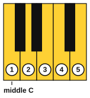
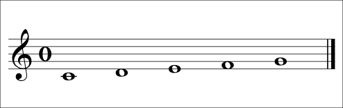

# The treble staff and C position

<span class="tag tag-reading">Reading</span>

After this lesson you can read the notes C4 to G4 on the treble staff, put your right hand in C position on the piano, and play a melody of five notes from the page.

Before this: [Pitch and the musical alphabet](../01-first-sounds/04-pitch-and-the-musical-alphabet.md), [Sitting at the piano and finger numbers](../01-first-sounds/05-sitting-and-finger-numbers.md), [Bars, time signatures and rests](../01-first-sounds/08-bars-time-signatures-and-rests.md). You need: your piano.

## The idea

### Sound first: five notes under five fingers

Put your right thumb on middle C and let the other fingers rest on the next four white keys. Play the keys in order, thumb to little finger. You hear C, D, E, F and G going up. This hand shape is **C position**: the thumb on C4 and each finger over its own key, with no movement of the hand.



Now learn to see those five notes on the page.

### The staff

Music writes pitch on a **staff**: five horizontal lines with four spaces between them. Lines and spaces are counted from the bottom: line 1 is the lowest line, and space 1 is the space between lines 1 and 2. A note is drawn as an oval, called the note head. It sits on a line, with the line passing through it, or in a space. The higher the note head, the higher the pitch.

On the staff, stepping from a line to the next space, or from a space to the next line, moves to the next letter of the musical alphabet. Going up, the letters run A B C D E F G and begin again.

### The treble clef

A **clef** is the sign at the left end of the staff that says which pitch each line and space stands for. The **treble clef**, also called the G clef, is the tall curling sign. Its curl circles the second line from the bottom, and that line is the note G4. Every other line and space follows from that: one step down from G4 is F4 in space 1, and another step down is E4 on line 1.

### C4 to G4 on the staff

The five notes of C position are below, at, or above the bottom of the staff:

| Note | Where it sits |
|---|---|
| C4 (middle C) | Under the staff, on a short extra line of its own |
| D4 | Under line 1, hanging below the bottom line |
| E4 | On line 1, the bottom line |
| F4 | In space 1, between lines 1 and 2 |
| G4 | On line 2 |

The short extra line through middle C is a **ledger line**. Ledger lines extend the staff up or down when a note is too high or too low to fit on the five lines.



### Reading a five-note melody

Follow these steps whenever you read new music.

1. Look at the time signature and count the beats in a bar.
2. Find the first note and name it, then decide where your hand goes. Here the thumb goes on middle C.
3. Read the direction of the notes as well as their names. Notes that go up the page go up the keyboard. Notes that stay at the same height repeat the same key. Notes that move to the next line or space move to the next white key.
4. Count the rhythm aloud first, then play.
5. Play slowly, with your eyes on the page and not on your hand.

Here is a melody that uses all five notes. Listen to it first, then follow the finger numbers over the notes as you play. The numbers repeat the finger-to-key rule: 1 plays C, 2 plays D, 3 plays E, 4 plays F, and 5 plays G.

```abc
X:1
M:4/4
L:1/4
Q:1/4=60
K:C
!1!C !2!D !3!E !2!D | !1!C !3!E !5!G !3!E | !4!F !3!E !2!D !1!C | C4 |]
```

The first bar goes up and back down, the second skips up, and the third steps down. Say the note names as you play, and look at how the melody moves up and down on the page as it moves on the piano.

## Try it

Exercise 1. Name these five notes.

```abc
%%opts play=off
X:1
M:4/4
L:1/4
K:C
E G C D | F4 |]
```

<details class="solution" markdown>
<summary>Answer</summary>

E4, G4, C4, D4, F4.

</details>

Exercise 2. Which note sits on the ledger line, and where does the next note up sit?

<details class="solution" markdown>
<summary>Answer</summary>

C4 (middle C) sits on the ledger line. D4, the next note up, hangs directly below the bottom line of the staff.

</details>

Exercise 3. In C position, which finger plays the note on line 2 of the treble staff?

<details class="solution" markdown>
<summary>Answer</summary>

Line 2 is G4, played by finger 5.

</details>

<div class="practice" markdown>

### Practice routine (30 minutes)

| Minutes | What to do | Tempo | Listen for |
|---|---|---|---|
| 5 | Warm-up: five-finger pattern C D E F G and back, right hand | 60 bpm | Even volume on every finger |
| 15 | New skill: name each note of the melody aloud, then clap the rhythm, then play bar by bar, then all together | 50 bpm, then 60 | No stops between bars |
| 5 | Reading: [Reading drill](../practice/reading-drill.md) or [Note flashcards](../practice/note-flashcards.md), notes C4 to G4 only | Untimed | Answering without counting up from C |
| 5 | Guitar: tune, then play string 1 open, fret 1 and fret 3, back and forth | 60 bpm | Clean notes with no buzz |

Repeat this routine on at least three days. Reading becomes fast only after many short looks at the page.

</div>

<div class="move-on" markdown>

### Move on when

- [ ] You can name all five notes C4 to G4 on the staff in under 10 seconds.
- [ ] You can play the melody above in C position at 60 bpm, three times in a row with no stops.
- [ ] You can name the clef sign and say which line it marks.
- [ ] You can write C4 on a ledger line from memory.

</div>

## Common mistakes

Reading by counting up from the bottom line every time. Learn the five notes by their places (bottom line, first space, second line) until you see them at once.

Forgetting the ledger line. Middle C has a line of its own. If a note sits below the staff with a short line through it, it is C4.

Looking at the hand. The point of C position is that the fingers know their keys. Keep your eyes on the page.

## Key terms

- **Staff**: five horizontal lines and four spaces on which notes are written.
- **Treble clef** (G clef): the sign that marks the second line from the bottom as G4.
- **Ledger line**: a short extra line used for notes above or below the staff.
- **C position**: the right-hand shape with the thumb on C4 and fingers 1 to 5 on C, D, E, F and G.
- **Note head**: the oval part of a note.

Next: [First melodies on piano](10-first-melodies-on-piano.md)
