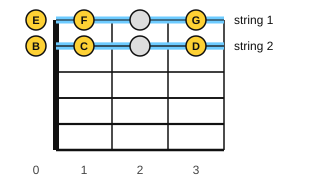

# Reading guitar tab

<span class="tag tag-guitar">Guitar</span>

After this lesson you can read guitar tab for strings 1 and 2, play notes at frets 0 to 3, and play short melodies from tab, using the notes above it for the rhythm.

Before this: [Holding the guitar, tuning and the pick](../01-first-sounds/06-holding-tuning-and-the-pick.md), [Bars, time signatures and rests](../01-first-sounds/08-bars-time-signatures-and-rests.md). You need: your guitar, a pick and a tuner.

## The idea

### What tab is

**Tab** (short for tablature) is a way of writing guitar music that shows where to put your fingers, not which notes to play. You can read it without knowing note names.

A tab has six lines, one for each string. The top line is string 1, the thinnest and highest string, and the bottom line is string 6, the thickest and lowest. Higher on the page means a higher-sounding string, as it does on the staff.

A number on a line is the fret to press on that string. A 0 means play the open string, with no finger. A 3 on the top line means press string 1 at fret 3. Time runs left to right, so the numbers are played in order.

Tab shows where to play, but not how long to hold each note. Guitar music in this book has the notes written on a staff above the tab, and the staff shows the rhythm. Use the staff for the quarter, half and whole notes you learned in lessons 7 and 8, and use the tab to find the notes. The staff for guitar is written an octave above where it sounds, so it looks different from the piano staff in lesson 9. Stage 3<!-- link: ../03-the-major-scale-and-keys/11-reading-notation-on-guitar.md --> explains this. For now, read the rhythm from the stems and the notes from the tab.

### Strings 1 and 2, frets 0 to 3

This lesson uses the two thinnest strings, string 1 (E) and string 2 (B), and frets 0 to 3. The figure shows what each position plays.



Fret 2 on each string gives a note that is not in the lesson yet (a note named with a sharp, taught in stage 3), so the figure leaves it blank and the tunes below do not use it.

For the fretting hand, use the finger with the same number as the fret: finger 1 plays fret 1, and finger 3 plays fret 3. Press close behind the fret wire, as in lesson 6.

### Playing from tab

Follow these steps for each exercise.

1. Read the tab line for the first note: which string, which fret.
2. Put the finger down first (or leave the string open), then pluck with a down stroke.
3. Count the rhythm from the notes above the tab: a quarter note is 1 beat, a half note 2, a whole note 4.
4. Play slowly at 60 bpm, and let each note ring until the next one starts.

Common mistake at step 2: plucking before your finger is down. The note comes out dull. Press first, then pick.

Example 1: the two open strings. Listen to the high E and the B below it. The tab shows 0 on the top line and 0 on the second line.

```abc
%%opts tab=guitar
X:1
M:4/4
L:1/4
Q:1/4=60
K:C clef=treble-8
B e B e | B e B e |]
```

Example 2: frets on string 1. Play open, fret 1, fret 3, fret 1, then open. Listen to the pitch going up and coming down.

```abc
%%opts tab=guitar
X:1
M:4/4
L:1/4
Q:1/4=60
K:C clef=treble-8
e f g f | e4 |]
```

Example 3: frets on string 2. The tab numbers are the same, 0 1 3 1 0, but they sit on the second line.

```abc
%%opts tab=guitar
X:1
M:4/4
L:1/4
Q:1/4=60
K:C clef=treble-8
B c d c | B4 |]
```

### Two tunes

You know these two melodies from the piano lessons. They sound the same on the guitar, and both use only strings 1 and 2 at frets 0, 1 and 3. Each note is on string 1 or string 2: the top two tab lines. Where the melody goes up, the tab moves up to string 1; where it goes down, to string 2.

Ode to Joy, by Beethoven (public domain):

```abc
%%opts tab=guitar
X:1
T:Ode to Joy (theme, simplified rhythm)
C:Ludwig van Beethoven
M:4/4
L:1/4
Q:1/4=60
K:C clef=treble-8
e e f g | g f e d | c c d e | e d d2 |
e e f g | g f e d | c c d e | d c c2 |]
```

Mary Had a Little Lamb, traditional:

```abc
%%opts tab=guitar
X:1
T:Mary Had a Little Lamb
C:Traditional
M:4/4
L:1/4
Q:1/4=60
K:C clef=treble-8
e d c d | e e e2 | d d d2 | e g g2 |
e d c d | e e e e | d d e d | c4 |]
```

## Try it

Exercise 1. A tab has the number 3 on the top line. Which string and which fret is it, and which finger do you use?

<details class="solution" markdown>
<summary>Answer</summary>

String 1, fret 3, finger 3.

</details>

Exercise 2. A tab has 0 on the second line from the top. Which string do you play, and do you press any fret?

<details class="solution" markdown>
<summary>Answer</summary>

String 2 (B), open. You press no fret.

</details>

Exercise 3. On the tab of Example 2, the numbers are 0 1 3 1 0. Which string are they on, and do they rise or fall in pitch in the middle of the pattern?

<details class="solution" markdown>
<summary>Answer</summary>

String 1, the top line. The pitch rises from fret 0 to fret 3 and falls back, so the middle note (fret 3) is the highest.

</details>

<div class="practice" markdown>

### Practice routine (30 minutes)

| Minutes | What to do | Tempo | Listen for |
|---|---|---|---|
| 5 | Warm-up: tune the guitar, then play string 1 open, fret 1, fret 3 and back, then the same on string 2 | 60 bpm | Clean notes with no buzz |
| 15 | New skill: Examples 1 to 3 from tab, then Ode to Joy and Mary Had a Little Lamb, two bars at a time | 50 bpm, then 60 | Pressing before picking |
| 5 | Reading: read the tab for the first four bars of Mary Had a Little Lamb aloud (string, fret), without playing | Untimed | Reading the tab at a glance |
| 5 | Piano: Ode to Joy, right hand, in C position | 60 bpm | The same tune on both instruments |

Repeat this routine on at least three days. Your fingers learn the fret positions by repeats, and the melodies get smoother over the days.

</div>

<div class="move-on" markdown>

### Move on when

- [ ] You can play Examples 1, 2 and 3 at 60 bpm, three times in a row with no stops and no buzz.
- [ ] You can play Mary Had a Little Lamb from tab at 60 bpm, three times in a row.
- [ ] You can play Ode to Joy from tab at 60 bpm, three times in a row.
- [ ] You can say the string and fret of any note in these tabs in under 2 seconds.

</div>

## Common mistakes

Reading the tab upside down. The top line is string 1, the thinnest string, not string 6. Say "top line, thin string" until it is automatic.

Reading the number as a finger instead of a fret. In tab, 3 means fret 3, not the third finger. The finger rule in this lesson only happens to match.

Ignoring the rhythm. The numbers show where to play, not how long. Count from the notes above the tab.

## Key terms

- **Tab** (tablature): a six-line chart for guitar, one line per string, with numbers for frets.
- **Fret number**: the number on a tab line that says which fret to press; 0 is an open string.

Next: [Chord diagrams and your first chord](12-chord-diagrams-and-e-minor.md)
