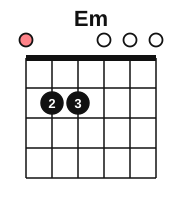

# Chord diagrams and your first chord

<span class="tag tag-guitar">Guitar</span>

After this lesson you can read a chord diagram, play the Em chord, and strum all six strings with down strokes, one strum per bar and then one strum per beat.

Before this: [Holding the guitar, tuning and the pick](../01-first-sounds/06-holding-tuning-and-the-pick.md), [Beat, tempo and note values](../01-first-sounds/07-beat-tempo-and-note-values.md), [Bars, time signatures and rests](../01-first-sounds/08-bars-time-signatures-and-rests.md). You need: your guitar, a pick and a tuner.

## The idea

### Chords

Until now you have played one note at a time. A **chord** is three or more notes played together. Guitar is built for chords, because one strum can sound all six strings.

Strum the six open strings once with a down stroke. You hear E, A, D, G, B and E all at once. Chords have names that tell you which notes to play. The Em chord uses the same six strings, with two of them pressed down.

### The chord diagram

A **chord diagram** is a small picture of the neck that shows where the fingers go. You read it as if the guitar were standing upright in front of you, with the headstock at the top.

- The six vertical lines are the strings. The left one is string 6 (thickest) and the right one is string 1 (thinnest).
- The horizontal lines are frets. The thick line at the top is the nut, and the first box under it is fret 1.
- A dot is a place to press, and the number inside the dot is the finger: 1 index, 2 middle, 3 ring, 4 little.
- An **o** above a string means play that string open.
- An **x** above a string means do not play it. Em has no x, so you play all six strings.



### The Em chord

The Em chord (E minor) has dots on fret 2 of string 5 and string 4, and every other string is open. It uses three different notes: E, G and B. The six strings play E, B, E, G, B and E, which is those three notes repeated at different heights. The "minor" in the name gives it a darker sound than the major chords you will meet in stage 2. Stage 4 explains where the name comes from.

Follow these steps.

1. Hold the guitar as in lesson 6, with your thumb behind the neck.
2. Put your middle finger (2) on string 5, fret 2, close behind the fret wire.
3. Put your ring finger (3) on string 4, fret 2, next to the middle finger.
4. Curve both fingers so the tips press the strings and do not touch the thin strings next to them.
5. Pluck each string one at a time, from 6 to 1. Every note should ring with a clear tone and no buzz and no dull thud.
6. If a string is muted, check which finger is touching it and curve that finger more.

Common mistake at step 4: a flat finger muting the open string next to it. Strings 3, 2 and 1 must ring. Arch your fingers like a bridge.

### Strumming

To **strum** is to sweep the pick across several strings in one motion. A **down stroke** moves the pick from the thick strings to the thin strings, that is from string 6 down to string 1.

1. Hold the pick as in lesson 6.
2. Rest your picking forearm on the body so your hand is above the soundhole.
3. Start with the pick above string 6. Let your forearm and wrist swing, moving the pick down across all six strings in one smooth motion.
4. Let the arm follow through below string 1, and return to the start.
5. Don't grip the pick tighter to make it louder. Let the whole forearm swing instead.

Let the chord ring. Don't lift your fingers when you stop strumming. The chord keeps sounding until you stop it, and the held sound is part of the music.

### Strumming the beats

Strum in time with the metronome. First, play one strum per bar. Strum on beat 1, then count "2 3 4" while the chord rings, and strum again on the next 1. Listen to the example: each chord is a whole note, so it lasts the whole bar.

```abc
%%opts tab=guitar
X:1
M:4/4
L:1/4
Q:1/4=60
K:Em clef=treble-8
"Em"[E,B,EGBe]4 | "Em"[E,B,EGBe]4 | "Em"[E,B,EGBe]4 | "Em"[E,B,EGBe]4 |]
```

Then play a down strum on each beat, counting "1 2 3 4". Each strum cuts off the one before it, so the sound is steady, with a pulse.

```abc
%%opts tab=guitar
X:1
M:4/4
L:1/4
Q:1/4=60
K:Em clef=treble-8
"Em"[E,B,EGBe] [E,B,EGBe] [E,B,EGBe] [E,B,EGBe] | [E,B,EGBe] [E,B,EGBe] [E,B,EGBe] [E,B,EGBe] |
[E,B,EGBe] [E,B,EGBe] [E,B,EGBe] [E,B,EGBe] | [E,B,EGBe]4 |]
```

If you hear a note that is dull or missing, stop and go back to step 5 of the Em chord and pluck the strings one at a time. Also, if your hand starts to ache from gripping, stop, shake it out and loosen the pick grip. Pain in the wrist or the fretting hand is a stop sign; see a teacher or a doctor if it comes back.

## Try it

Exercise 1. A chord diagram has an x above the leftmost string. Which string is that, and do you play it?

<details class="solution" markdown>
<summary>Answer</summary>

String 6, the thickest. The x means you do not play it.

</details>

Exercise 2. In the Em diagram, which strings have dots and which fingers go on them?

<details class="solution" markdown>
<summary>Answer</summary>

String 5 has finger 2 at fret 2, and string 4 has finger 3 at fret 2. The other four strings are open.

</details>

Exercise 3. At 60 bpm, how many seconds pass between whole-bar strums? How many strums in 4 bars with one per beat?

<details class="solution" markdown>
<summary>Answer</summary>

A bar of 4 beats lasts 4 seconds at 60 bpm, so 4 seconds between strums. One strum per beat is 4 strums per bar, so 16 strums in 4 bars.

</details>

<div class="practice" markdown>

### Practice routine (30 minutes)

| Minutes | What to do | Tempo | Listen for |
|---|---|---|---|
| 5 | Warm-up: tune, then string 1 open, fret 1, fret 3 and back | 60 bpm | Clean notes, no buzz |
| 5 | Build Em: place the fingers, pluck each string one at a time, lift and place again, ten times | Untimed | Every string ringing |
| 10 | Strumming: one down strum per bar for 4 bars, then one down strum per beat for 4 bars. Repeat | 60 bpm | Even volume and a chord that rings to the end of the bar |
| 5 | Piano: Ode to Joy, right hand, in C position | 60 bpm | No stops between bars |
| 5 | Ear: close your eyes, have the Em strum and the open-string strum played in turn (or play them yourself first), and say which is which | Untimed | The difference in colour between the two |

Repeat this routine on at least three days. Placing the fingers cleanly takes repeats over several days.

</div>

<div class="move-on" markdown>

### Move on when

- [ ] You can place the Em chord and play all six strings with a clear tone in one strum, ten times in a row.
- [ ] You can strum one down stroke per bar for 8 bars at 60 bpm with the chord ringing the whole time.
- [ ] You can strum four down strokes per bar for 8 bars at 60 bpm with no stops.
- [ ] You can read a chord diagram you have not seen and say which strings are open, muted or pressed.

</div>

## Common mistakes

Muting strings with the flat of a finger. Curve the fingers until all six strings ring.

Strumming only some of the strings. Start the stroke above string 6 and end below string 1, so none are missed.

Stopping the strumming arm to wait for the next beat. Keep the arm moving; strum on the beat and let it swing back.

## Film yourself

Record 30 seconds from the front, with your fretting hand, picking arm and the guitar in view, while you play the Em chord and strum four beats per bar. Watch it and check:

- Do your fingertips land close behind the fret wire?
- Are the fingers arched, with no finger touching a neighbouring string?
- Does the forearm swing in one smooth motion, with the wrist loose?
- Is the pick showing about 3 mm?
- Does the strum hit all six strings every time?

<!-- video: a front view of a beginner playing an Em chord and strumming four down strokes per bar at 60 bpm, showing finger placement and a relaxed strumming arm -->

## Key terms

- **Chord**: three or more notes played together.
- **Chord diagram**: a picture of the neck showing where the fingers go for a chord.
- **Em** (E minor): a chord with the notes E, G and B, played with fingers 2 and 3 on fret 2.
- **Strum**: sweeping the pick across several strings.
- **Down stroke**: a strum from the thick strings to the thin strings.
- **Let it ring**: leaving the chord to sound, with the fingers still down.

Next: [The bass clef and the grand staff](../02-two-hands-and-first-chords/01-bass-clef-and-grand-staff.md)
