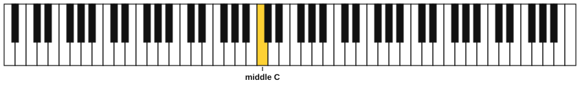
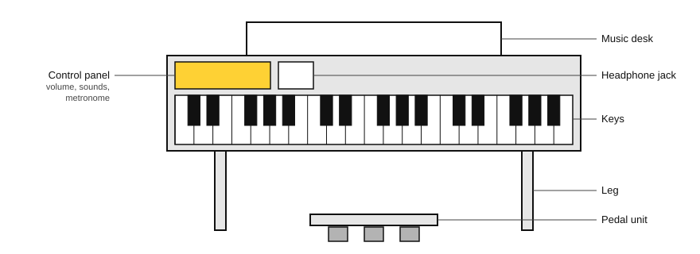
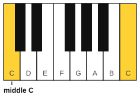
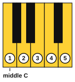
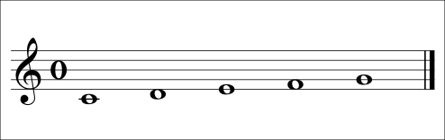
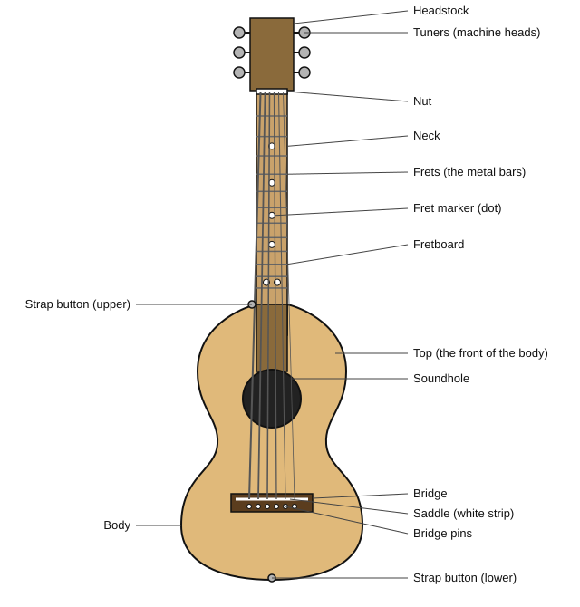
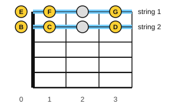
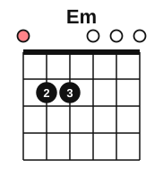

# Stage 1: First sounds

This stage gets you playing. You learn how to practise, the parts of your piano and guitar, the names of the notes, the beat and the note values, how to read the treble staff and guitar tab, and your first melodies and first chord. By the end, your right hand can play simple tunes in C position on the piano, and you can read tab for strings 1 and 2 and strum an Em chord on the guitar. It usually takes about 3 to 5 weeks at 30 minutes a day.

<!-- lessons:start -->
## Lessons

1. [How to practise](01-how-to-practise.md) (other)
2. [Meet your piano](02-meet-your-piano.md) (piano)
3. [Meet your guitar](03-meet-your-guitar.md) (guitar)
4. [Pitch and the musical alphabet](04-pitch-and-the-musical-alphabet.md) (theory)
5. [Sitting at the piano and finger numbers](05-sitting-and-finger-numbers.md) (piano)
6. [Holding the guitar, tuning and the pick](06-holding-tuning-and-the-pick.md) (guitar)
7. [Beat, tempo and note values](07-beat-tempo-and-note-values.md) (theory)
8. [Bars, time signatures and rests](08-bars-time-signatures-and-rests.md) (theory)
9. [The treble staff and C position](09-treble-staff-and-c-position.md) (reading)
10. [First melodies on piano](10-first-melodies-on-piano.md) (piano)
11. [Reading guitar tab](11-reading-tab.md) (guitar)
12. [Chord diagrams and your first chord](12-chord-diagrams-and-e-minor.md) (guitar)

<!-- lessons:end -->

Download the stage 1 deck: [01-first-sounds.apkg](../downloads/anki/01-first-sounds.apkg)

## Cheat sheet

Everything to remember from this stage, on one page.

### How to practise

- 30 minutes a day: 5 warm-up, 15 new skill, 5 reading or ear training, 5 on the other instrument.
- Repeat each routine on at least three days before you tick the "Move on when" boxes.
- Three clean in a row: three plays in a row with no stops and no wrong notes. A mistake resets the count.
- 60 bpm means one beat per second. The time between beats is 60 divided by the bpm, in seconds.
- Pain is a stop sign: stop, rest, check your posture, and see a teacher or doctor if it returns.

### The piano

| Fact | Detail |
|---|---|
| Keys | 88: 52 white and 36 black. Lowest A0, highest C8 |
| Black keys | Groups of 2 and 3. C is the white key left of a group of 2 |
| Middle C | C4, the C near the middle of the keyboard |
| White keys from C | C D E F G A B, then C again (an octave higher) |
| Octave number | Changes at C: B3 is the key next to C4 on its left |
| Pedals | Right: damper (sustain). Middle: sostenuto. Left: soft (una corda) |
| Terms | Weighted, graded hammer action, touch sensitivity (velocity), polyphony |

### Piano fingers and C position

| Finger | Number |
|---|---|
| Thumb | 1 |
| Index | 2 |
| Middle | 3 |
| Ring | 4 |
| Little | 5 |

In C position the right thumb is on C4. Fingers 1 to 5 play C, D, E, F and G.

### Reading the treble staff

| Note | Place on the staff |
|---|---|
| C4 | Ledger line below the staff |
| D4 | Under line 1 |
| E4 | Line 1 (bottom line) |
| F4 | Space 1 |
| G4 | Line 2 |

The treble clef (G clef) curls around line 2, which is G4.

### Rhythm

| Note | Beats | Rest | Beats |
|---|---|---|---|
| Quarter note | 1 | Quarter rest | 1 |
| Half note | 2 | Half rest (sits on a line) | 2 |
| Whole note | 4 | Whole rest (hangs from a line) | a full bar |

| Time signature | Beats in a bar | Count |
|---|---|---|
| 4/4 | 4 | 1 2 3 4 |
| 3/4 | 3 | 1 2 3 |
| 2/4 | 2 | 1 2 |

The top number is how many beats are in a bar. The bottom 4 means a quarter note is one beat.

### The guitar

| String | Name | Mnemonic |
|---|---|---|
| 6 (thickest) | E | Eddie |
| 5 | A | Ate |
| 4 | D | Dynamite |
| 3 | G | Good |
| 2 | B | Bye |
| 1 (thinnest) | E | Eddie |

Parts, from top to bottom: headstock, tuners, nut, neck (fretboard and frets), body (top, soundhole, bridge, saddle, bridge pins), strap buttons.

Tune in the order 6, 5, 4, 3, 2, 1. Always tune up to the note. Fretting hand fingers: 1 index, 2 middle, 3 ring, 4 little, T thumb. Press close behind the fret wire.

### Tab and chord diagrams

In tab the top line is string 1 and the bottom line is string 6. A number is a fret, and 0 is an open string.

In a chord diagram the left line is string 6 and the right line is string 1. A dot is a finger, o is open and x is not played.

Em (E minor): E, G, B. Fingers 2 and 3 on fret 2 of strings 5 and 4. Strum all six strings.

