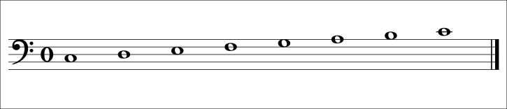
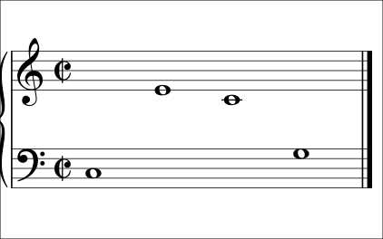
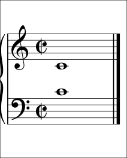

# The bass clef and the grand staff

<span class="tag tag-reading">Reading</span>

After this lesson you can name the notes C3 to C4 on the bass staff, say how the bass staff and the treble staff join into the grand staff, and find middle C on both.

Before this: [Pitch and the musical alphabet](../01-first-sounds/04-pitch-and-the-musical-alphabet.md), [The treble staff and C position](../01-first-sounds/09-treble-staff-and-c-position.md). You need: your piano.

## The idea

### Sound first: the keys below middle C

Find middle C (C4). Move left to the next C, the white key immediately left of the next group of two black keys. That key is C3. Play the white keys from C3 up to C4: C, D, E, F, G, A, B, C. These notes are lower than anything you have read so far. The treble staff reaches down only to middle C, so a melody around C3 would need many ledger lines, which are hard to read.

Music solves this with a second staff and a second clef.

### The bass clef

The **bass clef**, also called the **F clef**, is the curled sign with two dots. The two dots sit on either side of line 4, the second line from the top. That line is the note F3. As with the treble clef, one note fixes the rest: count up and down from F3 along the lines and spaces.

The lines of the bass staff, from the bottom, are G2, B2, D3, F3 and A3. The spaces, from the bottom, are A2, C3, E3 and G3. Notice that the bass staff is the treble staff moved down: its pattern of letters is shifted by two steps, so line 1 is G here and E in the treble staff.



| Note | Where it sits on the bass staff |
|---|---|
| C3 | Space 2 |
| D3 | Line 3 (the middle line) |
| E3 | Space 3 |
| F3 | Line 4, between the dots of the clef |
| G3 | Space 4, the top space |
| A3 | Line 5, the top line |
| B3 | In the space above the top line |
| C4 | On a ledger line above the staff |

Read the table from the clef: find F3 between the dots, then step to the next line or space for each letter.

### The grand staff and middle C

A pianist reads two staves at once. The **grand staff** is the treble staff above the bass staff, joined at the left by a **brace** (a large curly bracket) and by a bar line. The right hand usually plays the notes in the treble staff and the left hand plays the notes in the bass staff.



Middle C is the one key that both staves can write. In the treble staff it sits on a ledger line below the staff, as you learned. In the bass staff it sits on a ledger line above the staff. The two staves are separated by a gap exactly big enough to hold that one line, so middle C can be drawn on either side of the gap. It is the same key and the same pitch. Which staff it appears in tells you which hand usually plays it.



### Reading a bass-clef line

The steps are the ones from the treble staff, with a different landmark.

1. Look for the clef first. Two dots means bass clef.
2. Find F3 between the dots and middle C on its ledger line. These two landmarks fix the whole staff.
3. Name the first note from the nearest landmark, then follow the direction: higher on the page is higher on the keyboard.
4. Count the rhythm aloud and play.

Listen to this left-hand line. The notes step up from C3 to G3 and come back down, so the shape on the page matches the shape on the keyboard. Say each name before you play it.

```abc
X:1
M:4/4
L:1/4
Q:1/4=60
K:C clef=bass
C, D, E, F, | G,2 F,2 | E, D, C,2 | C,4 |]
```

## Try it

Exercise 1. Name these notes in the bass clef.

```abc
%%opts play=off
X:1
M:4/4
L:1/4
K:C clef=bass
F, A, C, E, | G,4 |]
```

<details class="solution" markdown>
<summary>Answer</summary>

F3, A3, C3, E3, G3. The F3 sits on the line between the dots.

</details>

Exercise 2. Which clef is each of these: a tall curling sign around line 2, and a curled sign with two dots on line 4?

<details class="solution" markdown>
<summary>Answer</summary>

The first is the treble clef (G clef), the second is the bass clef (F clef).

</details>

Exercise 3. A note sits on the ledger line above the bass staff. Which note is it, and which hand usually plays it?

<details class="solution" markdown>
<summary>Answer</summary>

Middle C (C4). Written in the bass staff, it is usually played by the left hand.

</details>

<div class="practice" markdown>

### Practice routine (30 minutes)

| Minutes | What to do | Tempo | Listen for |
|---|---|---|---|
| 5 | Warm-up: right hand C position, C D E F G and back | 60 bpm | Even volume on every finger |
| 15 | New skill: find C3 on the piano, play C3 up to C4 with the left hand and say each name aloud. Then name and play the notes of the example line one at a time, then at 50 bpm | Untimed, then 50 bpm | Names said before the key is pressed |
| 5 | Reading: [Note flashcards](../practice/note-flashcards.md), bass clef notes C3 to C4 | Untimed | Answering from the clef, not by counting up from the bottom |
| 5 | Guitar: Em chord, one down strum per bar for 4 bars | 60 bpm | Every string ringing |

Repeat this routine on at least three days. Bass-clef reading takes the same short daily looks that treble reading did.

</div>

<div class="move-on" markdown>

### Move on when

- [ ] You can name all eight notes C3 to C4 on the bass staff in under 15 seconds.
- [ ] You can point to F3 and say which clef sign marks it.
- [ ] You can play the example line with your left hand at 50 bpm, saying the note names, with no stops.
- [ ] You can draw middle C on both staves of a grand staff from memory.

</div>

## Common mistakes

Reading a bass-clef note as if it were in the treble clef. The lines have different names, so the same position gives a different note. Check the clef before the first note.

Forgetting that the left hand's notes get lower toward the left of the keyboard. Higher on the page is still higher on the piano, even in the bass staff.

Counting up from the bottom line for every note. Use the landmarks (F3 between the dots, middle C) and step from the nearest one.

## Key terms

- **Bass clef** (F clef): the sign with two dots around line 4, which is F3.
- **Grand staff**: the treble staff above the bass staff, joined by a brace and a bar line.
- **Brace**: the large curly bracket at the left of a grand staff.
- **Middle C**: C4, written on a ledger line below the treble staff or above the bass staff.

Next: [Left hand in C position](02-left-hand-c-position.md)
