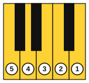
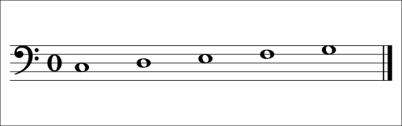

# Left hand in C position

<span class="tag tag-piano">Piano</span>

After this lesson you can put your left hand in C position with finger 5 on C3, and play short melodies from the bass staff at 60 bpm.

Before this: [Sitting at the piano and finger numbers](../01-first-sounds/05-sitting-and-finger-numbers.md), [First melodies on piano](../01-first-sounds/10-first-melodies-on-piano.md), [The bass clef and the grand staff](01-bass-clef-and-grand-staff.md). You need: your piano and a metronome.

## The idea

### Sound first: five low notes under five fingers

Put your left hand on the keys with the little finger on C3, the C below middle C. Let the other fingers rest on the next four white keys. Play them in order, from finger 5 up to finger 1. You hear C, D, E, F and G rising, the same pattern as your right hand played, but lower.

This is **left-hand C position**. Each finger sits over its own key and the hand does not move.

### Finger numbers mirror the right hand

The finger numbers are the same as in the right hand: thumb = 1, index = 2, middle = 3, ring = 4, little finger = 5. The hands are mirror images of each other. The right thumb is on the left of the right hand, and the left thumb is on the right of the left hand.

So in the left hand the numbers run the other way along the keyboard. Going up the keys, the left hand uses fingers 5, 4, 3, 2, 1. Going down, it uses 1, 2, 3, 4, 5.



| Finger | Key |
|---|---|
| 5 (little) | C3 |
| 4 (ring) | D3 |
| 3 (middle) | E3 |
| 2 (index) | F3 |
| 1 (thumb) | G3 |

On the page, the five notes are these. Notice that C3 sits in space 2, with the clef's F3 line three steps above it.



### Setting the hand

1. Sit as in lesson 5 of stage 1, with the bench centred on the keys you are playing.
2. Rest the left hand on the five keys with the fingers curved, as if holding a ball. The fingertips touch the keys.
3. Keep the thumb on its side edge, curved slightly, and not flat on the key.
4. Keep the wrist level with the back of the hand and loose.
5. Play with the weight of the arm: let the finger fall into the key, then let it come back up. Don't push from the finger alone.

Common mistake at step 5: tensing the shoulder and forearm because the left hand feels weaker. If your forearm tightens, stop, shake it out and play softer. Stop if anything hurts, and see a teacher or a doctor if it keeps happening.

### Reading a left-hand line

Use the steps from the previous lesson: check the clef, name the first note from a landmark (F3 or middle C), and follow the direction. Then match the note to the finger by its name: C is 5, D is 4, E is 3, F is 2, G is 1. After a few lines you will see the staff position and move the right finger without thinking about the name.

### Three left-hand melodies

Hot Cross Buns, a traditional tune, in the left hand. It starts on E3, played by finger 3. Listen for the same pattern as in stage 1, now low.

```abc
X:1
T:Hot Cross Buns
C:Traditional
M:4/4
L:1/4
Q:1/4=60
K:C clef=bass
!3!E, D, C,2 | E, D, C,2 | C, C, D, D, | E, D, C,2 |]
```

The theme of Ode to Joy (Beethoven, simplified rhythm), again in the left hand, an octave below your right-hand version. The melody starts on finger 3 and reaches finger 1 on G3 in bar 1.

```abc
X:1
T:Ode to Joy (theme, simplified rhythm)
C:Ludwig van Beethoven
M:4/4
L:1/4
Q:1/4=60
K:C clef=bass
!3!E, E, F, G, | G, F, E, D, | !5!C, C, D, E, | E, D, D,2 |]
```

An original line for this book. It starts on finger 5 and ends with a whole note, so count the long notes aloud.

```abc
X:1
T:Low Tide
C:Original, for this book
M:4/4
L:1/4
Q:1/4=60
K:C clef=bass
!5!C, D, E, D, | C,2 !1!G,2 | !2!F,2 E, D, | C,4 |]
```

## Try it

Exercise 1. Which finger plays F3 in the left hand, and which plays G3?

<details class="solution" markdown>
<summary>Answer</summary>

Finger 2 plays F3 and finger 1 plays G3.

</details>

Exercise 2. In Ode to Joy, how many times does finger 1 play?

<details class="solution" markdown>
<summary>Answer</summary>

Twice: at the end of bar 1 and at the start of bar 2 (both G3).

</details>

Exercise 3. The left hand plays upward through C D E F G. Which finger numbers does it use, in order?

<details class="solution" markdown>
<summary>Answer</summary>

5, 4, 3, 2, 1.

</details>

<div class="practice" markdown>

### Practice routine (30 minutes)

| Minutes | What to do | Tempo | Listen for |
|---|---|---|---|
| 5 | Warm-up: five-finger pattern C D E F G and back, left hand, then right hand | 60 bpm | Even volume on every finger |
| 15 | New skill: Hot Cross Buns, then Ode to Joy, left hand, two bars at a time. Add Low Tide on day 3 | 50 bpm, then 60 | No stops at the bar lines |
| 5 | Reading: [Note flashcards](../practice/note-flashcards.md), bass clef C3 to G3 | Untimed | Naming from the clef at once |
| 5 | Guitar: Em chord, four down strums per bar for 4 bars | 60 bpm | Every string ringing |

Repeat this routine on at least three days.

</div>

<div class="move-on" markdown>

### Move on when

- [ ] You can play the C D E F G pattern up and down with the left hand at 60 bpm, with even volume.
- [ ] You can play Ode to Joy with the left hand at 60 bpm, three times in a row with no stops.
- [ ] You can play Low Tide at 60 bpm with your eyes on the page for the whole line.
- [ ] You can say the left-hand finger for each of C3 to G3 without looking.

</div>

## Common mistakes

Mixing up the finger order. The left little finger is on C3 and the thumb is on G3, so the numbers fall as the notes rise. Say "5 4 3 2 1" up the keys until it is automatic.

Letting the thumb lie flat on the key. Play on the side of the tip of the thumb, with the thumb slightly curved.

Reading the bass clef as the treble clef. Check the two dots at the start of the line before you name the first note.

## Film yourself

Record 30 seconds from the side and 30 seconds from above while you play the C D E F G pattern with the left hand. Watch it and check:

- Are the fingers curved, with the fingertips on the keys?
- Is the wrist level and loose, with no bend upward or downward?
- Do all five notes sound at the same volume?
- Does the hand stay still, so that only the fingers move?

<!-- video: a side and top view of a beginner's left hand playing the C D E F G pattern in left-hand C position with curved fingers and a level wrist -->

## Key terms

- **Left-hand C position**: the left-hand shape with finger 5 on C3 and fingers 4, 3, 2 and 1 on D3, E3, F3 and G3.
- **Mirror**: the left hand uses the same finger numbers as the right, with the thumb on the opposite side.

Next: [Hands together](03-hands-together.md)
