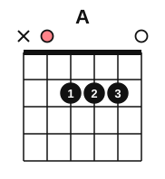

# The E and A chords

<span class="tag tag-guitar">Guitar</span>

After this lesson you can play the E and A chords with a clear tone on every string, change between Em and E using one finger, and change between E and A at 60 bpm.

Before this: [Chord diagrams and your first chord](../01-first-sounds/12-chord-diagrams-and-e-minor.md). You need: your guitar, a pick and a tuner.

## The idea

### Sound first: E next to Em

Play your Em chord and strum all six strings once. Then add your index finger on string 3 at fret 1, keeping fingers 2 and 3 where they are, and strum again. The second chord sounds brighter and more open. That chord is **E**, the E major chord. A chord named with only a letter, like E or A, is a **major chord**. The Em chord (E minor) is the darker one.

The two chords differ in one note. Em plays E, G and B. E plays E, G# and B. The G# (G sharp) is the G raised by one **half step**, the smallest step in the music you read, which on the guitar is one fret. The lesson Whole steps, half steps, sharps and flats<!-- link: ../03-the-major-scale-and-keys/01-whole-and-half-steps.md --> in stage 3 explains sharps in full. For now, the chord shapes are all you need.

### The E chord

E major: E, G#, B.


Follow these steps.

1. Hold the guitar as in stage 1, with your thumb behind the neck.
2. Put your middle finger (2) on string 5, fret 2.
3. Put your ring finger (3) on string 4, fret 2.
4. Put your index finger (1) on string 3, fret 1.
5. Check that your fingers are arched and each fingertip is close behind its fret wire.
6. Pluck the strings one at a time from 6 to 1. All six should ring.

You play all six strings. The open strings are 6, 2 and 1, and the three fingered strings are 5, 4 and 3. The six notes are E, B, E, G#, B and E. The salmon marker in the diagram shows the **root**, the note that gives the chord its name. In E it is the open low E on string 6.

Common mistake at step 4: the index finger lying flat and muting string 2 below it. Arch the finger so only the tip touches string 3.

### Changing between Em and E

Em and E share the finger on string 5 and the finger on string 4. They differ in one finger, so the change is small: lift or place finger 1 and nothing else moves.

1. Play Em, with fingers 2 and 3 down.
2. Keep fingers 2 and 3 on the strings, and put finger 1 on string 3 at fret 1. Strum. This is E.
3. Lift only finger 1. Strum. This is Em.
4. Repeat.

A finger that stays on the string through a change is an **anchor**. The two anchors here make this the easiest change in the book. Lesson 11 uses the same idea for harder changes.

### The A chord

A major: A, C#, E.



The A chord uses only five strings. The x above string 6 means do not play it. The notes are A, E, A, C# and E.

1. Put your index finger (1) on string 4, fret 2.
2. Put your middle finger (2) on string 3, fret 2.
3. Put your ring finger (3) on string 2, fret 2. The three fingers sit side by side in the same fret.
4. Arch each finger so the tips press the strings without touching the strings next to them. String 1 must stay open.
5. Aim your down stroke at string 5, and strum down through string 1. String 5 is the open A, the root.
6. Pluck the strings one at a time from 5 to 1. All five should ring.

Three fingers in one fret is a tight fit. If the ring finger touches string 1 and mutes it, turn your wrist slightly away from the neck and let the finger come down more from above. Some players use fingers 2, 3 and 4 for this chord. Try both and keep the one that rings cleanly.

Common mistake at step 5: striking string 6. The low E is not part of the chord and makes it sound muddy. Start the stroke on string 5. If you hit string 6 now and then, your picking hand is still learning where the strings are; slow down.

### Changing between E and A

E and A share no anchor finger, but their shapes are close: both sit in fret 1 and fret 2, in the middle of the neck. Change in one movement, like closing and opening a hand.

1. Play E, with fingers 1, 2 and 3 down.
2. Lift all three fingers at once, about a centimetre, and let your hand hover near the strings.
3. Place the A shape, all three fingers together.
4. Strum.

The listening test is the first strum after the change. If any string is dull, stop and find which finger is touching the wrong string.

## Hear and see

Listen to the E chord and the A chord as whole-note strums. Each bar has one strum, and the chord rings for four beats while you change shape. The staff shows the notes written an octave above where they sound, as printed guitar music is; stage 3 explains why.

```abc
%%opts tab=guitar
X:1
M:4/4
L:1/4
Q:1/4=60
K:C clef=treble-8
"Em"[E,B,EGBe]4 | "E"[E,B,E^GBe]4 | "Em"[E,B,EGBe]4 | "E"[E,B,E^GBe]4 |]
```

Now E and A, one strum on beat 1 and a change in beats 2 to 4.

```abc
%%opts tab=guitar
X:1
M:4/4
L:1/4
Q:1/4=60
K:C clef=treble-8
"E"[E,B,E^GBe]4 | "A"[A,EA^ce]4 | "E"[E,B,E^GBe]4 | "A"[A,EA^ce]4 |]
```

## Try it

Exercise 1. Which strings are open in the E chord?

<details class="solution" markdown>
<summary>Answer</summary>

Strings 6, 2 and 1.

</details>

Exercise 2. What is the one difference between the Em and E chord shapes?

<details class="solution" markdown>
<summary>Answer</summary>

E adds finger 1 on string 3, fret 1. Fingers 2 and 3 stay in the same places.

</details>

Exercise 3. Which string does the first stroke of an A chord aim at, and why?

<details class="solution" markdown>
<summary>Answer</summary>

String 5. The A chord does not use string 6, and string 5 is the open A, the root.

</details>

<div class="practice" markdown>

### Practice routine (30 minutes)

| Minutes | What to do | Tempo | Listen for |
|---|---|---|---|
| 5 | Warm-up: Em, one strum per bar for 4 bars | 60 bpm | Every string ringing |
| 15 | New skill: build E by adding finger 1 to Em, 8 changes between Em and E. Then build A, then 8 changes between E and A, one strum per bar | 60 bpm | Every string ringing after each change |
| 5 | Piano: Hot Cross Buns in both hands, one at a time, then Two Lanterns right hand | 60 bpm | No stops at the bar lines |
| 5 | Reading: [Note flashcards](../practice/note-flashcards.md), treble and bass, C3 to G4 | Untimed | Naming without counting |

Repeat this routine on at least three days.

</div>

<div class="move-on" markdown>

### Move on when

- [ ] You can place E and strum it with all six strings ringing, ten times in a row.
- [ ] You can place A and strum it with all five strings ringing, ten times in a row.
- [ ] You can change Em to E and back 8 times at 60 bpm, one strum per bar, with every string ringing.
- [ ] You can change E to A and back 4 times at 60 bpm, one strum per bar, with every string ringing.

</div>

## Common mistakes

Moving one finger at a time in a change. Lift and place the whole shape together, except where a finger is an anchor.

Looking for the notes while the beat goes by. Stop the strumming, place the shape without hurrying, then restart the count.

Gripping the neck hard. Press only enough for a clear tone; if your hand aches, stop, shake it out, and see a teacher or a doctor if the pain returns.

## Film yourself

Record 30 seconds from the front while you change between E and A. Watch it and check:

- Do the fingers move together as one shape?
- Are the fingers arched, and does each fingertip land close behind its fret wire?
- Does the thumb stay behind the neck, near the middle?
- Does the strumming arm stay relaxed through the change?

<!-- video: a front view of a beginner changing between E and A major chords, showing finger shapes and a relaxed strumming arm -->

## Key terms

- **Major chord**: a chord named by its letter alone, such as E or A. It sounds brighter than the minor chord of the same name.
- **E** (E major): the notes E, G# and B, played with fingers 1, 2 and 3.
- **A** (A major): the notes A, C# and E, played on strings 5 to 1.
- **Root**: the note that gives a chord its name.
- **Anchor**: a finger that stays on its string through a chord change.
- **Half step**: the smallest step in this book; on the guitar, one fret.

Next: [Ties, dots and eighth notes](05-ties-dots-and-eighth-notes.md)
