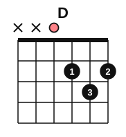

# The A minor and D chords

<span class="tag tag-guitar">Guitar</span>

After this lesson you can play the Am and D chords with a clear tone, strum only the strings each chord uses, and change between Am and E, Am and Em, and D and A at 60 bpm.

Before this: [The E and A chords](04-chords-e-and-a.md), [Ties, dots and eighth notes](05-ties-dots-and-eighth-notes.md). You need: your guitar, a pick and a tuner.

## The idea

### Sound first: A next to Am

Play your A chord and strum strings 5 to 1. Then move your fingers into the new shape below and strum again. The second chord is darker, the same difference you heard between E and Em. That chord is **Am**, A minor.

### The Am chord

A minor: A, C, E.


Am is played on strings 5 to 1, like A, with string 6 left silent. The notes on strings 5 to 1 are A, E, A, C and E.

1. Put your index finger (1) on string 2, fret 1.
2. Put your middle finger (2) on string 4, fret 2.
3. Put your ring finger (3) on string 3, fret 2.
4. Arch the fingers so strings 5 and 1 stay open and ring.
5. Aim the first stroke at string 5, and strum down through string 1.
6. Pluck the strings one at a time from 5 to 1. All five should ring.

Compare Am with E from the last lesson. In E, fingers 2, 3 and 1 sit on strings 5, 4 and 3. In Am the same three fingers, in the same order, sit on strings 4, 3 and 2. Am is the E shape moved one string toward the thin strings. That makes the change from Am to E short: move the whole shape one string together, keeping its form. The change from Am to Em is also short, because both chords have fingers on fret 2 of two neighbouring strings.

Common mistake at step 3: the finger on string 3 touching string 2 below it and muting it. Arch the finger so only the tip presses.

### Muting by not striking

The x above string 6 in the Am diagram means do not play that string. The chord is still strummed in one motion. **Muting by not striking** is a picking-hand skill: you start the pick on the first string the chord uses, and move through to the last. The string you skip is never touched.

Practise this on the open strings. Pick string 5 and strum down through string 1, ten times, without hitting string 6. Then move your aim to string 4 and strum down through string 1, ten times. You need the second skill for D.

### The D chord

D major: D, F#, A.



D uses only four strings, 4 to 1: x x 0 2 3 2. The notes are D, A, D and F# (F sharp, a half step above F, as in the E chord lesson).

1. Put your index finger (1) on string 3, fret 2.
2. Put your ring finger (3) on string 2, fret 3.
3. Put your middle finger (2) on string 1, fret 2.
4. The three fingers form a small triangle. Arch them so each tip presses its own string.
5. Aim the first stroke at string 4, the open D, which is the root.
6. Pluck strings 4, 3, 2 and 1 one at a time. All four should ring.

Common mistake at step 5: striking string 5 or 6. The low strings make the chord sound muddy and flat. Aim the pick at string 4 before you move your arm, and slow down until you hit it every time.

### Changes to practise

| Change | What stays the same | What to watch |
|---|---|---|
| Am to E | The shape; move it one string | Fingers 2, 3 and 1 land together |
| Am to Em | Fingers on fret 2 of two strings | Finger 1 lifts; the pair moves one string |
| D to A | The strings 4 to 1 are in both | Fingers land in frets 2 and 3 on strings 3 to 1 |

## Hear and see

Listen to Am and E in turn, one strum per bar. The staff shows the notes an octave above where they sound, as printed guitar music is.

```abc
%%opts tab=guitar
X:1
M:4/4
L:1/4
Q:1/4=60
K:C clef=treble-8
"Am"[A,EAce]4 | "E"[E,B,E^GBe]4 | "Am"[A,EAce]4 | "E"[E,B,E^GBe]4 |]
```

Now D and A, again one strum per bar. D has four strings, A has five, so the chord gets thicker when the A arrives.

```abc
%%opts tab=guitar
X:1
M:4/4
L:1/4
Q:1/4=60
K:C clef=treble-8
"D"[DAd^f]4 | "A"[A,EA^ce]4 | "D"[DAd^f]4 | "A"[A,EA^ce]4 |]
```

## Try it

Exercise 1. How many strings does the D chord use, and which string does the first stroke aim at?

<details class="solution" markdown>
<summary>Answer</summary>

Four strings (4, 3, 2 and 1). The first stroke aims at string 4, the open D.

</details>

Exercise 2. Which fingers play the Am chord, and on which strings?

<details class="solution" markdown>
<summary>Answer</summary>

Finger 2 on string 4, finger 3 on string 3, finger 1 on string 2.

</details>

Exercise 3. What is the difference in the notes of A and Am?

<details class="solution" markdown>
<summary>Answer</summary>

A is A, C#, E. Am is A, C, E. The third note is lowered by a half step, one fret (C# to C).

</details>

<div class="practice" markdown>

### Practice routine (30 minutes)

| Minutes | What to do | Tempo | Listen for |
|---|---|---|---|
| 5 | Warm-up: Em, E and A, each for 2 bars, one strum per bar | 60 bpm | Every string ringing |
| 15 | New skill: build Am and D, pluck each string, then strum. Practise the changes Am to E, Am to Em and D to A, 8 changes each, one strum per bar | 60 bpm | The unused strings staying silent |
| 5 | Piano: Low Tide, left hand alone, then Hot Cross Buns in both hands | 60 bpm | Even volume |
| 5 | Reading: [Note flashcards](../practice/note-flashcards.md), bass and treble, C3 to G4 | Untimed | Naming without counting |

Repeat this routine on at least three days.

</div>

<div class="move-on" markdown>

### Move on when

- [ ] You can place Am and strum strings 5 to 1 with all five ringing, ten times in a row.
- [ ] You can place D and strum strings 4 to 1 with all four ringing and no sound from strings 5 and 6, ten times in a row.
- [ ] You can change Am to E and back 8 times at 60 bpm, one strum per bar, with every string ringing.
- [ ] You can change D to A and back 8 times at 60 bpm, one strum per bar, with every string ringing.

</div>

## Common mistakes

Striking the strings the chord doesn't use. Place the pick on the first string you want before the stroke starts.

Muting string 1 in D with the finger on string 2. The three fingers are close together. Arch them more.

Changing the fingers one at a time. Lift and place the shape together, as you did for E and A.

## Film yourself

Record 30 seconds from the front while you play D, then Am, one strum each per bar. Watch it and check:

- Does the pick start on string 4 for D and string 5 for Am?
- Are the fingers arched in each shape?
- Does the fretting hand move as a block in the change?

<!-- video: a front view of a beginner playing D and Am chords, showing the starting string for each strum and arched fingers -->

## Key terms

- **Am** (A minor): the notes A, C and E, played on strings 5 to 1.
- **D** (D major): the notes D, F# and A, played on strings 4 to 1.
- **Muting by not striking**: leaving a string silent by starting the stroke on a different string, so the pick never touches it.

Next: [Legato, staccato and dynamics](07-legato-staccato-and-dynamics.md)
