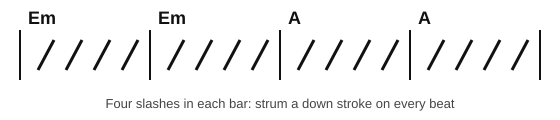

# Strumming with down strokes

<span class="tag tag-guitar">Guitar</span>

After this lesson you can strum four down strokes per bar with a steady beat, read a chord chart with rhythm slashes, and change chords without stopping the beat.

Before this: [The E and A chords](04-chords-e-and-a.md), [The A minor and D chords](06-chords-a-minor-and-d.md). You need: your guitar, a pick, a tuner and a metronome.

## The idea

### Sound first: a pulse made of strums

In stage 1 you strummed Em once per bar and then once per beat. Play four down strokes per bar on Em at 60 bpm now and listen to the beat. Each strum cuts off the one before it, so the chord has a steady pulse that matches the metronome. Strumming is a rhythm instrument as well as a chord instrument: a chord played with a good beat sounds like music, and the same chord played with an uneven beat sounds hesitant.

### The strumming motion

The motion starts in the forearm and the wrist, not in the fingers.

1. Hold the pick as in stage 1, with about 3 mm showing, between the thumb and the side of the index finger.
2. Rest the forearm on the edge of the guitar body, with your hand above the soundhole.
3. Swing the forearm and the wrist together, so the pick sweeps down across the strings you want in one smooth motion.
4. After the last string, let the hand rise a little above the strings and return to the top. The return does not touch the strings. The lesson Eighth-note strumming<!-- link: ../04-intervals-and-triads/09-eighth-note-strumming.md --> in stage 4 adds up strokes on the way back.
5. Keep the hand moving at a steady speed. The hand is a pendulum that swings down on every beat.

A good down stroke moves across the strings in about the time of a quick blink. It is a sweep and not a single pluck. Common mistake at step 3: stiffening the elbow to make the sound louder. Let the weight of the forearm do the work. If your forearm, wrist or shoulder aches, stop, shake it out, and see a teacher or a doctor if it keeps happening.

### Strumming quarter notes

A quarter note chord gets one down stroke. Four quarter notes fill a bar of 4/4, so the count is "1 2 3 4" with a strum on every number. At 60 bpm that is one strum per second.

Listen to this Em bar repeated, and strum along with the play bar once you can keep the pulse.

```abc
%%opts tab=guitar
X:1
M:4/4
L:1/4
Q:1/4=60
K:C clef=treble-8
"Em"[E,B,EGBe] [E,B,EGBe] [E,B,EGBe] [E,B,EGBe] | [E,B,EGBe] [E,B,EGBe] [E,B,EGBe] [E,B,EGBe] |]
```

### Rhythm slashes in a chord chart

Guitarists often read a **chord chart** instead of a full score. A chord chart shows the chord names above the bars and **rhythm slashes** (short diagonal strokes) inside each bar. One slash is one beat, so four slashes in 4/4 mean strum on every beat. A chord name changes where the new chord starts.



The chart above says: strum four down strokes on Em for two bars, then four on A for two bars. The staff version of the same music is below.

```abc
%%opts tab=guitar
X:1
M:4/4
L:1/4
Q:1/4=60
K:C clef=treble-8
"Em"[E,B,EGBe] [E,B,EGBe] [E,B,EGBe] [E,B,EGBe] | [E,B,EGBe] [E,B,EGBe] [E,B,EGBe] [E,B,EGBe] |
"A"[A,EA^ce] [A,EA^ce] [A,EA^ce] [A,EA^ce] | [A,EA^ce] [A,EA^ce] [A,EA^ce] [A,EA^ce] |]
```

### Keeping time while changing chords

The most common problem is stopping the strumming hand to make a chord change. The beat must keep going; the fretting hand has to catch up. These steps help.

1. Keep the strumming arm moving at all times, even while the other hand is in the air.
2. Start the change on beat 4 of the bar before the new chord. The beat 4 strum is the last strum of the old chord.
3. If you can't make the change in time, leave out the strum on beat 4 and let the arm swing through the air. You strum 3 beats on the old chord and 1 beat of silence, then play beat 1 of the new chord on time. A missing strum is better than a stopped beat.
4. As the change gets easier, put the beat 4 strum back.

Listen to the version with a rest on beat 4. The rest gives the fretting hand one full beat to move.

```abc
%%opts tab=guitar
X:1
M:4/4
L:1/4
Q:1/4=60
K:C clef=treble-8
"Em"[E,B,EGBe] [E,B,EGBe] [E,B,EGBe] z | "E"[E,B,E^GBe] [E,B,E^GBe] [E,B,E^GBe] z |
"Em"[E,B,EGBe] [E,B,EGBe] [E,B,EGBe] z | "E"[E,B,E^GBe]4 |]
```

## Try it

Exercise 1. How many slashes are in a bar of 4/4 chart notation where you strum every beat? And in a bar of 3/4?

<details class="solution" markdown>
<summary>Answer</summary>

Four slashes in 4/4, three in 3/4. One slash is one beat.

</details>

Exercise 2. A chart reads Am, Am, E, E with four slashes each. How many strums do you play in all, and on which bar does the first change happen?

<details class="solution" markdown>
<summary>Answer</summary>

16 strums (4 bars of 4). The first change happens at the start of bar 3, so the fretting hand should start moving on beat 4 of bar 2.

</details>

Exercise 3. At 60 bpm, how many seconds does a bar of four down strokes take, and how long is the bar-4 whole note chord in the last example?

<details class="solution" markdown>
<summary>Answer</summary>

4 seconds. The whole-note chord lasts 4 beats, which is also 4 seconds.

</details>

<div class="practice" markdown>

### Practice routine (30 minutes)

| Minutes | What to do | Tempo | Listen for |
|---|---|---|---|
| 5 | Warm-up: Em, four down strokes per bar for 4 bars | 60 bpm | Even volume, the chord ringing out |
| 15 | New skill: Em to E with a rest on beat 4 for 8 bars, then Em to A with four strums per bar for 8 bars. Try the chart above | 60 bpm | Steady beat across the change |
| 5 | Piano: Two Lanterns, hands separately then together | 50 bpm, then 40 | The left-hand note held |
| 5 | Ear: close your eyes and count the strums while the metronome clicks; open your eyes and check | 60 bpm | Strums landing with the click |

Repeat this routine on at least three days.

</div>

<div class="move-on" markdown>

### Move on when

- [ ] You can strum four down strokes per bar on Em for 16 bars at 60 bpm with no stops.
- [ ] You can play the Em to A chart (four strums per bar, 8 bars) at 60 bpm with the beat kept through every change.
- [ ] You can read a chart with chords Am, D and E and say how many strums are in each bar.
- [ ] You can play a version of the chart with a rest on beat 4 for the change, at 60 bpm, with no stops.

</div>

## Common mistakes

Stopping the arm to wait for the chord. Keep the arm moving and miss a strum rather than the beat.

Gripping the pick. A tight grip makes a harsh sound and a tired hand. Hold it firmly enough that it doesn't slip, and no tighter.

Speeding up as the music goes on. Practise with the metronome until your strums land on its clicks.

## Film yourself

Record 30 seconds from the front while you strum Em to A, four strums per bar. Watch it and check:

- Does the forearm and wrist swing as one motion?
- Does the hand keep moving during the chord change?
- Does the pick hit the strings the chord uses?
- Are the shoulder and neck relaxed?

<!-- video: a front view of a beginner strumming four down strokes per bar while changing between Em and A, showing a relaxed forearm swing -->

## Key terms

- **Down stroke**: a strum from the thick strings to the thin strings.
- **Chord chart**: music written as chord names above bars, without notes.
- **Rhythm slash**: a diagonal stroke in a chart; one slash is one beat.
- **Pulse**: the steady beat that the strumming keeps.

Next: [Sight-reading basics](09-sight-reading-basics.md)
