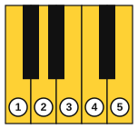
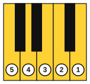
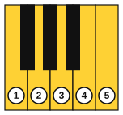
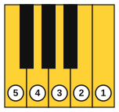
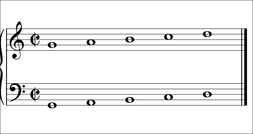
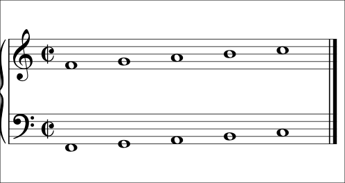

# G and F positions

<span class="tag tag-piano">Piano</span>

After this lesson you can place each hand in G position or F position, read the five notes of each on the staff, and play short pieces in these positions with one hand and with both hands.

Before this: [Left hand in C position](02-left-hand-c-position.md), [Hands together](03-hands-together.md), [Sight-reading basics](09-sight-reading-basics.md). You need: your piano and a metronome.

## The idea

### Sound first: the same shape in a new place

Play the right-hand C position pattern, C D E F G, with fingers 1 to 5. Now lift the hand and put the thumb on the white key G4, four white keys to the right, and play the five white keys from there: G A B C D. The finger pattern is the same, but you hear a different set of notes. This hand shape is **G position**. A **position** is a place on the keyboard where the five fingers rest on five neighbouring white keys, and it is named after the note under the thumb of the right hand.

Now put the thumb on F4, one white key below G4, and play F G A B C. That is **F position**.

### G position

In G position the right thumb is on G4. The left hand mirrors it: the little finger (5) is on G2 and the thumb (1) is on D3.





### F position

In F position the right thumb is on F4. The left little finger is on F2 and the left thumb is on C3.





### The positions on the staff

Both positions are shown on the grand staff below, for both hands.





| Position | Hand | Notes on the staff, lowest to highest |
|---|---|---|
| G | Right | G4 line 2, A4 space 2, B4 line 3, C5 space 3, D5 line 4 |
| G | Left | G2 line 1, A2 space 1, B2 line 2, C3 space 2, D3 line 3 |
| F | Right | F4 space 1, G4 line 2, A4 space 2, B4 line 3, C5 space 3 |
| F | Left | F2 below line 1, G2 line 1, A2 space 1, B2 line 2, C3 space 2 |

### Finding the position from the page

All music in this lesson is written with no key signature. The way to find the position is to read the first note and the range of the line.

1. Find the lowest note and the highest note. If they are five notes apart (say G to D), the music fits one position.
2. For the right hand, put the thumb on the lowest note. For the left hand, put the little finger on the lowest note.
3. Play the five notes up and down to feel the position before you start.
4. Keep your eyes on the page and the hand where it is. Music that leaves the five notes needs a hand move, which later stages teach.

Common mistake at step 2: putting the left thumb, instead of the left little finger, on the lowest note. The left hand mirrors the right, so its lowest note is under finger 5.

In F position, the notes F G A B C use a B natural, and this book does not play Bb until key signatures in stage 3. The pieces in F position here keep away from B.

## Hear and see

Au clair de la lune, a traditional French tune, in the right hand in G position. Listen for the repeated notes at the start and the step down at the end.

```abc
X:1
T:Au clair de la lune
C:Traditional
M:4/4
L:1/4
Q:1/4=60
K:C
!1!G G G A | B2 A2 | G B A A | G4 |]
```

Mary Had a Little Lamb (traditional) in F position, right hand. Compare with the C position version in stage 1. The tune is the same and every note is moved to a new key.

```abc
X:1
T:Mary Had a Little Lamb
C:Traditional
M:4/4
L:1/4
Q:1/4=60
K:C
!3!A G F G | A A A2 | G G G2 | A c c2 |]
```

Hot Cross Buns (traditional) in the left hand in G position. It begins on finger 3.

```abc
X:1
T:Hot Cross Buns
C:Traditional
M:4/4
L:1/4
Q:1/4=60
K:C clef=bass
!3!B,, A,, G,,2 | B,, A,, G,,2 | G,, G,, A,, A,, | B,, A,, G,,2 |]
```

"Night Bridge" is an original piece for both hands in G position. The left hand holds G2 and D3 under the melody.

```abc
X:1
T:Night Bridge
C:Original, for this book
M:4/4
L:1/4
Q:1/4=60
K:C
%%score {RH LH}
V:RH clef=treble
V:LH clef=bass
[V:RH] !3!B B A G | A B B2 | B B A G | B A G2 |]
[V:LH] !5!G,,2 G,,2 | !1!D,2 D,2 | G,,2 G,,2 | D,2 G,,2 |]
```

"Slow Ferry" is an original piece for both hands in F position.

```abc
X:1
T:Slow Ferry
C:Original, for this book
M:4/4
L:1/4
Q:1/4=60
K:C
%%score {RH LH}
V:RH clef=treble
V:LH clef=bass
[V:RH] !3!A A G F | G A A2 | G A c A | F4 |]
[V:LH] !5!F,,2 !1!C,2 | F,,2 C,2 | F,,2 C,2 | F,,4 |]
```

## Try it

Exercise 1. In G position, which finger of the right hand plays B, and which finger of the left hand plays B?

<details class="solution" markdown>
<summary>Answer</summary>

Right hand finger 3 (G is 1, A is 2, B is 3). Left hand finger 3 (G is 5, A is 4, B is 3).

</details>

Exercise 2. The lowest note in a left-hand line is F2 and the highest is C3. Which position is it?

<details class="solution" markdown>
<summary>Answer</summary>

Left-hand F position, with finger 5 on F2 and finger 1 on C3.

</details>

Exercise 3. How many white keys does the right hand move to go from C position to G position?

<details class="solution" markdown>
<summary>Answer</summary>

Four white keys to the right (C to D, D to E, E to F, F to G).

</details>

<div class="practice" markdown>

### Practice routine (30 minutes)

| Minutes | What to do | Tempo | Listen for |
|---|---|---|---|
| 5 | Warm-up: five notes up and down in C position, then G position, then F position, each hand | 60 bpm | The same even volume in every position |
| 15 | New skill: Au clair de la lune and Hot Cross Buns hands separately, then Night Bridge hands separately and together. Add Mary in F position and Slow Ferry on day 3 | 50 bpm, then 60 | No stops while moving between positions |
| 5 | Reading: sight-read a line in each position using the scan from the last lesson | 50 bpm | Finding the position before playing |
| 5 | Guitar: Am, D and A, three changes each, one strum per bar | 60 bpm | Every string ringing |

Repeat this routine on at least three days.

</div>

<div class="move-on" markdown>

### Move on when

- [ ] You can play the five notes of G position and F position with each hand, up and down, at 60 bpm with even volume.
- [ ] You can play Au clair de la lune at 60 bpm, three times in a row with no stops.
- [ ] You can play Night Bridge hands together at 50 bpm without stopping.
- [ ] You can find the position of a new line by looking at its lowest and highest notes.

</div>

## Common mistakes

Playing C position notes by habit. Check that the thumb (or the left little finger) is on the first note of the line before you start.

Looking at the hand to find the new position. Practise by feel: find the black key groups with your fingertips and then the white key.

Playing a line a position too high or too low. Say the first note aloud before you place the hand.

## Key terms

- **Position**: a place on the keyboard where the five fingers rest on five neighbouring white keys.
- **G position**: right thumb on G4; left little finger on G2.
- **F position**: right thumb on F4; left little finger on F2.

Next: [One-minute chord changes](11-one-minute-changes.md)
