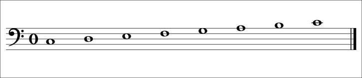
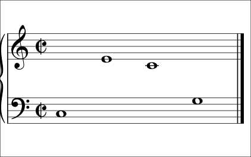
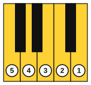
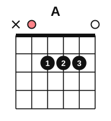
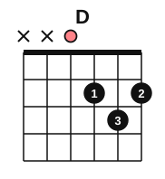

# Stage 2: Two hands and first chords

This stage adds the bass clef and the grand staff, so you can read music for both hands, and starts your left hand on the piano. You play both hands together, move to G and F positions, and learn ties, dots and eighth notes. You learn legato, staccato and dynamics, and practise sight reading. On the guitar you learn the E, A, Am and D chords, strum with down strokes, practise chord changes with the one-minute exercise, and play your first chord pieces. It usually takes about 4 to 6 weeks at 30 minutes a day.

<!-- lessons:start -->
## Lessons

1. [The bass clef and the grand staff](01-bass-clef-and-grand-staff.md) (reading)
2. [Left hand in C position](02-left-hand-c-position.md) (piano)
3. [Hands together](03-hands-together.md) (piano)
4. [The E and A chords](04-chords-e-and-a.md) (guitar)
5. [Ties, dots and eighth notes](05-ties-dots-and-eighth-notes.md) (theory)
6. [The A minor and D chords](06-chords-a-minor-and-d.md) (guitar)
7. [Legato, staccato and dynamics](07-legato-staccato-and-dynamics.md) (piano)
8. [Strumming with down strokes](08-strumming-down-strokes.md) (guitar)
9. [Sight-reading basics](09-sight-reading-basics.md) (reading)
10. [G and F positions](10-g-and-f-positions.md) (piano)
11. [One-minute chord changes](11-one-minute-changes.md) (guitar)
12. [First chord pieces](12-first-chord-pieces.md) (guitar)

<!-- lessons:end -->

Download the stage 2 deck: [02-two-hands-and-first-chords.apkg](../downloads/anki/02-two-hands-and-first-chords.apkg)

## Cheat sheet

Everything to remember from this stage, on one page.

### The bass clef and the grand staff

| Fact | Detail |
|---|---|
| Bass clef (F clef) | Two dots around line 4, which is F3 |
| Bass staff lines, bottom to top | G2 B2 D3 F3 A3 |
| Bass staff spaces, bottom to top | A2 C3 E3 G3 |
| Grand staff | Treble staff above, bass staff below, joined by a brace |
| Middle C | C4: a ledger line below the treble staff and a ledger line above the bass staff |

### Piano positions

| Position | Right hand (thumb to little finger) | Left hand (little finger to thumb) |
|---|---|---|
| C | C4 D4 E4 F4 G4 | C3 D3 E3 F3 G3 |
| G | G4 A4 B4 C5 D5 | G2 A2 B2 C3 D3 |
| F | F4 G4 A4 B4 C5 | F2 G2 A2 B2 C3 |

The left hand uses the same finger numbers as the right (thumb 1, little finger 5). Going up the keys it plays 5 4 3 2 1.

Learn a two-hand piece in this order: right hand alone, left hand alone, both hands at half speed, then up in steps of 5 bpm. Three clean in a row before you speed up.

### Rhythm, articulation and dynamics

| Sign | Meaning | Beats |
|---|---|---|
| Dotted half note | Half note plus half of it | 3 |
| Dotted quarter note | Quarter note plus half of it | 1.5 |
| Eighth note | Half a beat; counted "1 & 2 &" | 0.5 |
| Tie | Joins two notes of the same pitch into one | Added |
| Slur | Curve over different notes: play legato | |
| Staccato (dot) | Short and detached, about half the length | |
| p, mf, f | Soft, medium loud, loud | |
| Crescendo, diminuendo | Gradually louder, gradually softer | |

### Sight reading

Scan first: clef, time signature, highest and lowest notes, rhythm. Choose a slow tempo. Keep the beat going, let wrong notes go, rejoin at the next bar line if lost, keep your eyes on the page and look ahead.

### Guitar chords

| Chord | Notes | Strings played | Frets (strings 6 to 1) | Fingers |
|---|---|---|---|---|
| Em | E, G, B | 6 to 1 | 0 2 2 0 0 0 | 2 on string 5, 3 on string 4 |
| E | E, G#, B | 6 to 1 | 0 2 2 1 0 0 | 2 on string 5, 3 on string 4, 1 on string 3 |
| A | A, C#, E | 5 to 1 | x 0 2 2 2 0 | 1, 2, 3 on strings 4, 3, 2 |
| Am | A, C, E | 5 to 1 | x 0 2 2 1 0 | 2 on string 4, 3 on string 3, 1 on string 2 |
| D | D, F#, A | 4 to 1 | x x 0 2 3 2 | 1 on string 3, 3 on string 2, 2 on string 1 |

Em to E: keep fingers 2 and 3 down and add finger 1. Am is the E shape moved one string toward the thin strings. Start the stroke on the lowest string the chord uses (string 5 for A and Am, string 4 for D).

### Strumming and chord changes

- One slash in a chord chart is one beat. In 4/4, four down strokes per bar.
- Keep the arm moving through a change. If the change is late, leave out one strum rather than stopping the beat.
- One-minute changes: count the clean changes in 60 seconds. Targets: Em and E 30, Am and E 20, E and A 20, D and A 20, Am and Em 20, Am and D 15.
