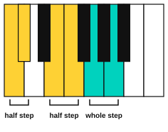
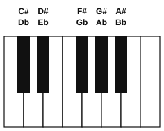
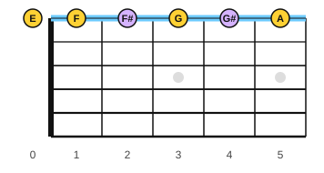

# Whole steps, half steps, sharps and flats

<span class="tag tag-theory">Theory</span>

After this lesson you can find a half step and a whole step from any note on the piano and the guitar, name the black keys with sharps and flats, and read a sharp, a flat and a natural sign in a bar.

Before this: [Pitch and the musical alphabet](../01-first-sounds/04-pitch-and-the-musical-alphabet.md), [The treble staff and C position](../01-first-sounds/09-treble-staff-and-c-position.md), [Reading guitar tab](../01-first-sounds/11-reading-tab.md). You need: your piano and your guitar.

## The idea

### Sound first: the smallest step

Play middle C, then the black key just above it, then D. You hear three pitches that rise in small, even-sounding moves. Now play C, then D directly. The jump from C to D is twice as big as the jump from C to the black key.

The smallest distance in most music is the **half step**, also called the **semitone**: the move from one key to the very next key on the piano, whether that key is black or white. There is no key in between. Two half steps make a **whole step**, also called a **tone**.



Look for the places on the keyboard with no black key between two white keys. E and F are neighbours with nothing between them, and so are B and C. Those two pairs are half steps. Every other pair of neighbouring white keys has a black key between them, so those pairs are whole steps.

### Names for the black keys

A black key is named from the white key next to it. A **sharp** (written # after the letter) raises a note by one half step. A **flat** (written b) lowers a note by one half step. So the black key just above C is C sharp (C#), and the same key is also D flat (Db), because it is one half step below D.



Two names for the same pitch are called **enharmonic** names. F# and Gb are enharmonic: you play the same key either way. Which name a piece uses depends on the key it is in, and lesson 2 shows why.

E# and Cb are also names (E# is the same key as F), but you will rarely meet them for a while.

### The same idea on the guitar

On the guitar, one fret is one half step. Play string 1 open (E), then fret 1 (F), then fret 2, then fret 3 (G). Fret 2 is the note between F and G, and its name is F#. That is the gap stage 1 left blank in the tab lesson.



E to F is one fret because it is a half step. F to G is two frets because it is a whole step. The guitar and the piano agree: only E to F and B to C are single steps between natural notes.

### Accidentals

A sharp, a flat or a natural sign written in front of a note is an **accidental**. The **natural sign** cancels a sharp or flat, so the note is played as the plain white key again. An accidental applies to every note of the same letter and octave from where it appears until the next bar line. The bar line cancels it.

Listen to this example. Bar 1 has one sharp sign on F, and the second F in the bar is also F#. Bar 2 starts with F natural, because the bar line cancelled the sharp, then plays F# again, then a natural sign cancels it.

```abc
X:1
M:4/4
L:1/4
Q:1/4=70
K:C
E ^F F G | F G ^F =F |]
```

In the first bar the notes are E, F#, F#, G. In the second bar they are F, G, F#, F. The accidental is written before the note head, on the same line or space.

Here is a climb in half steps, and then one in whole steps. Listen for how the first one sounds crowded and the second one sounds open.

```abc
X:1
M:4/4
L:1/4
Q:1/4=70
K:C
C ^C D ^D | E F ^F G |
C D E ^F | ^G ^A c2 |]
```

## Try it

Exercise 1. Is the step from B to C a half step or a whole step? Is the step from G to A?

<details class="solution" markdown>
<summary>Answer</summary>

B to C is a half step (no black key between them). G to A is a whole step (G# is between them).

</details>

Exercise 2. Name the note a half step above A, and the note a whole step below G, using the flat name for the first one.

<details class="solution" markdown>
<summary>Answer</summary>

A half step above A is Bb (also A#). A whole step below G is F.

</details>

Exercise 3. On string 1, which fret plays F#? Which fret plays G#?

<details class="solution" markdown>
<summary>Answer</summary>

F# is fret 2. G# is fret 4. String 1 reads E F F# G G# A at frets 0 to 5.

</details>

<div class="practice" markdown>

### Practice routine (30 minutes)

| Minutes | What to do | Tempo | Listen for |
|---|---|---|---|
| 5 | Warm-up: C position five-finger pattern C D E F G and back, right hand | 60 bpm | Even volume on every finger |
| 10 | Piano: starting on C4, play every key up to C5 one after the other, black and white, and say each name aloud (use sharps going up). Then play the example above in half steps | 60 bpm | Each move is the same small size |
| 5 | Piano: from C4, play a whole step up (skip one key), three times in a row, then do the same from E4 and from G4 | Untimed | Which starts are whole steps and which land on E to F |
| 10 | Guitar: on strings 1, 2 and 3, play frets 0 to 4 with one finger per fret, and say each note name | 60 bpm | Each fret is a half step higher |

Repeat this routine on at least three days.

</div>

<div class="move-on" markdown>

### Move on when

- [ ] You can name every black key on the keyboard with both its sharp and its flat name in under 20 seconds.
- [ ] You can play a half step and a whole step up from any note you pick, on the piano, and say the names of both notes.
- [ ] You can say which two pairs of neighbouring white keys are half steps.
- [ ] You can play F#, G# and A# on string 1 and name the fret for each.

</div>

## Common mistakes

Calling every move to the next white key a whole step. E to F and B to C are half steps. Check for a black key between the two.

Forgetting that a sharp lasts to the end of the bar. If the same letter appears again in that bar, it is still sharp.

Counting the starting note as step one. A whole step from C is D, one move of two half steps, and the count starts after C.

## Key terms

- **Half step** (semitone): the distance from one key to the very next key, or from one fret to the next.
- **Whole step** (tone): two half steps.
- **Sharp** (#): raises a note by a half step.
- **Flat** (b): lowers a note by a half step.
- **Natural sign**: cancels a sharp or flat.
- **Accidental**: a sharp, flat or natural sign written before a note. It lasts until the end of the bar.
- **Enharmonic**: two names for the same pitch, such as F# and Gb.

Next: [The major scale](02-the-major-scale.md)
