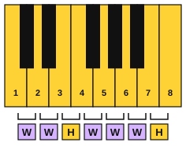
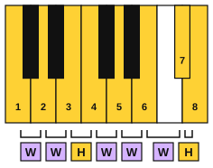

# The major scale

<span class="tag tag-theory">Theory</span>

After this lesson you can write and play the major scale pattern W W H W W W H starting on C, G, D or F, and number the notes 1 to 7 and the octave.

Before this: [Whole steps, half steps, sharps and flats](01-whole-and-half-steps.md). You need: your piano.

## The idea

### Sound first: a scale

Play the white keys from middle C up to the next C, one after the other: C D E F G A B C. You have just played a scale, and you probably know the sound. It rises evenly and the last note feels like an arrival.

A **scale** is a set of notes arranged in order from one note up to the same note an octave higher (or down again). This scale is the **major scale**. Its first note, the note it is named after and starts on, is the **tonic**. This one is the C major scale: C, D, E, F, G, A, B, C.

### The pattern

Lesson 1 told you where the half steps are on the white keys: E to F and B to C. Look at the C major scale again, and write each step as W for whole and H for half.



C to D is W, D to E is W, E to F is H, F to G is W, G to A is W, A to B is W, and B to C is H. The major scale pattern is **W W H W W W H**. Every major scale on every note has this pattern, and the pattern is the scale.

### Scale degrees

Each note of the scale has a number, its **scale degree**. The tonic is degree 1, the next note is 2, and so on up to 7. The note after 7 is the tonic again, an octave higher, and it is called 8 or the octave. In the C major scale, degree 1 is C, degree 3 is E, degree 5 is G and degree 7 is B. Scale degrees are written as plain numbers in this book.

Here is the whole scale, up and back down. Listen to the half steps at 3 to 4 and at 7 to 8, which are the places where the scale rises by the smallest move.

```abc
X:1
M:4/4
L:1/4
Q:1/4=70
K:C
C D E F | G A B c | c B A G | F E D C |]
```

### Building a major scale on any note

To build a major scale on another note, start on that note and move up by W W H W W W H. The scale on G needs a black key, F#, to make the last whole step.

1. Write the tonic: G.
2. Go up a whole step: A. Another whole step: B.
3. Go up a half step: C.
4. Go up three whole steps: D, E, F#.
5. Go up a half step: G, the octave.

The G major scale: G, A, B, C, D, E, F#, G.



Common mistake at step 4: using F, the white key, because it looks natural. Without F# the step from E to F is a half step, and the pattern breaks.

Listen to it. The tune sounds like the C scale shifted up, which is what building the same pattern on a new note does.

```abc
X:1
M:4/4
L:1/4
Q:1/4=70
K:C
G A B c | d e ^f g |]
```

For a scale on F, the pattern needs Bb, not A#. A scale uses each letter name once, in order, so after A comes B in some form. Bb is the B letter lowered. The F major scale: F, G, A, Bb, C, D, E, F. The D major scale: D, E, F#, G, A, B, C#, D.

| Scale | Notes | Black keys |
|---|---|---|
| C major | C, D, E, F, G, A, B, C | none |
| G major | G, A, B, C, D, E, F#, G | F# |
| D major | D, E, F#, G, A, B, C#, D | F#, C# |
| F major | F, G, A, Bb, C, D, E, F | Bb |

The black keys are different in every scale, because the half steps must land on degrees 3 to 4 and 7 to 8.

## Try it

Exercise 1. Name the half steps in the C major scale by the scale degrees they sit between.

<details class="solution" markdown>
<summary>Answer</summary>

Between degrees 3 and 4 (E to F) and between degrees 7 and 8 (B to C).

</details>

Exercise 2. Build the A major scale with the pattern W W H W W W H.

<details class="solution" markdown>
<summary>Answer</summary>

The A major scale: A, B, C#, D, E, F#, G#, A. Going up from A: W to B, W to C#, H to D, W to E, W to F#, W to G#, H to A.

</details>

Exercise 3. In the D major scale, which note is degree 5, and which note is degree 7?

<details class="solution" markdown>
<summary>Answer</summary>

Degree 5 is A and degree 7 is C#.

</details>

<div class="practice" markdown>

### Practice routine (30 minutes)

| Minutes | What to do | Tempo | Listen for |
|---|---|---|---|
| 5 | Warm-up: C position pattern C D E F G and back, each hand alone | 60 bpm | Even volume |
| 10 | Piano: play the C major scale one octave with the right hand (any fingers for now, lesson 3 teaches the fingering), saying the degree number as you play | 60 bpm | The arrival on 8 |
| 10 | Piano: find the G major scale from G4 by pattern, not from memory: play G, A, B, C, D, E and check each step against W W H W W W H | 60 bpm | The F# you add makes the top sound like the C scale |
| 5 | Guitar: on string 1, play frets 0, 1, 3 and back (E F G), then string 2 open, fret 1, fret 3 (B C D) | 60 bpm | Clean notes, no buzz |

Repeat this routine on at least three days.

</div>

<div class="move-on" markdown>

### Move on when

- [ ] You can say the pattern W W H W W W H from memory and say where the half steps fall (between degrees 3 and 4, and 7 and 8).
- [ ] You can write the C, G, D and F major scales, with the right letters, in under 2 minutes.
- [ ] You can play the G major scale from G4 on the piano with one hand without a wrong note.
- [ ] You can name degree 1, 3, 5 and 7 of any of those four scales.

</div>

## Common mistakes

Writing A# instead of Bb in the F major scale. Each letter appears once, so after A comes a B-letter, and it is Bb.

Counting the half step as a whole step. Check each step on the keyboard, not by sound alone.

Forgetting that the scale ends on the tonic again. Eight notes make the scale, with the first and last both the tonic.

## Key terms

- **Scale**: a set of notes in order from a note to the same note an octave away.
- **Major scale**: the scale with the pattern W W H W W W H.
- **Tonic**: the first note of a scale, the note it is named after.
- **Scale degree**: the number of a note in a scale (1 to 7, then 8 for the octave).

Next: [The C major scale and thumb-under](03-c-major-scale-and-thumb-under.md)
