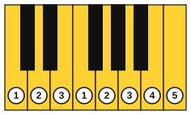
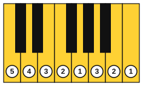

# The C major scale and thumb-under

<span class="tag tag-piano">Piano</span>

After this lesson you can play the C major scale up and down one octave with each hand alone, using the standard fingering and the thumb-under and finger-over moves.

Before this: [The major scale](02-the-major-scale.md), [Sitting at the piano and finger numbers](../01-first-sounds/05-sitting-and-finger-numbers.md), [Left hand in C position](../02-two-hands-and-first-chords/02-left-hand-c-position.md). You need: your piano.

## The idea

### The problem: eight notes, five fingers

A five-finger position covers five notes. The C major scale has eight notes in an octave, so the hand has to move. If you stretch one finger to every new key, the hand jerks and the notes come out uneven. The scale is played smoothly by passing the thumb under the hand (or the hand over the thumb) at one fixed place, so the fingers always land on the next key without a hop.

### Right hand, going up

The right-hand fingering going up is 1 2 3 1 2 3 4 5.



Fingers 1, 2 and 3 play C, D and E. Then the thumb goes under finger 3 to play F, and fingers 2, 3, 4 and 5 finish the scale on G, A, B and C. The **thumb-under** move happens once in an octave, between E and F.

Follow these steps for the move.

1. Play C, D and E with fingers 1, 2 and 3, with the hand quiet and the wrist level.
2. While finger 3 is still playing E, start to move the thumb under the palm toward F. Don't wait until E has finished.
3. Move the arm along with the thumb. Let the elbow drift slightly to the right as the hand goes up the keyboard, so the thumb has less far to reach.
4. Play F with the thumb, then G, A, B and C with fingers 2 to 5, and bring the arm back to centre.

Common mistake at step 2: waiting for E to finish, then jumping the thumb. This makes a gap before F. The thumb should be under the hand and ready by the time E ends.

Common mistake at step 3: twisting the wrist so the hand tips toward the little finger. Keep the wrist level, and move the elbow instead.

### Left hand, going up

The left-hand fingering going up is 5 4 3 2 1 3 2 1, starting on C3.



The left hand goes up with the little finger on C, then 4, 3, 2 and the thumb on G. Then finger 3 crosses over the thumb to play A. This is the **finger-over** move: the hand passes over the thumb, which stays near the G key, and then fingers 2 and 3 finish with B and C.

### Going down

Going down is the mirror. The right hand plays 5 4 3 2 1 3 2 1, with finger 3 crossing over the thumb after F to play E. The left hand plays 1 2 3 1 2 3 4 5, with the thumb going under finger 3 after A to play G. Each hand uses the same two moves, in the opposite order: what was a thumb-under going up becomes a finger-over going down, and the other way round.

### The scale from the page

Listen to the scale first, then play it with the fingering above the notes. Right hand, up and down, with the fingers written over the notes:

```abc
X:1
M:4/4
L:1/4
Q:1/4=60
K:C
!1!C !2!D !3!E !1!F | !2!G !3!A !4!B !5!c | !5!c !4!B !3!A !2!G | !1!F !3!E !2!D !1!C |]
```

Left hand, in the bass clef, up and down:

```abc
X:1
M:4/4
L:1/4
Q:1/4=60
K:C clef=bass
!5!C, !4!D, !3!E, !2!F, | !1!G, !3!A, !2!B, !1!C | !1!C !2!B, !3!A, !1!G, | !2!F, !3!E, !4!D, !5!C, |]
```

Play each hand alone until it is smooth. Then, if you want to try, play both hands together an octave apart at a slow tempo. This is not required yet; stage 8 returns to hands together.

Play the scale with a steady beat, one note per beat at 60 bpm. Listen for even volume and equal spacing between notes. The notes after the thumb move are the ones that tend to be late or loud.

## Try it

Exercise 1. In the right-hand scale going up, between which two notes does the thumb pass under, and which finger plays the last note?

<details class="solution" markdown>
<summary>Answer</summary>

Between E (finger 3) and F (the thumb). Finger 5 plays the last C.

</details>

Exercise 2. Write the left-hand fingering for the scale going down from C4 to C3.

<details class="solution" markdown>
<summary>Answer</summary>

1 2 3 1 2 3 4 5, on C, B, A, G, F, E, D, C.

</details>

Exercise 3. Which notes are the thumbs on when you play the left-hand scale going up?

<details class="solution" markdown>
<summary>Answer</summary>

G (the fifth note) and the top C. In the right hand the thumbs are on C and F.

</details>

<div class="practice" markdown>

### Practice routine (30 minutes)

| Minutes | What to do | Tempo | Listen for |
|---|---|---|---|
| 5 | Warm-up: C position five-finger pattern in each hand | 60 bpm | Even volume |
| 15 | Scale: right hand alone, 4 times up and down. Then left hand alone, 4 times. Then the thumb-under move alone: E to F, five times, slowly | 50 bpm, then 60 | No gap or bump at the thumb move |
| 5 | Reading: C position melodies from [First melodies on piano](../01-first-sounds/10-first-melodies-on-piano.md) | 60 bpm | Keep going after a wrong note |
| 5 | Guitar: Em chord, one strum per bar | 60 bpm | Every string rings |

Repeat this routine on at least three days.

</div>

<div class="move-on" markdown>

### Move on when

- [ ] You can play the right-hand scale up and down, three times in a row at 60 bpm, with no stops and no uneven notes.
- [ ] You can play the left-hand scale up and down, three times in a row at 60 bpm, with no stops and no uneven notes.
- [ ] You can say the fingering for each hand going up and going down without looking.
- [ ] You can record one pass and hear that the notes after the thumb move are as even as the others.

</div>

## Common mistakes

Reaching the thumb late. The thumb should start to move while finger 3 is still playing.

Twisting the wrist. Keep the wrist level, and move the elbow and the arm along the keyboard.

Playing louder after the thumb. The thumb is a strong finger, so it hits harder. Listen for equal volume.

If a hand, wrist or arm aches, stop and rest. If it keeps happening, see a teacher or a doctor.

## Film yourself

Record 30 seconds from the front, with both of your hands and the keys in view, as you play the right-hand scale up and down. Watch it and check:

- Does the wrist stay level when the thumb passes under?
- Does the elbow move to the right on the way up, and back on the way down?
- Does the thumb start to move before the previous note ends?
- Are the fingers curved, with the thumb on its side?

Watch: [How To Play Any Major Scale On The Piano](https://www.youtube.com/watch?v=vIuzrV1dwPs) by Pianote (free, on YouTube).

## Key terms

- **Thumb-under**: passing the thumb under the hand to play the next scale note.
- **Finger-over**: passing a finger over the thumb to play the next scale note.
- **Fingering**: the finger numbers chosen for a passage.

Next: [Singing the scale by number](04-singing-the-scale-by-number.md)
