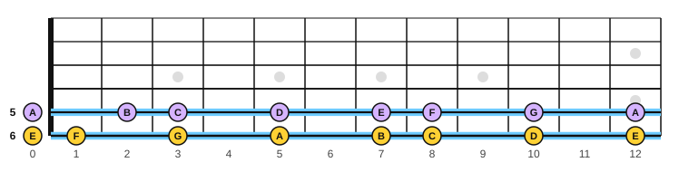
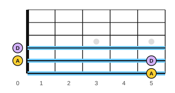

# Notes on strings 6 and 5

<span class="tag tag-guitar">Guitar</span>

After this lesson you can name and play every natural note on strings 6 and 5 from the open string to fret 12, find the octave at fret 12, and use the 5th-fret rule to check your tuning by ear.

Before this: [Whole steps, half steps, sharps and flats](01-whole-and-half-steps.md), [Holding the guitar, tuning and the pick](../01-first-sounds/06-holding-tuning-and-the-pick.md), [Reading guitar tab](../01-first-sounds/11-reading-tab.md). You need: your guitar, a pick and a tuner.

## The idea

### Counting up the neck

You know from lesson 1 that one fret is one half step. So you can find any note on a string by counting half steps up from the open string, remembering that E to F and B to C are the only natural pairs with a single half step between them. String 6 is open E. Fret 1 is F. Fret 2 is F#. Fret 3 is G. Keep counting and you get the whole string.

On string 6 the natural notes (no sharp or flat) are at these frets:

| Fret | 0 | 1 | 3 | 5 | 7 | 8 | 10 | 12 |
|---|---|---|---|---|---|---|---|---|
| Note | E | F | G | A | B | C | D | E |

On string 5, which starts on A:

| Fret | 0 | 2 | 3 | 5 | 7 | 8 | 10 | 12 |
|---|---|---|---|---|---|---|---|---|
| Note | A | B | C | D | E | F | G | A |

The frets that are left out (2, 4, 6, 9, 11 on string 6) are the sharps and flats. The gaps between natural notes are two frets apart, except at E to F and at B to C, where the gap is one fret.



### The octave at fret 12

Play the open string 6, then play fret 12 on the same string. The second note is the same letter, E, and sounds higher by an octave. The fret 12 marker (often a double dot) is where the string length is halved. Fret 12 on string 5 is also A, an octave above the open string. On every string, fret 12 is the open note again, one octave up.

You may notice that the same note appears in more than one place. A (the open string 5) is also string 6 at fret 5. E at string 5, fret 7, is the same E as string 6, fret 12. This is why the same sound can be played in several places on the neck.

### Reading it

Here are the natural notes on each string, going up, as printed guitar music. Listen to each one, and look at the tab to see where the notes are. The tab picks one place for each note, so a note with two places may show on either string. Play the examples on the string named in the text.

Play this on string 6 only:

```abc
%%opts tab=guitar
X:1
M:4/4
L:1/4
Q:1/4=70
K:C clef=treble-8
E, F, G, A, | B, C D E |]
```

And this on string 5 only:

```abc
%%opts tab=guitar
X:1
M:4/4
L:1/4
Q:1/4=70
K:C clef=treble-8
A, B, C D | E F G A |]
```

For the notes at frets 5 and above, move your whole hand up the neck so that your fingers sit over the frets you need. A hand placed so that fingers 1 to 4 cover four frets in a row is in one position. For string 6, put finger 1 on fret 5 for A, finger 3 on fret 7 for B and finger 4 on fret 8 for C. Then shift so that finger 1 is on fret 10 for D, and finger 3 is on fret 12 for E.

Common mistake: moving only one finger far away from the others. Move the whole hand with the thumb behind the neck, so the fingers keep their curve.

Here is a short tune written for this book, on both strings. Count in four and play it at 70 bpm with a down stroke on each note.

```abc
%%opts tab=guitar
X:1
M:4/4
L:1/4
Q:1/4=70
K:C clef=treble-8
E, G, A, G, | E, G, B, A, | A, C D C | A,4 |]
```

### The 5th-fret rule

You can tune the guitar by comparing strings with each other, without a tuner. Put a finger on fret 5 of string 6. It sounds A, the same note as the open string 5. Pluck both together, or one after the other. If one is a little different, you hear a wobble, and the wobble slows down as the two get closer. Adjust the open string 5 until the wobble disappears. This is the **5th-fret rule**.



Then fret 5 of string 5 is D, the open string 4. Fret 5 of string 4 is G, the open string 3. The one exception is string 2: fret 4 of string 3 is B, the open string 2. Fret 5 of string 2 is E, the open string 1. Tune string 6 with a tuner first, then check each string against its thicker neighbour.

As in stage 1, tune up to the note: if a string is too high, lower it below the note and bring it up. Use the tuner to confirm after you tune by ear.

## Try it

Exercise 1. Name the notes at string 6, fret 3 and string 6, fret 8.

<details class="solution" markdown>
<summary>Answer</summary>

Fret 3 is G and fret 8 is C. The count from open E is E, F, F#, G (fret 3), G#, A, A#, B, C (fret 8).

</details>

Exercise 2. Where is the note D on string 5, and where is the same D on string 4?

<details class="solution" markdown>
<summary>Answer</summary>

On string 5 it is at fret 5. On string 4 it is the open string.

</details>

Exercise 3. Fret 7 of string 6 sounds the same pitch as another string and fret. Which?

<details class="solution" markdown>
<summary>Answer</summary>

Fret 7 of string 6 is B, the same as string 5 at fret 2.

</details>

<div class="practice" markdown>

### Practice routine (30 minutes)

| Minutes | What to do | Tempo | Listen for |
|---|---|---|---|
| 5 | Warm-up: tune with the tuner, then check with the 5th-fret rule | Untimed | The wobble slowing and stopping |
| 10 | String 6, frets 0 to 12: play each natural note, saying its name aloud, up and back down | 60 bpm | A clear note after each hand shift |
| 10 | String 5, frets 0 to 12: the same. Then the tune above on both strings | 60 bpm, then 70 | No pause when the hand moves |
| 5 | Piano: C major scale, right hand then left hand | 60 bpm | Even volume across the thumb move |

Repeat this routine on at least three days. For extra practice, use the [Fretboard drill](../practice/fretboard-drill.md).

</div>

<div class="move-on" markdown>

### Move on when

- [ ] You can play any natural note on string 6 or string 5 when you are given its name, within 5 seconds.
- [ ] You can name the note at any of the frets 0, 3, 5, 7, 8, 10 and 12 on both strings in under 15 seconds.
- [ ] You can play the tune above at 70 bpm, three times in a row with no stops.
- [ ] You can tune string 5 against string 6 using fret 5 and say when the wobble stops.

</div>

## Common mistakes

Forgetting the single-fret gaps. E to F and B to C are one fret apart, and all the other natural notes are two frets apart.

Counting from fret 1 as zero. Fret 0 is the open string, and the first fret is one half step above it.

Tuning while the string is above the note, then stopping. Go below the note and come up to it, so the string stays in tune.

## Key terms

- **Natural note**: a note with no sharp or flat (A to G).
- **Octave at fret 12**: the 12th fret plays the open string's note one octave higher.
- **5th-fret rule**: fret 5 of a string sounds the same as the open string next to it (except between strings 3 and 2).
- **Position**: the place on the neck where your four fingers sit over four frets in a row.

Next: [The C, G and D minor chords](06-chords-c-g-and-d-minor.md)
