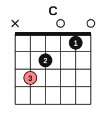
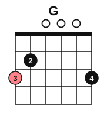
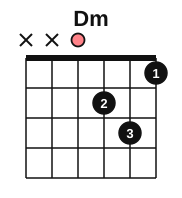

# The C, G and D minor chords

<span class="tag tag-guitar">Guitar</span>

After this lesson you can play the C, G and Dm chords, and change between C and G, G and Em, and Dm and Am, strumming one chord per bar in time.

Before this: [Chord diagrams and your first chord](../01-first-sounds/12-chord-diagrams-and-e-minor.md), [The A minor and D chords](../02-two-hands-and-first-chords/06-chords-a-minor-and-d.md), [Notes on strings 6 and 5](05-notes-on-strings-6-and-5.md). You need: your guitar, a pick and a tuner.

## The idea

### Three more chords

Each chord has a name that says which notes it uses. C major: C, E, G. G major: G, B, D. D minor: D, F, A. Every string that sounds in one of these chords plays one of those three notes, some of them repeated at different heights. Stage 4 explains why one is called major and the other minor. For now, hear that Dm sounds darker than C and G.

### The C chord

The C chord uses strings 5 to 1. String 6 is not played, so it has an x above it.



1. Put finger 3 (ring) on string 5, fret 3. That is the note C, the root of the chord.
2. Put finger 2 (middle) on string 4, fret 2.
3. Put finger 1 (index) on string 2, fret 1.
4. Start the strum on string 5 and let strings 3 and 1 ring open.

Common mistake at step 3: the index finger touching string 1 and muting it. Curve the finger so the tip comes straight down on string 2.

### The G chord

The G chord uses all six strings.



1. Put finger 3 (ring) on string 6, fret 3.
2. Put finger 2 (middle) on string 5, fret 2.
3. Put finger 4 (little) on string 1, fret 3.
4. Strum all six strings. Strings 4, 3 and 2 are open.

Some players use fingers 2, 1 and 3 for the same dots. This book uses 3, 2 and 4, because the middle finger stays on string 5 for the change to Em.

### The Dm chord

The Dm chord uses only the four thinnest strings. Strings 6 and 5 have an x.



1. Put finger 1 (index) on string 1, fret 1.
2. Put finger 2 (middle) on string 3, fret 2.
3. Put finger 3 (ring) on string 2, fret 3.
4. Start the strum on string 4, the open D, and strum down to string 1.

Common mistake at step 4: striking string 5 or 6. Aim your pick at string 4 and let it end below string 1.

Listen to each chord strummed once, with a whole bar to ring. The chords are written an octave above their sounding pitch, as in printed guitar music.

```abc
%%opts tab=guitar
X:1
M:4/4
L:1/4
Q:1/4=60
K:C clef=treble-8
"C"[C E G c e]4 | "G"[G, B, D G B g]4 | "Dm"[D A d f]4 | "Em"[E, B, E G B e]4 |]
```

### Changing between chords

A change is easiest when you look for what stays and what moves. Think of the fingers as a shape, and move the whole shape at once.

From C to G, the ring finger moves from string 5 to string 6 at fret 3, and the middle finger moves from string 4 to string 5 at fret 2. The two-finger shape moves one string toward the thicker strings, and the little finger drops in on string 1.

From G to Em, the middle finger stays on string 5, fret 2. The ring finger moves from string 6, fret 3 to string 4, fret 2, and the little finger lifts. An **anchor finger** is a finger that stays down through a change, and here it is the middle finger.

From Dm to Am (the Am you learned in stage 2), the index finger moves from string 1 to string 2 at fret 1. The other two fingers move to strings 4 and 3 at fret 2. Go slowly: this change moves all three fingers.

Practise each change with the fingers lifting only as far as they need to, close above the strings. In each of these progressions strum one down stroke per bar, count 1 2 3 4, and move your fingers during beats 2 to 4 so the next chord is ready on the next beat 1.

```abc
%%opts tab=guitar
X:1
M:4/4
L:1/4
Q:1/4=60
K:C clef=treble-8
"C"[C E G c e]4 | "G"[G, B, D G B g]4 | "C"[C E G c e]4 | "G"[G, B, D G B g]4 |
"G"[G, B, D G B g]4 | "Em"[E, B, E G B e]4 | "C"[C E G c e]4 | "G"[G, B, D G B g]4 |
"Dm"[D A d f]4 | "Am"[A, E A c e]4 | "Dm"[D A d f]4 | "Am"[A, E A c e]4 |]
```

If the change makes your hand ache, stop and shake it out. Pain in the wrist or the fingers is a stop sign; see a teacher or a doctor if it comes back.

## Try it

Exercise 1. Which strings do you strum for C, for G and for Dm?

<details class="solution" markdown>
<summary>Answer</summary>

C: strings 5 to 1. G: all six strings. Dm: strings 4 to 1.

</details>

Exercise 2. Which finger stays down when you change from G to Em?

<details class="solution" markdown>
<summary>Answer</summary>

The middle finger (finger 2) stays on string 5, fret 2.

</details>

Exercise 3. Name the three notes of Dm.

<details class="solution" markdown>
<summary>Answer</summary>

Dm: D, F, A.

</details>

<div class="practice" markdown>

### Practice routine (30 minutes)

| Minutes | What to do | Tempo | Listen for |
|---|---|---|---|
| 5 | Warm-up: tune, then Em, one strum per bar for 4 bars | 60 bpm | Every string ringing |
| 15 | Place each of C, G and Dm 10 times, plucking each string one at a time. Then C to G, G to Em and Dm to Am, 8 bars each, one strum per bar | 50 bpm, then 60 | The new chord ready on beat 1 |
| 5 | Piano: C major scale, right hand then left hand | 60 bpm | Even notes |
| 5 | Ear: strum C, then G, then Dm, and say which one sounds darkest | Untimed | The Dm sound |

Repeat this routine on at least three days.

</div>

<div class="move-on" markdown>

### Move on when

- [ ] You can place C, G and Dm and have every sounding string ring, ten times in a row for each.
- [ ] You can change C to G and back for 8 bars at 60 bpm with no stops.
- [ ] You can play the progression G, Em, C, G for 8 bars at 60 bpm.
- [ ] You can play Dm, Am, Dm, Am for 8 bars at 60 bpm.

</div>

## Common mistakes

Muting string 1 with the C index finger. Arch the finger so only string 2 is pressed.

Strumming the strings marked x. Start the C strum on string 5, and the Dm strum on string 4.

Lifting all the fingers high for a change. Keep them close to the strings.

## Film yourself

Record 30 seconds from the front, with the fretting hand and the neck in view, while you change between C and G. Check:

- Do the fingers move as a shape, or one at a time?
- Are the fingertips close behind the fret wires?
- Do the fingers stay low above the strings?
- Is the new chord ready on beat 1?

Watch: [Want Fast & Perfect Chord Changes on Guitar?](https://www.youtube.com/watch?v=xSFHgeJUuIs) by JustinGuitar (free, on YouTube).

## Key terms

- **C major** (C): the chord C, E, G.
- **G major** (G): the chord G, B, D.
- **D minor** (Dm): the chord D, F, A.
- **Anchor finger**: a finger that stays down through a chord change.

Next: [Key signatures with sharps](07-sharp-key-signatures.md)
