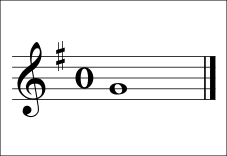
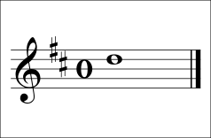
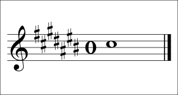

# Key signatures with sharps

<span class="tag tag-theory">Theory</span>

After this lesson you can read a key signature of up to two sharps, say which major key it shows, write the order of sharps, and tell the key of a piece from its signature and its last note.

Before this: [The major scale](02-the-major-scale.md), [Whole steps, half steps, sharps and flats](01-whole-and-half-steps.md), [The treble staff and C position](../01-first-sounds/09-treble-staff-and-c-position.md). You need: your piano.

## The idea

### Sound first: a tune in G

Listen to this tune. It has no sharp signs in front of any note, yet the sound is not C major. It ends on G, and the F in the third bar is played as F#.

```abc
X:1
M:4/4
L:1/4
Q:1/4=70
K:G
G A B c | d2 B2 | c B A f | g4 |]
```

Now look at the staff. At the start of every line, right after the clef, there is one sharp sign on the top line. That sign is the **key signature**. It tells you that every F in the piece, in every octave, is F#, unless a natural sign says otherwise.

### Why key signatures exist

The G major scale needs F#, so a tune in G has an F# wherever an F appears. Without a key signature, the page would be full of sharp signs. The signature puts them once at the start, and the tune stays clean. The key signature tells you which scale the notes come from.



G major has one sharp: F#. The first sharp in the signature is always on F, and it sits on the top line of the treble staff.



D major has two sharps: F# and C#. The second sharp is on C, in the third space from the bottom. Key signatures show the sharps in the same order every time.

### The order of sharps

The order of sharps is F, C, G, D, A, E, B. A key with one sharp has F#. A key with two sharps has F# and C#. A key with three sharps has F#, C# and G#, and so on down the list. A phrase can help you remember it: Father Charles Goes Down And Ends Battle.



| Major key | Sharps | Which |
|---|---|---|
| C | none | none |
| G | one | F# |
| D | two | F#, C# |
| A | three | F#, C#, G# |
| E | four | F#, C#, G#, D# |

Only G major and D major are used in this stage. The others appear in later stages. C major has no sharps or flats. G major has one sharp. D major has two sharps. A major has three sharps. E major has four sharps.

### Finding the key from the signature

The last sharp in the signature is the note a half step below the tonic. For one sharp (F#), the tonic is a half step above: G. For two sharps (F#, C#), the last is C#, and a half step above it is D. So you can name a major key from its signature.

1. Find the last sharp in the signature.
2. Go up a half step from it. That note is the tonic.
3. Look at the music to check. A tune in that key usually ends on the tonic, and often begins on it.

Common mistake at step 2: naming the last sharp as the key. The last sharp is degree 7 of the scale, one half step below the tonic. In D major, C# is degree 7 and D is the key.

The key signature also gives you a place to start. A piece in G major is made of the notes of the G major scale: G, A, B, C, D, E, F#. This is the **key** of the piece: the scale and the tonic that most of the notes come from.

Listen to the D major scale written with its key signature. There are no sharp signs in front of the notes. The signature supplies them.

```abc
X:1
M:4/4
L:1/4
Q:1/4=70
K:D
D E F G | A B c d |]
```

The notes are D, E, F#, G, A, B, C#, D. The F and the c in the music are F# and C# because the signature says so.

## Try it

Exercise 1. Write the sharps in the key signature of D major, in order.

<details class="solution" markdown>
<summary>Answer</summary>

F# then C#. D major has two sharps.

</details>

Exercise 2. A piece has one sharp in its signature and its last note is G. What is the key, and which note in the music is played sharp?

<details class="solution" markdown>
<summary>Answer</summary>

G major. Every F is played as F#.

</details>

Exercise 3. A piece has the signature F#, C#, G# (three sharps). What is its tonic? Use the half-step rule.

<details class="solution" markdown>
<summary>Answer</summary>

The last sharp is G#. A half step above it is A, so the key is A major. A major has three sharps.

</details>

<div class="practice" markdown>

### Practice routine (30 minutes)

| Minutes | What to do | Tempo | Listen for |
|---|---|---|---|
| 5 | Warm-up: C major scale, each hand, with the fingering from lesson 3 | 60 bpm | Even notes |
| 10 | Piano: play the G major scale right hand from G4 and the D major scale right hand from D4, any fingering for now, and find the sharps by the pattern W W H W W W H | 60 bpm | The F# and C# landing where the pattern says |
| 10 | Reading: play the tunes in the two examples above, right hand, reading the key signature (not the note names) | 60 bpm | Playing F# every time without a sharp sign |
| 5 | Guitar: C, G and Em chords, one strum per bar | 60 bpm | Clean changes |

Repeat this routine on at least three days. Say the order of sharps aloud each day.

</div>

<div class="move-on" markdown>

### Move on when

- [ ] You can write the order of sharps F C G D A E B from memory, and say which key has one, two, three and four sharps.
- [ ] You can name the key from a signature of one or two sharps in under 5 seconds.
- [ ] You can play the G major tune above at 70 bpm, three times in a row with no stops and with every F sharp.
- [ ] You can say why the last sharp is not the tonic.

</div>

## Common mistakes

Playing F natural in G major because no sharp sign is in front of the note. The signature covers the whole piece.

Putting the second sharp on the wrong line or space. Learn the shape from the figure: F on the top line, then C in the third space.

Naming the last sharp as the key. The key is a half step above it.

## Key terms

- **Key signature**: the sharps or flats at the start of each line, after the clef, that apply to the whole piece.
- **Key** (of a piece): the scale, and its tonic, that most of the notes come from.
- **Order of sharps**: F, C, G, D, A, E, B.

Next: [The G and D major scales](08-g-and-d-major-scales.md)
