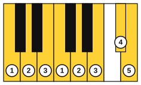
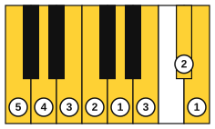
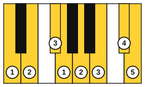
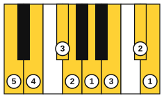

# The G and D major scales

<span class="tag tag-piano">Piano</span>

After this lesson you can play the G and D major scales one octave with each hand alone, and the C, G and D major scales for two octaves, with the standard fingering.

Before this: [The C major scale and thumb-under](03-c-major-scale-and-thumb-under.md), [Key signatures with sharps](07-sharp-key-signatures.md). You need: your piano.

## The idea

### The same fingering, new black keys

The G major scale: G, A, B, C, D, E, F#, G. The D major scale: D, E, F#, G, A, B, C#, D. Both use the same finger numbers as C major. The right hand goes 1 2 3 1 2 3 4 5 and the left hand goes 5 4 3 2 1 3 2 1. The thumb-under and finger-over moves happen in the same places in the scale, though the hand now meets black keys.

What changes is that the hand now meets black keys. Fingers 3 and 4 are the longest, and they reach onto the black keys while the others stay on the white keys. Keep the wrist level and let the fingers do the reaching.

### The G major scale

The right hand starts with the thumb on G4. The F# is the seventh note, and finger 4 plays it.



The left hand starts with finger 5 on G3. Fingers 5 4 3 2 1 play G, A, B, C and D, then finger 3 crosses over for E, finger 2 plays F# and the thumb plays G.



Listen to the right hand first, then the left hand. The key signature supplies the F#, so there is no sharp sign in front of the F.

```abc
X:1
M:4/4
L:1/4
Q:1/4=60
K:G
!1!G !2!A !3!B !1!c | !2!d !3!e !4!f !5!g | !5!g !4!f !3!e !2!d | !1!c !3!B !2!A !1!G |]
```

```abc
X:1
M:4/4
L:1/4
Q:1/4=60
K:G clef=bass
!5!G, !4!A, !3!B, !2!C | !1!D !3!E !2!F !1!G | !1!G !2!F !3!E !1!D | !2!C !3!B, !4!A, !5!G, |]
```

### The D major scale

The right hand starts with the thumb on D4. There are two black keys, F# (finger 3) and C# (finger 4).



The left hand starts with finger 5 on D3. The F# is played by finger 3 and the C# by finger 2.



```abc
X:1
M:4/4
L:1/4
Q:1/4=60
K:D
!1!D !2!E !3!F !1!G | !2!A !3!B !4!c !5!d | !5!d !4!c !3!B !2!A | !1!G !3!F !2!E !1!D |]
```

```abc
X:1
M:4/4
L:1/4
Q:1/4=60
K:D clef=bass
!5!D, !4!E, !3!F, !2!G, | !1!A, !3!B, !2!C !1!D | !1!D !2!C !3!B, !1!A, | !2!G, !3!F, !4!E, !5!D, |]
```

Common mistake: playing a black key with the tip of the finger flat and far in, which makes the finger slide off. Curve the finger so the tip lands on the key's front edge.

### Two octaves

A two-octave scale is the one-octave pattern twice. The right hand goes 1 2 3 1 2 3 4, then 1 2 3 1 2 3 4, then 5 on the top note. The thumb passes under after every third finger. The left hand goes 5 4 3 2 1 3 2 1, then 4 3 2 1 3 2 1. Both patterns work for C, G and D, using the same finger numbers on different keys. Listen to the right hand going up two octaves in C, one note per beat.

```abc
X:1
M:4/4
L:1/4
Q:1/4=60
K:C
!1!C !2!D !3!E !1!F | !2!G !3!A !4!B !1!c | !2!d !3!e !1!f !2!g | !3!a !4!b !5!c'2 |]
```

The thumb plays C, F, C and F, and finger 4 sits just before each thumb move. For G and D, keep the same finger numbers on the new keys.

Play the two-octave scales with each hand alone. Playing them hands together comes in Scales and arpeggios hands together<!-- link: ../08-fretboard-barre-chords-and-caged/09-scales-and-arpeggios-hands-together.md -->. If a hand or wrist aches, stop and rest.

## Try it

Exercise 1. Which finger plays the F# in the right-hand G major scale, and which plays it in the left-hand G major scale?

<details class="solution" markdown>
<summary>Answer</summary>

Finger 4 in the right hand and finger 2 in the left hand.

</details>

Exercise 2. How many sharps does the key signature of D major have, and which keys do they appear on in the right-hand scale?

<details class="solution" markdown>
<summary>Answer</summary>

D major has two sharps, F# and C#. In the right-hand scale they are the third and seventh notes, played by fingers 3 and 4.

</details>

Exercise 3. At 60 bpm, with one note per beat, how long does a two-octave scale of 15 notes take going up?

<details class="solution" markdown>
<summary>Answer</summary>

15 beats at one beat per second is 15 seconds.

</details>

<div class="practice" markdown>

### Practice routine (30 minutes)

| Minutes | What to do | Tempo | Listen for |
|---|---|---|---|
| 5 | Warm-up: C major scale, one octave, each hand alone | 60 bpm | Even notes |
| 15 | G major, right hand then left hand, 4 times each. Then D major the same. Then one two-octave C major, right hand | 50 bpm, then 60 | An even sound across every black key |
| 5 | Reading: the tunes in the examples above, hands separately | 60 bpm | Playing the key-signature sharps without a sign |
| 5 | Guitar: C, G and Dm chords, one strum per bar | 60 bpm | Every sounding string ringing |

Repeat this routine on at least three days.

</div>

<div class="move-on" markdown>

### Move on when

- [ ] You can play the G major scale up and down, each hand alone, three times in a row at 60 bpm with no stops.
- [ ] You can play the D major scale up and down, each hand alone, three times in a row at 60 bpm with no stops.
- [ ] You can play the C major scale for two octaves with the right hand at 60 bpm, one note per beat, without a stop.
- [ ] You can say the right-hand and left-hand fingering for G and D from memory.

</div>

## Common mistakes

Using the wrong finger on the black keys. Check the figures: in G major the right hand plays F# with finger 4, and in D major it plays F# with finger 3 and C# with finger 4.

Tipping the hand to reach a black key. Keep the wrist level and let the finger reach.

Rushing the second octave. Keep one note per beat and the same volume.

## Key terms

- **Two-octave scale**: a scale that runs for two octaves and 15 notes.

Next: [Flat keys and the circle of fifths](09-flat-keys-and-the-circle-of-fifths.md)
