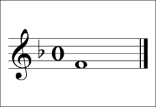
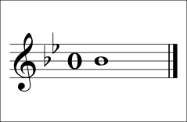
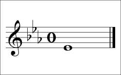
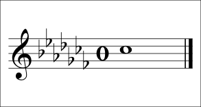
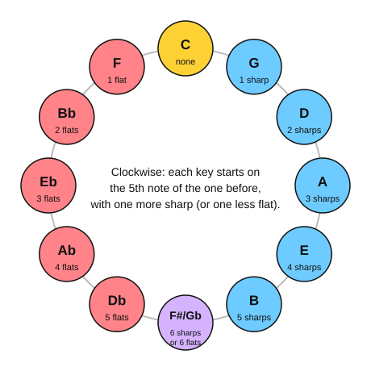

# Flat keys and the circle of fifths

<span class="tag tag-theory">Theory</span>

After this lesson you can read a key signature of one, two or three flats, write the order of flats, find the key from any signature in this lesson and the last one, and read the circle of fifths.

Before this: [The major scale](02-the-major-scale.md), [Key signatures with sharps](07-sharp-key-signatures.md). You need: your piano.

## The idea

### Sound first: a scale that needs a flat

Lesson 2 built the F major scale: F, G, A, Bb, C, D, E, F. Play it on the piano starting on F4, using Bb, the black key just below B, for the fourth note. It sounds like the C scale moved up, which is what the pattern W W H W W W H gives.

```abc
X:1
M:4/4
L:1/4
Q:1/4=70
K:F
F G A B | c d e f |]
```

There are no flat signs in front of the notes in the music. The key signature at the start has one flat, and it covers every B.

### Flat key signatures

Key signatures with flats work like those with sharps. The flats are written in a fixed order, and a key with more flats uses more of the list. The order of flats is B, E, A, D, G, C, F. It is the order of sharps read backwards. A phrase for it is Battle Ends And Down Goes Charles's Father.



F major has one flat. The flat is Bb, on the middle line of the treble staff.



Bb major has two flats: Bb and Eb. The Bb major scale: Bb, C, D, Eb, F, G, A, Bb.



Eb major has three flats: Bb, Eb and Ab. The Eb major scale: Eb, F, G, Ab, Bb, C, D, Eb.



Listen to a short scale in each of the two new flat keys. The first is Bb major and the second is Eb major.

```abc
X:1
M:4/4
L:1/4
Q:1/4=70
K:Bb
B c d e | f g a b |]
```

```abc
X:1
M:4/4
L:1/4
Q:1/4=70
K:Eb
E F G A | B c d e |]
```

### Finding a flat key from its signature

With sharps, the key is a half step above the last sharp. With flats, there is an easy rule: the key is the second-to-last flat in the signature. In the signature Bb, Eb, the second-to-last flat is Bb, and the key is Bb major. With Bb, Eb, Ab, the second-to-last flat is Eb, and the key is Eb major. A signature of one flat is the exception, and it is F major.

| Major key | Flats | Which |
|---|---|---|
| F | one | Bb |
| Bb | two | Bb, Eb |
| Eb | three | Bb, Eb, Ab |
| Ab | four | Bb, Eb, Ab, Db |

F major has one flat. Bb major has two flats. Eb major has three flats. Ab major has four flats.

Common mistake: naming the last flat as the key. In the signature Bb, Eb, Ab the last flat is Ab, and the key is Eb.

### The circle of fifths

Look at the keys you have met: C, G, D, F, Bb, Eb. G starts on degree 5 of C major (C, D, E, F, G), and D starts on degree 5 of G major. Going the other way, F is degree 4 of C major, and Bb is degree 4 of F major. Each step up to degree 5 adds one sharp, and each step to degree 4 adds one flat.

Arrange the twelve major keys in a circle with C at the top. Going clockwise, each key starts on the fifth note of the key before it, and has one more sharp (or one fewer flat). Going anticlockwise, each key starts on degree 4 of the key before and has one more flat. This is the **circle of fifths**.



Here are the counts. G major has one sharp. D major has two sharps. A major has three sharps. E major has four sharps. B major has five sharps. F# major has six sharps. Gb major has six flats. Db major has five flats. Ab major has four flats. Eb major has three flats. Bb major has two flats. F major has one flat. C major has no sharps or flats.

Use the circle to find a key from a signature. Count the sharps or flats and go that many steps from C, clockwise for sharps and anticlockwise for flats. Two flats: two steps anticlockwise, which is Bb. Three sharps: three steps clockwise, which is A.

## Try it

Exercise 1. Name the key with the signature Bb, Eb, Ab.

<details class="solution" markdown>
<summary>Answer</summary>

Eb major. The second-to-last flat is Eb. On the circle, three steps anticlockwise from C is Eb.

</details>

Exercise 2. Name the flats in the signature of Bb major, in order.

<details class="solution" markdown>
<summary>Answer</summary>

Bb, then Eb.

</details>

Exercise 3. Use the circle: which key has four sharps, and which key has four flats?

<details class="solution" markdown>
<summary>Answer</summary>

E major has four sharps. Ab major has four flats.

</details>

<div class="practice" markdown>

### Practice routine (30 minutes)

| Minutes | What to do | Tempo | Listen for |
|---|---|---|---|
| 5 | Warm-up: G and D major scales, right hand, one octave | 60 bpm | Even notes across the black keys |
| 10 | Piano: play the F major scale from F4, right hand with fingering 1 2 3 4 1 2 3 4. Then find the Bb major and Eb major scales by the pattern W W H W W W H, any fingering, one hand | 60 bpm | The half steps landing at 3 to 4 and 7 to 8 |
| 10 | Theory: write the order of sharps and the order of flats from memory, then draw the circle of fifths with the sharps and flats counts and check it against the figure | Untimed | Whether you reach 12 keys without a gap |
| 5 | Guitar: C, G, Dm and Em, one strum per bar, 8 bars | 60 bpm | Every string ringing |

Repeat this routine on at least three days.

</div>

<div class="move-on" markdown>

### Move on when

- [ ] You can write the order of flats B E A D G C F and the order of sharps F C G D A E B from memory.
- [ ] You can name the key from a signature of up to three sharps or up to three flats in under 5 seconds.
- [ ] You can draw the circle of fifths from memory with C at the top and the numbers of sharps and flats.
- [ ] You can play the F major scale with the right hand at 60 bpm, three times in a row with no stops.

</div>

## Common mistakes

Naming the last flat as the key. The key is the second-to-last flat.

Writing A# for Bb in a flat key. A scale uses each letter once, so F major has Bb and no A#.

Going the wrong way round the circle. Clockwise adds sharps and anticlockwise adds flats.

## Key terms

- **Order of flats**: B, E, A, D, G, C, F.
- **Circle of fifths**: the twelve major keys in a circle; clockwise, each key starts on the fifth note of the one before and has one more sharp.

Next: [Minuet in G](10-minuet-in-g.md)
