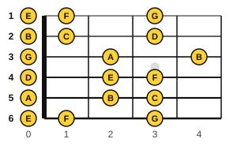

# Reading notation on guitar

<span class="tag tag-guitar">Guitar</span>

After this lesson you can read guitar music on the staff with the 8 under the clef, find the first-position notes on all six strings, and play a short melody from the staff, using the tab underneath to check.

Before this: [Reading guitar tab](../01-first-sounds/11-reading-tab.md), [The treble staff and C position](../01-first-sounds/09-treble-staff-and-c-position.md), [Notes on strings 6 and 5](05-notes-on-strings-6-and-5.md). You need: your guitar, a pick and a tuner.

## The idea

### Why the guitar staff looks an octave too high

Guitar music is printed in the treble clef, but the guitar sounds an octave lower than the notes look. A written E4 is played on the guitar and sounds E3. The reason is practical: the lowest guitar string is E2, far below the treble staff, and writing it where it sounds would need many ledger lines.

To show this, a guitar part uses the treble clef with a small **8** under it. The 8 says: play an octave lower than written. In this book, the open strings are written E3, A3, D4, G4, B4 and E5, and they sound E2, A2, D3, G3, B3 and E4.

```abc
%%opts tab=guitar
X:1
M:4/4
L:1/4
Q:1/4=70
K:C clef=treble-8
E, A, D G | B e B G |]
```

The tab under the staff shows a 0 on each of the six strings in turn, because every note here is an open string. The staff and the tab show the same notes. The staff gives the written pitch, which is an octave above the sound.

### First position

The first position is the hand placement over frets 1 to 4, with finger 1 on fret 1, finger 2 on fret 2, finger 3 on fret 3 and finger 4 on fret 4. Most of the first notes you read are here, and the open strings too. A note that you can play at fret 0 to fret 4 is in first position.



| String | Open | Fret | Notes in first position |
|---|---|---|---|
| 1 | E | 0, 1, 3 | E, F, G |
| 2 | B | 0, 1, 3 | B, C, D |
| 3 | G | 0, 2, 4 | G, A, B |
| 4 | D | 0, 2, 3 | D, E, F |
| 5 | A | 0, 2, 3 | A, B, C |
| 6 | E | 0, 1, 3 | E, F, G |

The fret numbers above are for the natural notes only. The frets between them (such as fret 2 on string 1) are sharps and flats from lesson 1.

### Written notes on the staff

Written, the first-position naturals run from a low E, far below the staff, to a G above it.

| String | Written notes (low to high) |
|---|---|
| 6 | E3 F3 G3 |
| 5 | A3 B3 C4 |
| 4 | D4 E4 F4 |
| 3 | G4 A4 B4 |
| 2 | B4 C5 D5 |
| 1 | E5 F5 G5 |

Strings 4 to 1 are in or near the staff. Strings 6 and 5 use ledger lines below the staff: C4 is the middle C of lesson 9 and sits on its own ledger line. If you cannot name a low note, count down from C4 on the ledger line, then check it in the tab.

### Strings 1 to 3 first

Start with the three thinnest strings. These melodies sit on the staff and need no ledger lines. First Ode to Joy (Beethoven), then Mary Had a Little Lamb (traditional). Read the staff, then check each note in the tab.

```abc
%%opts tab=guitar
X:1
M:4/4
L:1/4
Q:1/4=70
K:C clef=treble-8
e e f g | g f e d | c c d e | e3/2 d/ d2 |]
```

```abc
%%opts tab=guitar
X:1
M:4/4
L:1/4
Q:1/4=70
K:C clef=treble-8
e d c d | e e e2 | d d d2 | e g g2 |]
```

### Strings 4 to 6

Now add the thick strings. This melody, written for the book, uses strings 4, 5 and 6 with ledger lines at the start. Name the notes first, then play it.

```abc
%%opts tab=guitar
X:1
M:4/4
L:1/4
Q:1/4=70
K:C clef=treble-8
E, F, G, F, | E, A, B, A, | D E F E | D4 |]
```

Follow these steps for any new line.

1. Look at the clef and the 8. This is guitar music, so the notes sound an octave lower than they look.
2. Find the time signature and count one bar aloud.
3. Name the first note, then find it on the neck: string first, then fret.
4. Read the shape of the line: up, down or repeated.
5. Play slowly. Look at the staff for the rhythm and at the tab only when a note is lost.

Common mistake at step 5: reading only the tab. Tab shows the fret and does not show the rhythm. Use the staff for the beat and the tab to find the place.

## Try it

Exercise 1. A note is written on the bottom line of the treble staff. Which string and fret play it in first position?

<details class="solution" markdown>
<summary>Answer</summary>

The bottom line is a written E4, which sounds E3. In first position that is string 4, fret 2 (the open D plus a whole step).

</details>

Exercise 2. What does the small 8 under the treble clef mean?

<details class="solution" markdown>
<summary>Answer</summary>

The music sounds an octave lower than it is written.

</details>

Exercise 3. Name the written notes of the open strings 3, 2 and 1.

<details class="solution" markdown>
<summary>Answer</summary>

G4, B4 and E5 (they sound G3, B3 and E4).

</details>

<div class="practice" markdown>

### Practice routine (30 minutes)

| Minutes | What to do | Tempo | Listen for |
|---|---|---|---|
| 5 | Warm-up: open strings 6 to 1, each with a down stroke, then C, G and Dm chords | 60 bpm | Clear notes |
| 10 | Read: Ode to Joy and Mary Had a Little Lamb from the staff, with the tab covered on the second play | 60 bpm | Finding each note from the staff |
| 10 | Read: the strings 4 to 6 melody. Name every note aloud, then play | 60 bpm | The notes in the right place on the neck |
| 5 | Piano: G major scale, right hand | 60 bpm | Even notes |

Repeat this routine on at least three days.

</div>

<div class="move-on" markdown>

### Move on when

- [ ] You can explain what the 8 under the clef means.
- [ ] You can name any first-position note from the staff in under 5 seconds and say its string and fret.
- [ ] You can play Ode to Joy from the staff with the tab covered, at 70 bpm, three times in a row.
- [ ] You can play the strings 4 to 6 melody at 60 bpm without stopping.

</div>

## Common mistakes

Reading the notes as piano notes. The guitar sounds an octave lower than the staff shows.

Reading only the tab. Use the staff for the rhythm.

Mixing up the strings at the ledger lines. Count down from middle C on its ledger line.

## Key terms

- **Treble clef with an 8 below** (guitar clef): the treble clef used for guitar. The music sounds an octave lower than written.
- **First position**: the hand placement over frets 1 to 4.
- **Written pitch**: the pitch the staff shows, as against the sounding pitch.

Next: [First tunes by ear](12-first-tunes-by-ear.md)
