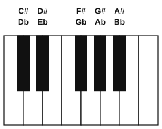
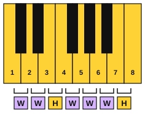
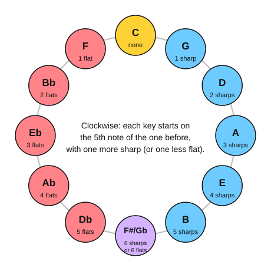
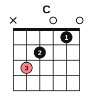
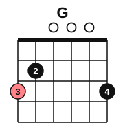
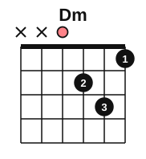

# Stage 3: The major scale and keys

This stage explains how the major scale is built and puts it to work. You learn half steps, whole steps, sharps and flats, then the pattern of the major scale, key signatures and the circle of fifths. On the piano you play the C, G and D major scales and your first classical piece, the Minuet in G. On the guitar you learn the notes on strings 6 and 5, the C, G and Dm chords, and how to read notation. You also sing the scale by number and work out simple tunes by ear. It usually takes about 5 to 7 weeks at 30 minutes a day.

<!-- lessons:start -->
## Lessons

1. [Whole steps, half steps, sharps and flats](01-whole-and-half-steps.md) (theory)
2. [The major scale](02-the-major-scale.md) (theory)
3. [The C major scale and thumb-under](03-c-major-scale-and-thumb-under.md) (piano)
4. [Singing the scale by number](04-singing-the-scale-by-number.md) (ear)
5. [Notes on strings 6 and 5](05-notes-on-strings-6-and-5.md) (guitar)
6. [The C, G and D minor chords](06-chords-c-g-and-d-minor.md) (guitar)
7. [Key signatures with sharps](07-sharp-key-signatures.md) (theory)
8. [The G and D major scales](08-g-and-d-major-scales.md) (piano)
9. [Flat keys and the circle of fifths](09-flat-keys-and-the-circle-of-fifths.md) (theory)
10. [Minuet in G](10-minuet-in-g.md) (piano)
11. [Reading notation on guitar](11-reading-notation-on-guitar.md) (guitar)
12. [First tunes by ear](12-first-tunes-by-ear.md) (ear)

<!-- lessons:end -->

Download the stage 3 deck: [03-the-major-scale-and-keys.apkg](../downloads/anki/03-the-major-scale-and-keys.apkg)

## Cheat sheet

Everything to remember from this stage, on one page.

### Steps, sharps and flats

- Half step (semitone): the next key or the next fret. Whole step (tone): two half steps.
- E to F and B to C are the only half steps between natural notes.
- Sharp (#) raises a half step, flat (b) lowers a half step, natural sign cancels. An accidental lasts to the end of the bar.
- Enharmonic: one key, two names (F# and Gb).

### The major scale

The pattern is W W H W W W H. Degrees are numbered 1 to 7, then 8 (the octave). Degree 1 is the tonic.

| Scale | Notes |
|---|---|
| C major | C, D, E, F, G, A, B, C |
| G major | G, A, B, C, D, E, F#, G |
| D major | D, E, F#, G, A, B, C#, D |
| F major | F, G, A, Bb, C, D, E, F |

Fingering for one octave going up: right hand 1 2 3 1 2 3 4 5, left hand 5 4 3 2 1 3 2 1 (C, G and D). Going down, each hand plays the other hand's pattern.

### Key signatures

- Order of sharps: F C G D A E B. Order of flats: B E A D G C F.
- With sharps, the key is a half step above the last sharp. With flats, the key is the second-to-last flat (F major has one flat).

| Key | Signature |
|---|---|
| C major | none |
| G major | 1 sharp (F#) |
| D major | 2 sharps (F#, C#) |
| F major | 1 flat (Bb) |
| Bb major | 2 flats (Bb, Eb) |
| Eb major | 3 flats (Bb, Eb, Ab) |

### The circle of fifths

Clockwise from C: G, D, A, E, B, F#/Gb. Anticlockwise from C: F, Bb, Eb, Ab, Db.

### Guitar: strings 6 and 5

| String | Fret 0 | 1 | 2 | 3 | 5 | 7 | 8 | 10 | 12 |
|---|---|---|---|---|---|---|---|---|---|
| 6 | E | F | F# | G | A | B | C | D | E |
| 5 | A | A# | B | C | D | E | F | G | A |

Fret 12 is the open string an octave up. 5th-fret rule: fret 5 of a string sounds like the next open string (for string 2, use fret 4 of string 3).

### Chords

C major: C, E, G. G major: G, B, D. D minor: D, F, A.

Strum C on strings 5 to 1, G on strings 6 to 1, Dm on strings 4 to 1. Changes: C to G (the shape moves one string), G to Em (the middle finger stays), Dm to Am.

### Reading and ear

- Guitar music is written an octave above the sound (the 8 under the clef).
- A step moves to the next scale note. A leap skips at least one.
- Sing tunes by number: Twinkle is 1 1 5 5 6 6 5. The tonic is home.
