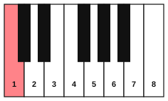

# Interval numbers

<span class="tag tag-theory">Theory</span>

After this lesson you can name the number of any interval within an octave on the staff, tell a harmonic interval from a melodic one, and call a melodic move a step or a skip.

Before this: [Pitch and the musical alphabet](../01-first-sounds/04-pitch-and-the-musical-alphabet.md), [The treble staff and C position](../01-first-sounds/09-treble-staff-and-c-position.md), [Whole steps, half steps, sharps and flats](../03-the-major-scale-and-keys/01-whole-and-half-steps.md). You need: your piano and your guitar.

## The idea

### Sound first: two notes

Play middle C and then the G above it, one after the other. Now play the same two keys together. You hear the same pair of notes in two ways: a move from one pitch to another, and a single blended sound.

The distance between two notes is an **interval**. When the notes sound one after the other, it is a **melodic interval**, and a melody is made of them. When the notes sound together, it is a **harmonic interval**, and chords are made of them. Every interval has a number and, from the next lesson on, a quality (major, minor, perfect and so on). This lesson is about the number.

### Counting the number

To find the number of an interval, count the letter names from the lower note to the upper note, and count both ends. From C up to G the letters are C, D, E, F, G. That is 5 letters, so the interval is a **5th**.



The figure counts every white key up from C. The names are 2nd, 3rd, 4th, 5th, 6th and 7th. The interval from C up to the next C is an **octave**, from the Latin for eight. Two notes with the same pitch make a **unison**, which is a 1.

The number counts letters and ignores sharps and flats. C up to E and C up to Eb are both 3rds, because both span C, D, E. The sharp or flat changes the size inside the 3rd, and the next lesson shows how.

Listen to the intervals above C, each played melodically. The notes get further apart, and you can hear the second note moving away from the first.

```abc
X:1
M:2/4
L:1/4
Q:1/4=60
K:C
C D | C E | C F | C G | C A | C B | C c |]
```

Now the same distances played harmonically. The 2nd sounds rough, and the 5th and the octave sound open.

```abc
X:1
M:2/4
L:1/4
Q:1/4=60
K:C
[CD]2 | [CE]2 | [CF]2 | [CG]2 | [CA]2 | [CB]2 | [Cc]2 |]
```

### Reading the number on the staff

You do not need to count letters aloud every time. On the staff, a 2nd is a line and the next space, or a space and the next line. A 3rd is line to line, or space to space, with one line or space skipped between. This gives a quick test.

- Both notes on lines, or both in spaces: an odd number (3rd, 5th, 7th).
- One on a line and one in a space: an even number (2nd, 4th, 6th, octave).

Check it on the staff: E4 is on line 1 and G4 is on line 2, so E up to G is a 3rd. E4 and A4 are on line 1 and in space 2, so E up to A is a 4th. Use the test as a check on your counting, and count letters when you are unsure.

### Steps and skips

In a melody, a move to the next letter name is a **step**. It is a 2nd, and on the staff it goes from a line to the next space or the other way. A move that jumps over one letter name is a **skip**. It is a 3rd, and on the staff it goes line to line or space to space. A move larger than a 3rd is a leap, and [Reading by intervals](10-reading-by-intervals.md) uses all three words to read music faster.

A "step" here means the next letter name, whatever its size. E to F is a step, and so is C to D. The next lesson shows that these two steps are different sizes.

Listen to a melody made of steps, then one made of skips.

```abc
X:1
M:4/4
L:1/4
Q:1/4=60
K:C
C D E F | E D C2 |]
```

```abc
X:1
M:4/4
L:1/4
Q:1/4=60
K:C
C E G E | C E G2 |]
```

### Intervals on the guitar

Two strings next to each other are tuned to a fixed interval. Strings 6 and 5 are E and A, and E, F, G, A is 4 letters, a 4th. Strings 5 and 4 are A and D, a 4th. Strings 4 and 3 are D and G, a 4th. Strings 3 and 2 are G and B, and G, A, B is 3 letters, a 3rd. Strings 2 and 1 are B and E, a 4th. Only one pair is a 3rd, and that is why many shapes shift by one fret when they cross strings 3 and 2.

## Try it

Exercise 1. Name the number of each interval, played melodically from the first note to the second.

```abc
X:1
M:2/4
L:1/4
K:C
C F | D A | E G | G c |
B d | F f |]
```

<details class="solution" markdown>
<summary>Answer</summary>

C to F is a 4th, D to A is a 5th, E to G is a 3rd, G to C is a 4th, B to D is a 3rd, and F to F is an octave.

</details>

Exercise 2. Write the letter name of the note a 3rd above E, a 5th above D, a 4th above B and a 6th above G (all going up).

<details class="solution" markdown>
<summary>Answer</summary>

A 3rd above E is G (E, F, G). A 5th above D is A (D, E, F, G, A). A 4th above B is E (B, C, D, E). A 6th above G is E (G, A, B, C, D, E).

</details>

Exercise 3. The open strings 4 and 2 of the guitar are D and B. What is the interval number from the lower to the higher?

<details class="solution" markdown>
<summary>Answer</summary>

D, E, F, G, A, B is 6 letters, so it is a 6th.

</details>

<div class="practice" markdown>

### Practice routine (30 minutes)

| Minutes | What to do | Tempo | Listen for |
|---|---|---|---|
| 5 | Warm-up: five-finger pattern C D E F G and back, each hand alone | 60 bpm | The same volume on every finger |
| 15 | New skill: play the melodic intervals above C from the first example, saying each number aloud ("C to F, a 4th"); then pick any white key and play a 3rd, a 4th and a 5th above it | 60 bpm | The notes get further apart as the number grows |
| 5 | Reading: the [reading drill](../practice/reading-drill.md); for each pair of notes shown, say the interval number | Untimed | Using the line and space test as a check |
| 5 | Guitar: play the open strings 6 and 5 together, then 5 and 4, 4 and 3, 3 and 2, 2 and 1, saying "4th, 4th, 4th, 3rd, 4th" | 60 bpm | The 3rd (strings 3 and 2) sounds different from the 4ths |

Repeat this routine on at least three days.

</div>

<div class="move-on" markdown>

### Move on when

- [ ] You can name the number of 10 intervals on the staff in under 60 seconds with at most one error.
- [ ] You can say the line and space test for odd and even numbers without looking.
- [ ] You can say the interval between each pair of neighbouring open guitar strings.
- [ ] You can label each move of a short melody as a step or a skip.

</div>

## Common mistakes

Counting from zero, so that C to E becomes a "2nd". Count the lower note as 1: C is 1, D is 2, E is 3.

Counting keys on the piano instead of letter names. The black keys between do not count in the number. C to E has one white key between, but it is a 3rd.

Changing the number when a sharp or flat appears. C to E and C to Eb are both 3rds. Only the quality changes.

## Key terms

- **Interval**: the distance between two notes, named by a number and a quality.
- **Melodic interval**: two notes played one after the other.
- **Harmonic interval**: two notes played together.
- **Unison**: two notes with the same pitch (an interval of 1).
- **Octave**: the interval of 8, from one note to the next note with the same letter name.
- **Step**: a melodic move to the next letter name (a 2nd).
- **Skip**: a melodic move over one letter name (a 3rd).

Next: [Interval qualities](02-interval-qualities.md)
