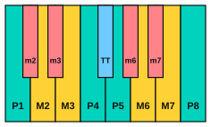

# Interval qualities

<span class="tag tag-theory">Theory</span>

After this lesson you can name an interval fully (for example "a minor 3rd" or "a perfect 5th"), count its half steps, and write the note above or below a given note for any interval up to an octave.

Before this: [Interval numbers](01-interval-numbers.md), [Whole steps, half steps, sharps and flats](../03-the-major-scale-and-keys/01-whole-and-half-steps.md), [The major scale](../03-the-major-scale-and-keys/02-the-major-scale.md). You need: your piano and your guitar.

## The idea

### Sound first: two 3rds

Play C and E together, then C and Eb together (Eb is the black key to the left of E). Both are 3rds, because both span the letters C, D, E. But the first sounds bright and the second sounds darker, and the notes are not the same distance apart.

```abc
X:1
M:2/4
L:1/4
Q:1/4=60
K:C
C E | C _E | [CE]2 | [C_E]2 |]
```

The number tells you how many letters the interval spans. The **quality** tells you its exact size, counted in half steps. A **half step** (semitone) is the distance from one key to the next key on the piano, black or white. From C to E is 4 half steps (C, C#, D, D#, E: four moves). From C to Eb is 3 half steps. The bigger one is a **major 3rd** and the smaller one is a **minor 3rd**.

C up to E is a major 3rd. C up to Eb is a minor 3rd.

### The five qualities

Five words describe the size of an interval.

- **Major** and **minor** apply to 2nds, 3rds, 6ths and 7ths. The minor interval is a half step smaller than the major one.
- **Perfect** applies to unisons, 4ths, 5ths and octaves. There is one size of each.
- **Augmented** means a half step larger than major or perfect.
- **Diminished** means a half step smaller than minor or perfect.

So a major 3rd (4 half steps) made one half step smaller is a minor 3rd (3). A perfect 5th (7) made one half step larger is an augmented 5th (8), and one half step smaller is a diminished 5th (6).

### The half steps above C

Every interval from C up to the C above, with its size in half steps. Play each one while you read the row.

| Name | Half steps | Example |
|---|---|---|
| Perfect unison | 0 | C up to C |
| Minor 2nd | 1 | C up to Db |
| Major 2nd | 2 | C up to D |
| Minor 3rd | 3 | C up to Eb |
| Major 3rd | 4 | C up to E |
| Perfect 4th | 5 | C up to F |
| Augmented 4th or diminished 5th | 6 | C up to F# or Gb |
| Perfect 5th | 7 | C up to G |
| Minor 6th | 8 | C up to Ab |
| Major 6th | 9 | C up to A |
| Minor 7th | 10 | C up to Bb |
| Major 7th | 11 | C up to B |
| Perfect octave | 12 | C up to C |



In the figure, teal keys are perfect intervals, yellow keys are major, salmon keys are minor, and blue is the 6-half-step interval, which has two names: an augmented 4th (C up to F#) or a diminished 5th (C up to Gb). It sounds the same either way; the letters decide the name. the lesson [Hearing intervals 2](../08-fretboard-barre-chords-and-caged/12-hearing-intervals-2.md) in stage 8 teaches its sound, called the tritone.

Notice the two kinds of 2nd. E up to F is a minor 2nd (1 half step) and C up to D is a major 2nd (2 half steps). Both are steps, which is the word from the last lesson. A step can be a half step or a whole step.

Here is every interval above C, one bar each, from the minor 2nd up to the octave.

```abc
X:1
M:2/4
L:1/4
Q:1/4=60
K:C
C _D | C D | C _E | C E |
C F | C ^F | C G | C _A |
C A | C _B | C B | C c |]
```

### Naming an interval: three steps

1. Count the letters for the number (lesson 1). From E to G is 3 letters, so a 3rd.
2. Count the half steps. From E to G is 3 half steps (E, F, F#, G).
3. Look up the number and size in the table. A 3rd of 3 half steps is a minor 3rd.

E up to G is a minor 3rd. A different way to check it uses the major scale. Take the lower note as the first note of a major scale. The notes of the E major scale are E, F#, G#, A, B, C#, D#, E. The scale has G# as its 3rd note, so E up to G# is a major 3rd, and E up to G is a half step smaller, a minor 3rd.

This works for every note of a major scale: from its first note, the 2nd, 3rd, 6th and 7th are major, and the 4th, 5th and octave are perfect. The D major scale is D, E, F#, G, A, B, C#, D, so D up to F# is a major 3rd, D up to G is a perfect 4th, D up to A is a perfect 5th and D up to B is a major 6th.

### Intervals on the guitar

On one string, each fret is one half step, so the number of frets is the size of the interval. The tab below starts on the open string 1 (E) and climbs: fret 3 is a minor 3rd (3 half steps), fret 4 is a major 3rd, fret 5 is a perfect 4th, fret 7 is a perfect 5th and fret 12 is an octave.

```abc
%%opts tab=guitar
X:1
M:2/4
L:1/4
Q:1/4=60
K:C clef=treble-8
e g | e ^g | e a | e b | e e' |]
```

## Try it

Exercise 1. Name each interval, with its quality and number: C up to Eb, F up to A, G up to D, E up to C, A up to G, B up to F#.

<details class="solution" markdown>
<summary>Answer</summary>

C up to Eb is a minor 3rd (3 half steps). F up to A is a major 3rd (4). G up to D is a perfect 5th (7). E up to C is a minor 6th (8). A up to G is a minor 7th (10). B up to F# is a perfect 5th (7).

</details>

Exercise 2. Write the note for each: a major 3rd above D, a minor 3rd above D, a perfect 5th above E, a minor 6th above C, a major 7th above F.

<details class="solution" markdown>
<summary>Answer</summary>

A major 3rd above D is F# (D, E, F: the 3rd letter is F, and 4 half steps from D lands on F#). A minor 3rd above D is F. A perfect 5th above E is B. A minor 6th above C is Ab (6th letter is A, 8 half steps). A major 7th above F is E (7th letter is E, 11 half steps).

</details>

Exercise 3. On the guitar, string 3 is G. Which fret on string 3 is a major 3rd above the open string, and which note is it?

<details class="solution" markdown>
<summary>Answer</summary>

Fret 4, which is B. Fret 4 on string 3 sounds the same note as the open string 2, which is why those two strings are a major 3rd apart.

</details>

<div class="practice" markdown>

### Practice routine (30 minutes)

| Minutes | What to do | Tempo | Listen for |
|---|---|---|---|
| 5 | Warm-up: five-finger pattern C D E F G and back, each hand alone | 60 bpm | The same volume on every finger |
| 15 | New skill: play the intervals above C from the table, saying each name and half step count aloud; then play a minor and a major 3rd above D, E and G | 60 bpm | Each minor interval is smaller than its major partner |
| 5 | Ear and reading: the [interval quiz](../practice/interval-quiz.md), level 1, or name 10 intervals from the table without looking | Untimed | The size as well as the name |
| 5 | Guitar: on string 1, play the open string and then frets 3, 4, 5, 7 and 12, saying the interval each time | 60 bpm | The fret count equals the half steps |

Repeat this routine on at least three days.

</div>

<div class="move-on" markdown>

### Move on when

- [ ] You can give the half step count of every interval from a minor 2nd to an octave without looking at the table.
- [ ] You can name 10 intervals above white keys, with quality and number, in under 2 minutes with at most one error.
- [ ] You can write the note above a given note for a major or minor 3rd, a perfect 4th or 5th, and a major 6th.
- [ ] You can name the interval on string 1 for frets 3, 4, 5, 7 and 12.

</div>

## Common mistakes

Mixing up the number and the size. The number counts letters. The quality comes from the half steps. Do both counts every time.

Calling every 3rd "major" because it is the one you hear most. Check the half steps: 4 is major, 3 is minor.

Writing the wrong letter for the upper note. A minor 3rd above D is F, not E#, because a 3rd must use the third letter (D, E, F). Choose the letter first, then add the sharp or flat.

## Key terms

- **Half step** (semitone): the distance from one piano key to the next, black or white; one fret on the guitar.
- **Quality**: the exact size of an interval: major, minor, perfect, augmented or diminished.
- **Major** and **minor**: the two sizes of a 2nd, 3rd, 6th or 7th; minor is a half step smaller.
- **Perfect**: the single size of a unison, 4th, 5th or octave.
- **Augmented**: a half step larger than major or perfect.
- **Diminished**: a half step smaller than minor or perfect.

Next: [Hearing intervals](03-hearing-intervals.md)
