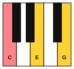
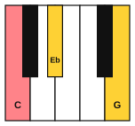
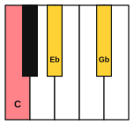
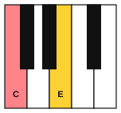

# Triads

<span class="tag tag-theory">Theory</span>

After this lesson you can name the root, 3rd and 5th of a triad, say whether it is major, minor, diminished or augmented, and spell all four kinds on any note.

Before this: [Interval qualities](02-interval-qualities.md), [Chord diagrams and your first chord](../01-first-sounds/12-chord-diagrams-and-e-minor.md). You need: your piano and your guitar.

## The idea

### Sound first: three notes at once

Play C, E and G together on the piano, with your right hand on fingers 1, 3 and 5 of C position. You hear a settled, bright sound. It is the same chord as the C chord on the guitar, which has these three notes repeated at different heights.

A **triad** is a chord of three notes, made by stacking two 3rds. Start on one note, add the note a 3rd above it, and add the note a 3rd above that. C, E and G are letters with one letter skipped between each: C, (D), E, (F), G. On the staff the three notes of a triad in this form sit on three neighbouring lines or in three neighbouring spaces.

```abc
X:1
M:4/4
L:1/4
Q:1/4=60
K:C
[CEG]4 | [DFA]4 | [EGB]4 |]
```

The three notes have names. The **root** is the lowest note and the note the chord is named after. The **3rd** is the note a 3rd above the root, and the **5th** is the note a 5th above the root. In C, E, G the root is C, the 3rd is E and the 5th is G. The first chord in the example is the C triad, and the last one, E, G, B, is the same notes as the Em chord you played in stage 1.

### Four kinds of triad

The size of the two stacked 3rds decides the kind. A major 3rd has 4 half steps and a minor 3rd has 3.

| Chord | Notes | Lower 3rd | Upper 3rd | Root to 5th |
|---|---|---|---|---|
| C | C, E, G | Major | Minor | Perfect 5th |
| Cm | C, Eb, G | Minor | Major | Perfect 5th |
| Cdim | C, Eb, Gb | Minor | Minor | Diminished 5th |
| Caug | C, E, G# | Major | Major | Augmented 5th |

The **major triad** has a major 3rd under a minor 3rd. The **minor triad** has a minor 3rd under a major 3rd. The **diminished triad** has two minor 3rds, which squeezes the 5th down to a diminished 5th (6 half steps). The **augmented triad** has two major 3rds, which stretches the 5th out to an augmented 5th (8 half steps).

Chord symbols write the kind after the root: C for major, Cm for minor, Cdim for diminished and Caug for augmented. Some books write C+ for augmented.









Listen to the four in order: major, minor, diminished, augmented. The major sounds bright and settled, the minor sounds darker, the diminished sounds tense and wants to move, and the augmented sounds unsettled, with no clear direction.

```abc
X:1
M:4/4
L:1/4
Q:1/4=60
K:C
[CEG]2 [C_EG]2 | [C_E_G]2 [CE^G]2 |]
```

The 3rd decides major or minor. Move only the middle note down a half step and a major triad becomes a minor one. Lower the 5th as well and it becomes diminished. Raise the 5th of a major triad and it becomes augmented.

### Building a triad on any note

1. Write the root, then the letters two and four steps above it. From D, the letters are D, F, A.
2. Build the major triad first: the 3rd is 4 half steps above the root and the 5th is 7 half steps above it. From D, the 3rd is F# and the 5th is A.
3. Change the major triad to the kind you want: lower the 3rd for minor, lower the 3rd and the 5th for diminished, raise the 5th for augmented.

Following these steps, D major: D, F#, A. D minor: D, F, A. Bb major: Bb, D, F. G minor: G, Bb, D. F# diminished: F#, A, C. Always use the letters from step 1. The F# diminished triad is F#, A, C, not F#, A, B#, even though B# is the same key as C.

### Triads on the guitar

The Em chord is E, G and B. E up to G is a minor 3rd and G up to B is a major 3rd, so Em is a minor triad. That is where the "m" in the name comes from. The E major chord is E, G# and B. E up to G# is a major 3rd, so E is a major triad. On the guitar, the move from Em to E changes one finger, because only the 3rd changes (G to G#). The same is true of Am (A, C, E) and A (A, C#, E).

A guitar chord has six strings but only three different notes. The extra strings repeat the same notes at different heights, so the chord is still a triad.

## Try it

Exercise 1. Spell G major, D minor, B diminished, F augmented, Eb major and F# minor.

<details class="solution" markdown>
<summary>Answer</summary>

G major: G, B, D. D minor: D, F, A. B diminished: B, D, F. F augmented: F, A, C#. Eb major: Eb, G, Bb. F# minor: F#, A, C#.

</details>

Exercise 2. Name the kind of triad: A, C, E; D, F#, A; E, G, Bb; C, E, G#.

<details class="solution" markdown>
<summary>Answer</summary>

A, C, E has a minor 3rd under a major 3rd: minor. D, F#, A has a major 3rd under a minor 3rd: major. E, G, Bb has two minor 3rds: diminished. C, E, G# has two major 3rds: augmented.

</details>

Exercise 3. On the guitar, the E chord has a G# and the Em chord has a G. What is the interval from E to G#, and what kind of triad is E?

<details class="solution" markdown>
<summary>Answer</summary>

E up to G# is a major 3rd, so E is a major triad.

</details>

<div class="practice" markdown>

### Practice routine (30 minutes)

| Minutes | What to do | Tempo | Listen for |
|---|---|---|---|
| 5 | Warm-up: five-finger pattern C D E F G and back, each hand alone | 60 bpm | The same volume on every finger |
| 15 | New skill: find and play the four triads on C, then on G and on F, saying the notes and the kind aloud ("C, Eb, G, minor") | 60 bpm | What changes in the sound when the 3rd or the 5th moves |
| 5 | Ear training: the [chord quiz](../practice/chord-quiz.md), level 1 (major or minor) | Untimed | Bright against dark |
| 5 | Guitar: Em, then E, then Em, then Am, then A, one strum each, naming the 3rd that changed | 60 bpm | The one finger that moves |

Repeat this routine on at least three days.

</div>

<div class="move-on" markdown>

### Move on when

- [ ] You can spell the major, minor, diminished and augmented triads on C, F, G and D without looking, at most 10 seconds each.
- [ ] You can name the kind of any triad of three given notes.
- [ ] You can say why Em is minor and E is major, using the interval from the root to the 3rd.
- [ ] You can play any of those triads on the piano, all three notes together.

</div>

## Common mistakes

Using the wrong letters. A triad on F uses the letters F, A and C. F minor is F, Ab, C and never F, G#, C. Choose the letters first (every other letter), then add the sharps and flats.

Thinking the 5th decides major or minor. Both use a perfect 5th. The 3rd decides, and the 5th only changes in diminished and augmented triads.

Mixing up the symbols. A capital letter alone (C) is a major triad. A small m (Cm) is minor. Write dim and aug in full.

## Key terms

- **Triad**: a chord of three notes made of a root with a 3rd and a 5th above it.
- **Root**: the note a triad is built on and named after.
- **3rd** and **5th** (of a chord): the notes a 3rd and a 5th above the root.
- **Major triad**: a major 3rd and a perfect 5th above the root.
- **Minor triad**: a minor 3rd and a perfect 5th above the root.
- **Diminished triad**: a minor 3rd and a diminished 5th above the root.
- **Augmented triad**: a major 3rd and an augmented 5th above the root.

Next: [Triads and arpeggios on piano](05-triads-and-arpeggios-on-piano.md)
