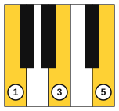
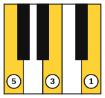

# Triads and arpeggios on piano

<span class="tag tag-piano">Piano</span>

After this lesson you can play the C, F, G, Am, Dm and Em triads in each hand, play them as broken triads, and play a one-octave C arpeggio with each hand.

Before this: [Triads](04-triads.md), [Left hand in C position](../02-two-hands-and-first-chords/02-left-hand-c-position.md), [G and F positions](../02-two-hands-and-first-chords/10-g-and-f-positions.md). You need: your piano.

## The idea

### Triads under the fingers

A triad is the first, third and fifth notes of a five-finger position. In C position the five keys are C, D, E, F and G, and fingers 1, 3 and 5 sit on C, E and G. That is the C triad. So you do not need a new hand shape: you play the keys under fingers 1, 3 and 5 together, and fingers 2 and 4 stay above the keys.



The left hand is the mirror image. Its thumb is finger 1 on the highest note and its little finger is finger 5 on the lowest, so the left hand plays 5, 3, 1 from low to high.



Follow these steps for a blocked triad (all three notes at once).

1. Set the hand in the five-finger position, with the wrist level and relaxed.
2. Rest fingers 1, 3 and 5 on the keys without pressing.
3. Let the weight of your arm drop into the three fingers so that all three notes start at the same moment.
4. Lift the hand and set it down again for the next chord.

Common mistake at step 3: the notes arrive one after another, as a rolled chord. Practise dropping the hand together, and check that your fingers are curved and your wrist is not stiff.

### Six triads on white keys

Each triad below moves the five-finger position to a new first note. All the notes are white keys.

| Chord | Notes (right hand, fingers 1, 3, 5) | Kind |
|---|---|---|
| C | C, E, G | Major |
| F | F, A, C | Major |
| G | G, B, D | Major |
| Am | A, C, E | Minor |
| Dm | D, F, A | Minor |
| Em | E, G, B | Minor |

All six use only white keys, but they do not sound alike. D up to F is a minor 3rd, so Dm is minor. F up to A is a major 3rd, so F is major. In a major triad the lower gap is 4 half steps and the upper gap is 3, and in a minor triad it is the other way round.

Play this progression with the right hand. The rests give you time to lift and set the hand.

```abc
X:1
M:4/4
L:1/4
Q:1/4=60
K:C
[CEG]2 z2 | [FAc]2 z2 | [GBd]2 z2 | [CEG]4 |]
```

The left hand plays the same triads one octave lower. The G triad is lower still, so the example below starts G2, B2, D3.

```abc
X:1
M:4/4
L:1/4
Q:1/4=60
K:C clef=bass
[C,E,G,]2 z2 | [F,A,C]2 z2 | [G,,B,,D,]2 z2 | [C,E,G,]4 |]
```

### Broken triads and the arpeggio

A **broken triad** (also called a broken chord) plays the three notes one after another. Play it with the same fingers, 1, 3 and 5, and let each note ring until the next one.

```abc
X:1
M:4/4
L:1/4
Q:1/4=60
K:C
!1!C !3!E !5!G !3!E | !1!F !3!A !5!c !3!A | !1!G !3!B !5!d !3!B | !1!C !3!E !5!G2 |]
```

An **arpeggio** is a broken triad that continues into the next octave. A one-octave C arpeggio is C, E, G and the next C, up and then down. The right hand uses fingers 1, 2, 3 and 5. Finger 5 plays the top C, so the whole octave fits under one hand position with no crossing. The left hand uses 5, 4, 2 and 1 going up and 1, 2, 4 and 5 coming down.

Listen to both hands separately, then try them together: the right hand starts on C4 and the left hand on C3, an octave lower.

```abc
X:1
M:4/4
L:1/4
Q:1/4=60
K:C
%%score {RH LH}
V:RH clef=treble
V:LH clef=bass
[V:RH] !1!C !2!E !3!G !5!c | !5!c !3!G !2!E !1!C |]
[V:LH] !5!C, !4!E, !2!G, !1!C | !1!C !2!G, !4!E, !5!C, |]
```

Play it slowly, one octave, and aim for an even sound: no note should jump out. The hand moves smoothly with the arm, and the thumb and fingers stay near the keys.

## Try it

Exercise 1. Which notes does the right hand play for the Em triad, and with which fingers?

<details class="solution" markdown>
<summary>Answer</summary>

E, G, B with fingers 1, 3 and 5.

</details>

Exercise 2. Name the two 3rds in the Dm triad (D, F, A) and say why it is minor.

<details class="solution" markdown>
<summary>Answer</summary>

D up to F is a minor 3rd and F up to A is a major 3rd. A minor 3rd under a major 3rd makes a minor triad.

</details>

Exercise 3. Which fingers play the left-hand C arpeggio going up?

<details class="solution" markdown>
<summary>Answer</summary>

5, 4, 2 and 1, on C, E, G and the C above.

</details>

<div class="practice" markdown>

### Practice routine (30 minutes)

| Minutes | What to do | Tempo | Listen for |
|---|---|---|---|
| 5 | Warm-up: five-finger pattern C D E F G and back, each hand alone | 60 bpm | The same volume on every finger |
| 15 | New skill: blocked triads C, F, G, C (right hand, then left hand); the broken triads in the third example; then the one-octave C arpeggio, each hand alone | 50 bpm, then 60 | All three notes starting together; an even arpeggio |
| 5 | Reading: the [note flashcards](../practice/note-flashcards.md), naming the three notes of each triad as you play them | Untimed | Seeing the three notes as one shape |
| 5 | Guitar: Em, E, Am and A, one down strum each, naming the root, 3rd and 5th | 60 bpm | Every string ringing |

Repeat this routine on at least three days.

</div>

<div class="move-on" markdown>

### Move on when

- [ ] You can play the blocked C, F, G, C progression with each hand at 60 bpm, three times in a row, with all notes sounding together.
- [ ] You can play the Am, Dm and Em triads with the right hand, hearing the minor sound.
- [ ] You can play the broken-triad example at 60 bpm, three times in a row with no stops.
- [ ] You can play the one-octave C arpeggio with each hand at 60 bpm, up and down, with an even sound.

</div>

## Common mistakes

Playing a rolled chord by accident. The three notes must start together. Drop the arm's weight into the keys at the same moment.

Tense fingers on the 3rd and 5th. Keep the wrist level and the hand relaxed, or the 5th finger will tire.

Changing fingers in the arpeggio. Use 1, 2, 3, 5 up and 5, 3, 2, 1 down for the right hand. Use the same fingers every time, so the pattern becomes automatic.

## Key terms

- **Blocked triad**: the three notes of a triad played at the same time.
- **Broken triad** (broken chord): the three notes of a triad played one after another.
- **Arpeggio**: a broken triad extended across an octave or more.

Next: [Open seventh chords](06-open-seventh-chords.md)
