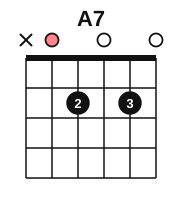
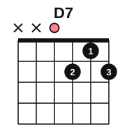
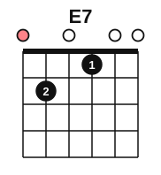
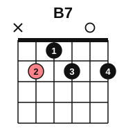

# Open seventh chords

<span class="tag tag-guitar">Guitar</span>

After this lesson you can play the A7, D7, E7 and B7 chords, spell each one, and hear how each 7th chord leans toward a home chord.

Before this: [Triads](04-triads.md), [Chord diagrams and your first chord](../01-first-sounds/12-chord-diagrams-and-e-minor.md), [The E and A chords](../02-two-hands-and-first-chords/04-chords-e-and-a.md), [The A minor and D chords](../02-two-hands-and-first-chords/06-chords-a-minor-and-d.md), [Strumming with down strokes](../02-two-hands-and-first-chords/08-strumming-down-strokes.md). You need: your guitar, a pick and a tuner.

## The idea

### Sound first: a chord that leans

Strum the E chord, then strum E7 (the shape is below). The E7 chord has a tension that the plain E chord does not. Now play E7 and then A. The A chord sounds like the answer to a question that E7 asked. Play A7 and then D, and you hear the same pull.

A chord like E7 is a 7th chord. It is a triad with one more note added on top, the note a 7th above the root. E7 has four different notes: E, G#, B and D.

### What the 7 means

A **7th chord** has four notes: the root, 3rd, 5th and 7th. The chords in this lesson are built from a major triad plus a minor 7th, that is, a note 10 half steps above the root. The full name is a dominant 7th chord, and stage 9 explains "dominant". On a chord chart, the 7 after the letter marks it: A7, D7, E7, B7.

| Chord | Notes |
|---|---|
| A7 | A, C#, E, G |
| D7 | D, F#, A, C |
| E7 | E, G#, B, D |
| B7 | B, D#, F#, A |

In each chord, the last note is a minor 7th above the root. A up to G is a minor 7th, D up to C is a minor 7th, E up to D is a minor 7th and B up to A is a minor 7th. Compare A7 with the A chord (A, C#, E): the only new note is G.

### Four shapes

Each diagram is read as in stage 1: the left line is string 6, the right line is string 1, o means open, x means do not play, and the salmon marker is the root.

A7. Play strings 5 to 1; do not play string 6. Put finger 2 on string 4, fret 2 and finger 3 on string 2, fret 2. Strings 5, 3 and 1 ring open.



D7. Play strings 4 to 1. Put finger 2 on string 3, fret 2, finger 1 on string 2, fret 1 and finger 3 on string 1, fret 2. String 4 rings open.



E7. Play all six strings. Start from your E chord and lift the finger on string 4, fret 2. You now have finger 2 on string 5, fret 2 and finger 1 on string 3, fret 1. Strings 6, 4, 2 and 1 ring open.



B7. Play strings 5 to 1; do not play string 6. Put finger 2 on string 5, fret 2, finger 1 on string 4, fret 1, finger 3 on string 3, fret 2 and finger 4 on string 1, fret 2. String 2 rings open. This is the hardest of the four, so learn it last.



For each shape, follow the same steps.

1. Place the fingers one at a time, close behind the fret wires.
2. Pluck the strings one by one from the lowest played string. Every note must ring clean, with no muted string and no buzz.
3. Strum all the played strings with one slow down stroke and let the chord ring.
4. Lift all fingers, then place them again without looking, and check with another strum.

Common mistake at step 2: a finger lying flat and touching the open string next to it. Arch your fingers so the open strings ring.

### The pull toward home

Listen to each 7th chord followed by a chord it leans toward. Each chord gets one strum and rings for the bar. Hear how the second chord settles the first.

```abc
%%opts tab=guitar
X:1
M:4/4
L:1/4
Q:1/4=60
K:C clef=treble-8
"A7"[A,EG^ce]4 | "D"[DAd^f]4 | "D7"[DAc^f]4 | "G"[G,B,DGBg]4 |
"E7"[E,B,D^GBe]4 | "A"[A,EA^ce]4 | "B7"[B,^DAB^f]4 | "E"[E,B,E^GBe]4 |]
```

The pairs are A7 to D, D7 to G, E7 to A and B7 to E. In each pair, the 7th chord is the one that asks for the next chord. A 7th chord that moves to its home chord is said to resolve. Stage 9 explains why these pairs work, with the name V7.

## Try it

Exercise 1. Spell D7 and E7, and name the 7th in each.

<details class="solution" markdown>
<summary>Answer</summary>

D7: D, F#, A, C. The 7th is C. E7: E, G#, B, D. The 7th is D.

</details>

Exercise 2. Which chord does each 7th chord lean toward: A7, D7, E7, B7?

<details class="solution" markdown>
<summary>Answer</summary>

A7 leans to D, D7 to G, E7 to A and B7 to E.

</details>

Exercise 3. How many different notes does E7 have, and how many strings are strummed?

<details class="solution" markdown>
<summary>Answer</summary>

Four different notes (E, G#, B and D), played on six strings. The extra strings repeat E and B at different heights.

</details>

<div class="practice" markdown>

### Practice routine (30 minutes)

| Minutes | What to do | Tempo | Listen for |
|---|---|---|---|
| 5 | Warm-up: Em, E, Am, A and D, one down strum on each beat, four beats per chord | 60 bpm | Every string ringing in each chord |
| 15 | New skill: learn A7, D7, E7 and B7 one at a time (place, pluck, strum); then the pairs A7 to D, D7 to G, E7 to A and B7 to E, four strums on each chord | 50 bpm, then 60 | The 7th chord leaning toward the second chord |
| 5 | Ear training: play E7, then A, then E7, then E, and say which sounds finished | Untimed | The lean of the 7th chord |
| 5 | Piano: blocked C, F, G, C triads with the right hand (lesson 5) | 60 bpm | All three notes sounding together |

Repeat this routine on at least three days.

</div>

<div class="move-on" markdown>

### Move on when

- [ ] You can place A7, D7 and E7 from memory, strum once, and have every played string ring clean.
- [ ] You can place B7 within 5 seconds, with a clean strum, three times in a row.
- [ ] You can play A7 to D, D7 to G, E7 to A and B7 to E, four strums each, at 60 bpm with no stops.
- [ ] You can spell A7, D7, E7 and B7 without looking.

</div>

## Common mistakes

Strumming string 6 in A7, D7 or B7. Those shapes mute string 6 (and string 5 for D7). Start the strum on the right string and aim the pick.

Treating A7 as the same chord as A. The A chord has no G. A7 adds the note G, and the 7 in each chord name means a minor 7th above the root.

Letting a fretting finger touch an open string. Check each string by plucking it alone.

## Key terms

- **7th chord**: a chord with four notes: the root, 3rd, 5th and 7th.
- **Dominant 7th chord**: a major triad with a minor 7th, written A7, D7, E7, B7 and so on.
- **Resolve**: to move from a tense chord to the chord it leans toward.

Next: [Inversions](07-inversions.md)
