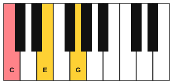
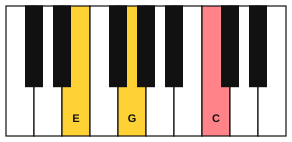
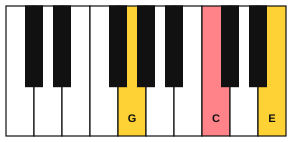
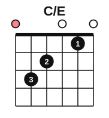

# Inversions

<span class="tag tag-theory">Theory</span>

After this lesson you can write a triad in root position, first inversion and second inversion, name an inversion from its lowest note, and read a slash chord such as C/E.

Before this: [Triads](04-triads.md), [Triads and arpeggios on piano](05-triads-and-arpeggios-on-piano.md). You need: your piano and your guitar.

## The idea

### Sound first: same notes, new bass

Play C, E and G together with your right hand. Now take the lowest note, C, and play it one octave higher, so the chord is E, G and C. Do it once more: move E to the top, so the chord is G, C and E. You played the same three letters each time, but the chord sounds different. The root position sounds the most settled and the second inversion the least.

```abc
X:1
M:4/4
L:1/4
Q:1/4=60
K:C
[CEG]2 [EGc]2 | [Gce]2 z2 |]
```

The lowest sounding note of a chord is its **bass note**. In the first chord it is C, in the second E and in the third G. Putting a different note of the chord in the bass is called an **inversion**.

### The three positions

When the root is the lowest note, the triad is in **root position**. When the 3rd is the lowest note, it is in **first inversion**. When the 5th is the lowest note, it is in **second inversion**. The name depends only on the bass note, not on the order of the notes above it.

| Position | Notes, low to high | Bass note |
|---|---|---|
| Root position | C, E, G | C (the root) |
| First inversion | E, G, C | E (the 3rd) |
| Second inversion | G, C, E | G (the 5th) |







To find an inversion, take the lowest note and move it up an octave. That gives the first inversion. Do the same again for the second. A third time brings you back to root position, an octave higher.

### Slash chords

A chord symbol can name the bass note too. In **C/E**, read the slash as "over": the C chord with E in the bass. That is C in first inversion. C/G is the C chord with G in the bass, which is second inversion. A chord symbol with no slash means root position.

Listen to the C chord held in the right hand while the left hand changes the bass note. The right hand does not move, but the chord changes colour.

```abc
X:1
M:4/4
L:1/4
Q:1/4=60
K:C
%%score {RH LH}
V:RH clef=treble
V:LH clef=bass
[V:RH] [CEG]4 | [CEG]4 | [CEG]4 |]
[V:LH] C,4 | E,4 | G,4 |]
```

The bars are C, C/E and C/G.

### Why inversions

Inversions let a bass line move smoothly. Play a bass that climbs C, E, F, G. The chords over it are C, C/E, F and G, and the bass moves by one skip and two steps, with no large leaps. Inversions also let the right hand change chords with small movements, which is the next lesson.

### Inversions on the guitar

The C chord on the guitar has the root C in the bass, on string 5. To play C/E, add the open string 6 (E) to the bottom of the C shape. Strum all six strings. Now the lowest note is E, the 3rd of C.



The six strings play E, C, E, G, C and E: the notes of C, with E lowest.

## Try it

Exercise 1. Write the three positions of G major, low to high.

<details class="solution" markdown>
<summary>Answer</summary>

G major: G, B, D. The first inversion is B, D, G (bass B). The second inversion is D, G, B (bass D).

</details>

Exercise 2. Name the chord, the inversion and the slash chord symbol: (a) E, G, C; (b) A, D, F; (c) B, D, G.

<details class="solution" markdown>
<summary>Answer</summary>

(a) C major (C, E, G) with E in the bass: first inversion, C/E. (b) D minor (D, F, A) with A in the bass: second inversion, Dm/A. (c) G major (G, B, D) with B in the bass: first inversion, G/B.

</details>

Exercise 3. Write the symbol for F major with A in the bass, and for F major with C in the bass.

<details class="solution" markdown>
<summary>Answer</summary>

F/A (first inversion) and F/C (second inversion).

</details>

<div class="practice" markdown>

### Practice routine (30 minutes)

| Minutes | What to do | Tempo | Listen for |
|---|---|---|---|
| 5 | Warm-up: one-octave C arpeggio, each hand alone | 60 bpm | An even sound on every note |
| 15 | New skill: play the C triad in root position, first and second inversion with the right hand; then the same for F and G; then the third example (right hand holds C while the left hand plays C, E, G) | 50 bpm, then 60 | The bass note, and how it changes the colour |
| 5 | Reading: write the three positions of Am and Dm on paper and name the bass note of each | Untimed | Seeing the same three letters in a new order |
| 5 | Guitar: C, C/E and Am, one strum each beat, four beats per chord | 60 bpm | The open string 6 ringing in C/E |

Repeat this routine on at least three days.

</div>

<div class="move-on" markdown>

### Move on when

- [ ] You can write the three positions of C, F, G, Am and Dm without looking.
- [ ] You can name the inversion of any triad from its lowest note.
- [ ] You can explain what C/E and C/G mean.
- [ ] You can play C to C/E to Am on the guitar at 60 bpm, three times in a row, with every string ringing.

</div>

## Common mistakes

Naming an inversion by the top note. Only the lowest note counts. E, G, C and G, C, E are different inversions.

Thinking an inversion is a different chord. It has the same three letters. Only the bass note moves.

Playing a slash chord with the root in the bass. In C/E the lowest note must be E.

## Key terms

- **Bass note**: the lowest sounding note of a chord.
- **Inversion**: a version of a chord with a note other than the root in the bass.
- **Root position**: the root is the bass note.
- **First inversion**: the 3rd is the bass note.
- **Second inversion**: the 5th is the bass note.
- **Slash chord**: a chord symbol with the bass note after a slash, such as C/E.

Next: [Inversions on piano](08-inversions-on-piano.md)
