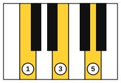
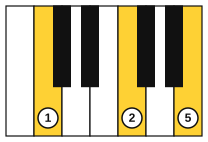
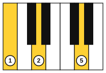

# Inversions on piano

<span class="tag tag-piano">Piano</span>

After this lesson you can play the C, F and G chords with the right hand using the inversions that keep the hand nearly still, and play them over left-hand root notes.

Before this: [Inversions](07-inversions.md), [Triads and arpeggios on piano](05-triads-and-arpeggios-on-piano.md), [Hands together](../02-two-hands-and-first-chords/03-hands-together.md). You need: your piano.

## The idea

### Sound first: the hand that jumps

Play the C, F and G triads in root position with your right hand: C E G, then F A C, then G B D. Each change moves your whole hand up the keyboard. A pianist who plays chords for a song does not move like that. The hand stays in one place, and each chord takes the inversion that is closest to the last one.

Now play C E G, then C F A, then B D G (the shapes are in the figures below), then C E G again. The hand barely moves. The chords are the same three, in different inversions.

### Common tones and nearest inversions

A **common tone** is a note that two chords share. When you change chords, keep the common tone where it is and move the other notes by the smallest step.

C to F. The C chord (C, E, G) and the F chord (F, A, C) share C. Keep C. E moves up to F, and G moves up to A. The F chord is now C, F, A: F in second inversion.

C to G. The C chord and the G chord (G, B, D) share G. Keep G. C moves down to B and E moves down to D. The G chord is now B, D, G: G in first inversion.

F to G has no common tone. In the shapes above, C moves down to B, F moves down to D and A moves down to G.

| Symbol | Right-hand notes | Fingers | Position |
|---|---|---|---|
| C | C, E, G | 1, 3, 5 | Root position |
| F/C | C, F, A | 1, 2, 5 | Second inversion |
| G/B | B, D, G | 1, 2, 5 | First inversion |







Follow these steps to learn each shape.

1. Find the lowest note first, with finger 1: C for the C chord, C for the F chord, B for the G chord.
2. Add finger 5 on the top note.
3. Add the middle finger: 3 for the C chord (on E), and 2 for the other two chords (on F and on D).
4. Play the shape three times, then close your eyes and find it again.

Common mistake at step 3: using finger 3 in the F and G shapes. The gap between the lowest and middle notes is a 4th in the F shape (C to F) and a 3rd in the G shape (B to D), and finger 2 sits better in both.

### The shapes in order

The names of the three chords are I, IV and V in the key of C. Stage 9 explains the numbers. For now, the C, F and G chords are the three that most simple songs are built on, and these shapes let you play them without leaping.

Listen to the right hand moving through C, F, G and back to C.

```abc
X:1
M:4/4
L:1/4
Q:1/4=60
K:C
[CEG]4 | [CFA]4 | [B,DG]4 | [CEG]4 |]
```

Now add the left hand. It plays only the root of each chord, below middle C: C3 with finger 5, F3 with finger 2 and G3 with finger 1.

```abc
X:1
M:4/4
L:1/4
Q:1/4=60
K:C
%%score {RH LH}
V:RH clef=treble
V:LH clef=bass
[V:RH] [CEG]2 [CEG]2 | [CFA]2 [CFA]2 | [CEG]2 [CEG]2 | [B,DG]2 [B,DG]2 |
[V:LH] !5!C,2 C,2 | !2!F,2 F,2 | !5!C,2 C,2 | !1!G,2 G,2 |
[V:RH] [CEG]2 [CFA]2 | [CEG]2 [B,DG]2 | [CFA]2 [B,DG]2 | [CEG]4 |]
[V:LH] C,2 F,2 | C,2 G,2 | F,2 G,2 | C,4 |]
```

Play the right hand alone first, then the left hand alone, then both. Both hands play on beats 1 and 3 of every bar.

## Try it

Exercise 1. Which note do C (C, E, G) and the F shape (C, F, A) share? Which note do C and the G shape (B, D, G) share?

<details class="solution" markdown>
<summary>Answer</summary>

C and F share C. C and G share G.

</details>

Exercise 2. The chord after C (C, E, G) is Am (A, C, E). Which inversion of Am is closest to C, and which note moves?

<details class="solution" markdown>
<summary>Answer</summary>

The first inversion, Am/C, with the notes C, E, A and C in the bass. C and E stay, and G moves up one step to A.

</details>

Exercise 3. Which fingers play the F shape in the right hand, and which notes?

<details class="solution" markdown>
<summary>Answer</summary>

Finger 1 on C, finger 2 on F and finger 5 on A.

</details>

<div class="practice" markdown>

### Practice routine (30 minutes)

| Minutes | What to do | Tempo | Listen for |
|---|---|---|---|
| 5 | Warm-up: blocked triads C, F, G, C in root position, right hand then left hand | 60 bpm | All three notes starting together |
| 15 | New skill: the three shapes one by one with your eyes closed; the first example with the right hand alone; then the second example in two parts, each hand alone, then together | 50 bpm, then 60 | The hand staying nearly still |
| 5 | Reading: name the bass note and the inversion of each right-hand chord in the second example, without playing | Untimed | Seeing the pattern of the shapes |
| 5 | Guitar: C to G, then G to Em, four strums on each chord | 60 bpm | Clean changes with no gap |

Repeat this routine on at least three days.

</div>

<div class="move-on" markdown>

### Move on when

- [ ] You can find the C, F and G shapes in under 3 seconds each, with your eyes closed.
- [ ] You can play the first example at 60 bpm, three times in a row, with no stops.
- [ ] You can play the second example with both hands at 60 bpm, three times in a row.
- [ ] You can say the common tone for C to F and C to G.

</div>

## Common mistakes

Jumping the whole hand to the root position of each chord. Look for the shape that keeps the hand near middle C.

Using the wrong fingering in the F and G shapes. Fingers 1, 2 and 5 keep the hand relaxed. Fingers 1, 3 and 5 would stretch the middle finger.

Playing the left-hand root above middle C. Keep it in the octave below, so the left hand stays under the right.

## Key terms

- **Common tone**: a note shared by two chords.
- **Nearest inversion**: the inversion of the next chord that needs the smallest movement from the current chord.

Next: [Eighth-note strumming](09-eighth-note-strumming.md)
