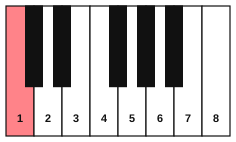
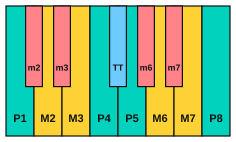
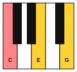
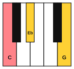
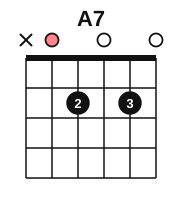
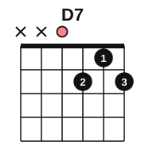
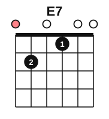
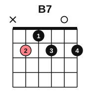

# Stage 4: Intervals and triads

This stage teaches you to name the distance between two notes and to build chords from it. You learn interval numbers and qualities, hear the intervals and chords you build, play triads and arpeggios on the piano, learn the A7, D7, E7 and B7 chords on the guitar, turn chords upside down, strum in eighth notes, read music by steps, skips and leaps, and learn from two easy classical pieces. It usually takes about 5 to 7 weeks at 30 minutes a day.

<!-- lessons:start -->
## Lessons

1. [Interval numbers](01-interval-numbers.md) (theory)
2. [Interval qualities](02-interval-qualities.md) (theory)
3. [Hearing intervals](03-hearing-intervals.md) (ear)
4. [Triads](04-triads.md) (theory)
5. [Triads and arpeggios on piano](05-triads-and-arpeggios-on-piano.md) (piano)
6. [Open seventh chords](06-open-seventh-chords.md) (guitar)
7. [Inversions](07-inversions.md) (theory)
8. [Inversions on piano](08-inversions-on-piano.md) (piano)
9. [Eighth-note strumming](09-eighth-note-strumming.md) (guitar)
10. [Reading by intervals](10-reading-by-intervals.md) (reading)
11. [Easy classical pieces: a musette and a minuet](11-easy-classical-pieces.md) (piano)
12. [Hearing chord quality](12-hearing-chord-quality.md) (ear)

<!-- lessons:end -->

Download the stage 4 deck: [04-intervals-and-triads.apkg](../downloads/anki/04-intervals-and-triads.apkg)

## Cheat sheet

Everything to remember from this stage, on one page.

### Interval numbers

- Count the letter names from the lower note to the upper note, counting both ends. C up to G is C, D, E, F, G: a 5th.
- Sharps and flats do not change the number.
- Melodic: one note after the other. Harmonic: both together.
- Step: a 2nd. Skip: a 3rd. Leap: a 4th or larger. Repeat: the same note.
- On the staff, line to line or space to space is an odd number. Line to space is an even number.
- The open guitar strings are a 4th apart, except strings 3 and 2 (G to B), which are a 3rd.

### Interval qualities

| Interval | Half steps | Example above C |
|---|---|---|
| Perfect unison | 0 | C up to C |
| Minor 2nd | 1 | C up to Db |
| Major 2nd | 2 | C up to D |
| Minor 3rd | 3 | C up to Eb |
| Major 3rd | 4 | C up to E |
| Perfect 4th | 5 | C up to F |
| Augmented 4th or diminished 5th | 6 | C up to F# or Gb |
| Perfect 5th | 7 | C up to G |
| Minor 6th | 8 | C up to Ab |
| Major 6th | 9 | C up to A |
| Minor 7th | 10 | C up to Bb |
| Major 7th | 11 | C up to B |
| Perfect octave | 12 | C up to C |

- Unisons, 4ths, 5ths and octaves are perfect. 2nds, 3rds, 6ths and 7ths are major or minor.
- Minor is a half step smaller than major. Augmented is a half step larger than major or perfect. Diminished is a half step smaller than minor or perfect.
- From the first note of a major scale, the 2nd, 3rd, 6th and 7th are major, and the 4th, 5th and octave are perfect.
- On one guitar string, the number of frets is the number of half steps.

### Reference tunes

| Interval | Tune (first two notes) |
|---|---|
| Major 2nd up | Frère Jacques |
| Major 2nd down | Mary Had a Little Lamb |
| Minor 2nd down | Für Elise |
| Minor 3rd up | Greensleeves |
| Major 3rd up | When the Saints Go Marching In |
| Perfect 4th up | Amazing Grace |
| Perfect 5th up | Twinkle, Twinkle, Little Star |

### Triads

A triad is a root with a 3rd and a 5th above it, built from two stacked 3rds.

| Triad | Symbol | Lower 3rd, upper 3rd | On C |
|---|---|---|---|
| Major | C | Major, minor | C, E, G |
| Minor | Cm | Minor, major | C, Eb, G |
| Diminished | Cdim | Minor, minor | C, Eb, Gb |
| Augmented | Caug | Major, major | C, E, G# |

- The 3rd decides major or minor. The 5th is perfect in both.
- To build a triad: write the root and the letters two and four above it, then fix the sharps and flats.
- Hear it: major is bright and settled, minor is darker, diminished is tense, and augmented is unsettled.

### Triads on the piano

| Chord | Notes | Kind |
|---|---|---|
| C | C, E, G | Major |
| F | F, A, C | Major |
| G | G, B, D | Major |
| Am | A, C, E | Minor |
| Dm | D, F, A | Minor |
| Em | E, G, B | Minor |

- Right hand fingers 1, 3, 5. Left hand fingers 5, 3, 1.
- A one-octave C arpeggio: right hand 1 2 3 5, left hand 5 4 2 1.

### Inversions

| Position | Bass note | Notes of C | Symbol |
|---|---|---|---|
| Root position | Root | C, E, G | C |
| First inversion | 3rd | E, G, C | C/E |
| Second inversion | 5th | G, C, E | C/G |

- The bass note is the lowest note. The name of an inversion depends only on it.
- C, F and G with the hand nearly still: C (C, E, G, fingers 1 3 5), F/C (C, F, A, fingers 1 2 5), G/B (B, D, G, fingers 1 2 5).
- Common tone: C and F share C. C and G share G.

### Seventh chords: A7, D7, E7 and B7

A dominant 7th chord is a major triad with a minor 7th above the root.

| Chord | Notes | Leans toward |
|---|---|---|
| A7 | A, C#, E, G | D |
| D7 | D, F#, A, C | G |
| E7 | E, G#, B, D | A |
| B7 | B, D#, F#, A | E |

### Eighth-note strumming

| Count | 1 | & | 2 | & | 3 | & | 4 | & |
|---|---|---|---|---|---|---|---|---|
| Hand | down | up | down | up | down | up | down | up |
| Strum D D U U D U | D | - | D | U | - | U | D | U |

- The hand never stops. Only the pick touching the strings changes.
- Up strokes are light and use the top three or four strings.

### Reading by intervals

| Landmark | Note | Place |
|---|---|---|
| Middle C | C4 | Ledger line below the treble staff |
| Treble G | G4 | Treble line 2 |
| High C | C5 | Treble space 3 |
| Bass F | F3 | Bass line 4 |
| Low C | C3 | Bass space 2 |

### Learning a piece

1. Survey: key, time signature, hands, phrases, repeats, hard spots.
2. Split into sections of 2 to 4 bars, cut at the ends of phrases.
3. Each section: right hand, left hand, hands together slowly, then up to tempo.
4. Half tempo first. Three clean in a row, then 5 bpm faster.

### Hearing chord quality

- Bright or dark? The 3rd decides: major is bright, minor is dark.
- If dark: settled is minor, tense is diminished.
- Inversions keep the quality.
