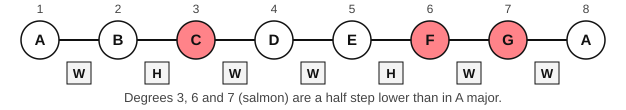
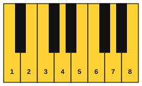

# The natural minor scale

<span class="tag tag-theory">Theory</span>

After this lesson you can build the natural minor scale on any note with the pattern W H W W H W W, play A natural minor on the piano, and say which major key shares its key signature.

Before this: [The major scale](../03-the-major-scale-and-keys/02-the-major-scale.md), [Whole steps, half steps, sharps and flats](../03-the-major-scale-and-keys/01-whole-and-half-steps.md). You need: your piano.

## The idea

### Sound first: the same white keys, a different home

Play the eight white keys from C to C, up the keyboard. You hear the major scale you know. Now play the white keys from A to A. The notes are the same seven, but the music settles on a different home note, and the scale sounds darker.

```abc
X:1
M:4/4
L:1/4
Q:1/4=70
K:C
C D E F | G A B c |]
```

```abc
X:1
M:4/4
L:1/4
Q:1/4=70
K:Am
A B c d | e f g a |]
```

The second scale is **A natural minor**. A **minor scale** is a scale whose 3rd note is a minor 3rd (three half steps) above the first. "Natural" means no notes have been changed from the key signature; the next lesson meets two scales with raised notes.

### The pattern

Each step in the A minor scale is a whole step (W, two half steps, two piano keys) or a half step (H, the next key with no key between). From A, the steps are W H W W H W W.



The A natural minor scale: A, B, C, D, E, F, G, A. Compare the major pattern from stage 3, W W H W W W H. If you take the major pattern and start it on its 6th step, you get the minor pattern: W H W W H W W is the same seven steps, rotated. That rotation is why the white keys give both C major and A minor.



### What changes from the major scale

Put the minor and major scales on the same first note. The A major scale: A, B, C#, D, E, F#, G#, A. The A natural minor scale: A, B, C, D, E, F, G, A. Degrees 1, 2, 4 and 5 are the same. Degrees 3, 6 and 7 are each a half step lower in the minor. In the number notation of this book, natural minor is 1 2 b3 4 5 b6 b7. The lowered 3rd is what gives the scale its colour.

### Relative major

A minor has no sharps and no flats, the same key signature as C major. The two keys are **relative keys**: A minor is the **relative minor** of C major, and C major is the **relative major** of A minor. The relative major's first note is a minor 3rd above the minor key's first note: A up to C is a minor 3rd. Equally, the minor scale starts on the 6th note of its relative major.

The same rule works anywhere. D natural minor: D, E, F, G, A, Bb, C, D. It has one flat, Bb, so it shares a key signature with F major (D is the 6th note of F major). E natural minor: E, F#, G, A, B, C, D, E. It has one sharp, F#, so its relative major is G major.

Here is a short melody in A natural minor. Listen for the home note A at the start and at the end.

```abc
X:1
M:4/4
L:1/4
Q:1/4=70
K:Am
A B c B | A E A2 | c d e d | c B A2 |
e f e d | c d e2 | d c B G | A4 |]
```

## Try it

Exercise 1. Write the E natural minor scale.

<details class="solution" markdown>
<summary>Answer</summary>

The E natural minor scale: E, F#, G, A, B, C, D, E. Steps: E to F# is a whole step, F# to G a half step, then W W H W W.

</details>

Exercise 2. Which major key has the same key signature as D natural minor?

<details class="solution" markdown>
<summary>Answer</summary>

F major. D up to F is a minor 3rd, and both keys have one flat (Bb).

</details>

Exercise 3. A natural minor has the note C. A major has C#. Which scale degree is that, and is it higher or lower in the minor?

<details class="solution" markdown>
<summary>Answer</summary>

It is degree 3, and it is a half step lower in the minor (written b3).

</details>

<div class="practice" markdown>

### Practice routine (30 minutes)

| Minutes | What to do | Tempo | Listen for |
|---|---|---|---|
| 5 | Warm-up: C major scale, one octave, each hand alone | 60 bpm | Even volume on every note |
| 10 | New skill: A natural minor, one octave up and down, each hand alone, with the same fingering as the C major scale starting on A | 60 bpm | The 3rd note (C) sounding darker than C# would |
| 5 | Melody: the A minor melody above, right hand | 60 bpm | Landing on A at the end |
| 5 | Theory: on paper, write E natural minor and D natural minor from memory, marking W and H | Untimed | The same pattern W H W W H W W in each |
| 5 | Guitar: Am and Em, one strum per bar, alternating | 60 bpm | Every string ringing in both chords |

Repeat this routine on at least three days.

</div>

<div class="move-on" markdown>

### Move on when

- [ ] You can play A natural minor, one octave up and down with each hand, at 60 bpm, three times in a row with no stops.
- [ ] You can write the step pattern W H W W H W W from memory and spell the E and D natural minor scales in under a minute.
- [ ] You can say which major key shares the key signature of A, E and D minor.
- [ ] You can play the A minor melody at 60 bpm three times in a row.

</div>

## Common mistakes

Calling A minor "C major starting on A" and then playing it like C major. The notes are the same, but the home note is A. End every phrase on A, and the ear hears A as home.

Forgetting the flat in D natural minor. The scale has Bb. Say "D minor, one flat" before you play.

Mixing up the number of the lowered notes. The 3rd, 6th and 7th are lowered compared with the major scale on the same first note.

## Key terms

- **Minor scale**: a scale whose 3rd note is a minor 3rd above the first.
- **Natural minor**: the minor scale with the steps W H W W H W W and no changed notes.
- **Relative keys**: a major and a minor key that share a key signature.
- **Relative minor**: the minor key that shares a key signature with a given major key, starting on its 6th note.
- **Relative major**: the major key that shares a key signature with a given minor key, a minor 3rd above it.

Next: [Harmonic and melodic minor](02-harmonic-and-melodic-minor.md)
