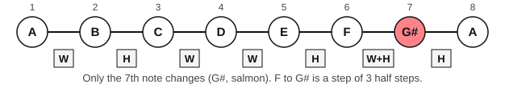
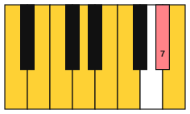
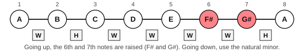
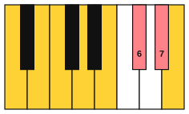

# Harmonic and melodic minor

<span class="tag tag-theory">Theory</span>

After this lesson you can build the harmonic and melodic minor scales on any note, say what a leading tone is, and hear why composers raise notes in a minor key.

Before this: [The natural minor scale](01-natural-minor.md). You need: your piano, and your guitar for the last exercise.

## The idea

### The problem with the 7th note

In A natural minor the 7th note is G, a whole step below the home note A. When a melody ends G to A, the pull to A is gentle. Many composers wanted a stronger pull, so they raised the 7th note by a half step to G#. The two versions sound different. Play the E minor chord (E, G, B) and then A minor (A, C, E), then the E major chord (E, G#, B) and A minor. Listen for which of the two ends more firmly.

```abc
X:1
M:4/4
L:1/4
Q:1/4=60
K:Am
[EGB]2 [ACE]2 | [E^GB]2 [ACE]2 |]
```

The second pair pulls harder, because G# sits a half step below A. A note a half step below the tonic is a **leading tone**: it leads up to the home note. G# up to A is a minor 2nd. In natural minor the 7th note is a whole step below the tonic, so the scale has no leading tone.

### Harmonic minor

The **harmonic minor** scale is natural minor with the 7th note raised by a half step. The A harmonic minor scale: A, B, C, D, E, F, G#, A. The steps are W H W W H W+H H, where W+H means three half steps, from F up to G#. That wide step sounds distinctive, and it is the scale's mark.



Listen to the scale going up and then down, with G# both ways.

```abc
X:1
M:4/4
L:1/4
Q:1/4=70
K:Am
A B c d | e f ^g a | ^g f e d | c B A2 |]
```



The raised note is written as an accidental in front of each G in the music. The key signature stays the same as natural minor, with no sharps for A minor. The accidental lasts to the end of the bar, so a G in the next bar is natural again unless it has its own sign.

### Melodic minor

The wide step from F to G# is awkward to sing and to play in a tune. The **melodic minor** scale avoids it by raising two notes when the scale goes up: the 6th and the 7th. Going down, it uses natural minor, with both notes back to normal.

Ascending, the A melodic minor scale: A, B, C, D, E, F#, G#, A. Descending: A, G, F, E, D, C, B, A.



```abc
X:1
M:4/4
L:1/4
Q:1/4=70
K:Am
A B c d | e ^f ^g a | g f e d | c B A2 |]
```



Going up, the raised notes lead the ear to A. Coming down, the line falls by steps from A through G, F and E, and there is no wish to climb, so the plain notes fit.

### The three forms together

| Form | Notes going up (A) | Notes going down |
|---|---|---|
| Natural minor | A, B, C, D, E, F, G, A | Same as going up |
| Harmonic minor | A, B, C, D, E, F, G#, A | Same as going up |
| Melodic minor | A, B, C, D, E, F#, G#, A | A, G, F, E, D, C, B, A |

These are three forms of one minor scale, not three different keys. A piece in A minor uses whichever form fits the melody at that moment, and the key signature never changes.

## Hear and see

Here is a short tune in A minor that uses the leading tone G#. Find the G# in the music and listen to how it leads up to A each time.

```abc
X:1
M:4/4
L:1/4
Q:1/4=70
K:Am
A B c B | A ^G A2 | c d e f | e d c B |
B c d c | B ^G E2 | A B ^G B | A4 |]
```

## Try it

Exercise 1. Write the E harmonic minor scale.

<details class="solution" markdown>
<summary>Answer</summary>

The E harmonic minor scale: E, F#, G, A, B, C, D#, E. It is E natural minor with the 7th note (D) raised to D#.

</details>

Exercise 2. What is the leading tone of D minor, and what interval does it make with the tonic?

<details class="solution" markdown>
<summary>Answer</summary>

C#. C# up to D is a minor 2nd.

</details>

Exercise 3. A tune in A minor climbs F#, G#, A. Which form of the scale is it using?

<details class="solution" markdown>
<summary>Answer</summary>

Melodic minor going up. If the tune had F natural and G#, it would be harmonic minor.

</details>

<div class="practice" markdown>

### Practice routine (30 minutes)

| Minutes | What to do | Tempo | Listen for |
|---|---|---|---|
| 5 | Warm-up: A natural minor, one octave, each hand alone | 60 bpm | Even volume |
| 10 | New skill: A harmonic minor and A melodic minor, one octave up and down, right hand alone, using the A natural minor fingering | 60 bpm | The step F to G# in harmonic minor; the plain notes coming down in melodic minor |
| 5 | Melody: the tune above, right hand | 60 bpm | G# leading up to A |
| 5 | Theory: on paper, write E harmonic minor and the D harmonic minor scale from memory | Untimed | Only the 7th note changes |
| 5 | Guitar: alternate E and Em, one strum per bar | 60 bpm | The finger on string 3, fret 1, adds the G# |

Repeat this routine on at least three days.

</div>

<div class="move-on" markdown>

### Move on when

- [ ] You can play A harmonic minor and A melodic minor, one octave up and down, right hand, at 60 bpm, three times in a row.
- [ ] You can say which notes of A melodic minor change between going up and going down.
- [ ] You can write E and D harmonic minor from memory in under a minute.
- [ ] You can point out the leading tone in any minor key you are given.

</div>

## Common mistakes

Playing melodic minor with the raised notes on the way down. Going up F# and G#; going down F and G, the natural notes.

Putting G# in the key signature. A minor has no sharps in the signature, so the G# is an accidental that you write each time it appears in a bar.

Hearing the harmonic minor step as a mistake. The step from F to G# is three half steps wide and sounds wide. It is the shape of the scale.

## Key terms

- **Leading tone**: the note a half step below the tonic, which leads up to it.
- **Harmonic minor**: natural minor with the 7th note raised a half step.
- **Melodic minor**: a scale with the 6th and 7th notes raised going up, and natural minor going down.

Next: [The A minor and D minor scales](03-a-and-d-minor-scales.md)
