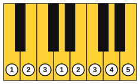
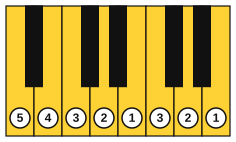
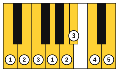
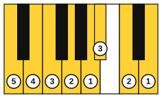

# The A minor and D minor scales

<span class="tag tag-piano">Piano</span>

After this lesson you can play the A minor and D minor scales in natural, harmonic and melodic forms, one octave with each hand alone, with the right fingering.

Before this: [The natural minor scale](01-natural-minor.md), [Harmonic and melodic minor](02-harmonic-and-melodic-minor.md), [The C major scale and thumb-under](../03-the-major-scale-and-keys/03-c-major-scale-and-thumb-under.md). You need: your piano.

## The idea

### A minor uses the C major fingering

A minor has no black keys in its natural form, so it feels like the C major scale you know, starting from A. The right-hand fingering is 1 2 3 1 2 3 4 5: the thumb crosses under after the third finger, between C and D. The left hand is 5 4 3 2 1 3 2 1. Coming down, the numbers run backwards.



Play the natural form first, right hand alone. Listen for even volume where the thumb passes under.

```abc
X:1
M:4/4
L:1/4
Q:1/4=60
K:Am
!1!A !2!B !3!c !1!d | !2!e !3!f !4!g !5!a | !4!g !3!f !2!e !1!d | !3!c !2!B !1!A2 |]
```

For the harmonic form, play the same fingering and raise the G to G#. The raised note falls on finger 4 going up and down.

```abc
X:1
M:4/4
L:1/4
Q:1/4=60
K:Am
!1!A !2!B !3!c !1!d | !2!e !3!f !4!^g !5!a | !4!^g !3!f !2!e !1!d | !3!c !2!B !1!A2 |]
```

For the melodic form, going up raise F and G to F# and G# (fingers 3 and 4), and coming down use the natural notes.

```abc
X:1
M:4/4
L:1/4
Q:1/4=60
K:Am
!1!A !2!B !3!c !1!d | !2!e !3!^f !4!^g !5!a | !4!g !3!f !2!e !1!d | !3!c !2!B !1!A2 |]
```

The left hand mirrors the right. Its fingers run 5 4 3 2 1 3 2 1 going up. The thumb plays E, then finger 3 crosses over it to F.



```abc
X:1
M:4/4
L:1/4
Q:1/4=60
K:Am clef=bass
!5!A, !4!B, !3!C !2!D | !1!E !3!F !2!G !1!A | !2!G !3!F !1!E !2!D | !3!C !4!B, !5!A,2 |]
```

### D minor has a flat

The D natural minor scale: D, E, F, G, A, Bb, C, D. It has one flat, so the key signature shows Bb on the middle line. The right-hand fingering is the same shape as before, 1 2 3 1 2 3 4 5, and the Bb falls on finger 3, a long finger on a black key. The left hand is 5 4 3 2 1 3 2 1, with finger 3 again on Bb.



```abc
X:1
M:4/4
L:1/4
Q:1/4=60
K:Dm
!1!D !2!E !3!F !1!G | !2!A !3!B !4!c !5!d | !4!c !3!B !2!A !1!G | !3!F !2!E !1!D2 |]
```

The harmonic form raises C to C#, on finger 4. The melodic form plays B natural and C# going up, with a natural sign in front of the B, and goes back to Bb and C coming down.

```abc
X:1
M:4/4
L:1/4
Q:1/4=60
K:Dm
!1!D !2!E !3!F !1!G | !2!A !3!B !4!^c !5!d | !4!^c !3!B !2!A !1!G | !3!F !2!E !1!D2 |]
```

```abc
X:1
M:4/4
L:1/4
Q:1/4=60
K:Dm
!1!D !2!E !3!F !1!G | !2!A !3!=B !4!^c !5!d | !4!c !3!B !2!A !1!G | !3!F !2!E !1!D2 |]
```



```abc
X:1
M:4/4
L:1/4
Q:1/4=60
K:Dm clef=bass
!5!D, !4!E, !3!F, !2!G, | !1!A, !3!B, !2!C !1!D | !2!C !3!B, !1!A, !2!G, | !3!F, !4!E, !5!D,2 |]
```

### Fingering table

| Scale | Right hand going up | Left hand going up |
|---|---|---|
| A minor (all three forms) | 1 2 3 1 2 3 4 5 | 5 4 3 2 1 3 2 1 |
| D minor (all three forms) | 1 2 3 1 2 3 4 5 | 5 4 3 2 1 3 2 1 |

Going down, play the fingers in reverse. Learn each scale with the hands separate before you try hands together. The lesson [Scales and arpeggios hands together](../08-fretboard-barre-chords-and-caged/09-scales-and-arpeggios-hands-together.md) returns to scales with both hands.

To change a form, move only the raised notes. In A minor, the note that changes is G (harmonic) or F and G (melodic, going up). In D minor, it is C (harmonic) or B and C (melodic, going up).

## Try it

Exercise 1. Which finger plays Bb in the right-hand D minor scale?

<details class="solution" markdown>
<summary>Answer</summary>

Finger 3. The scale is D1 E2 F3 G1 A2 Bb3 C4 D5.

</details>

Exercise 2. Write the D melodic minor scale going up and coming down.

<details class="solution" markdown>
<summary>Answer</summary>

Up: D, E, F, G, A, B, C#, D. Down: D, C, Bb, A, G, F, E, D.

</details>

Exercise 3. Which note do the harmonic and melodic forms of A minor share going up, and which one do they not share?

<details class="solution" markdown>
<summary>Answer</summary>

Both raise G to G#. Only the melodic form also raises F to F#.

</details>

<div class="practice" markdown>

### Practice routine (30 minutes)

| Minutes | What to do | Tempo | Listen for |
|---|---|---|---|
| 5 | Warm-up: A natural minor, right hand then left hand, one octave | 60 bpm | No bump when the thumb passes under |
| 15 | New skill: A harmonic and A melodic minor, then D natural, harmonic and melodic minor, right hand alone, then left hand alone | 60 bpm | Which note changes in each form |
| 5 | Reading: the A minor melody from lesson 1, right hand, then the left hand an octave lower | 60 bpm | A steady beat, even with the raised notes |
| 5 | Guitar: Am, Dm and Em, one strum per bar | 60 bpm | Every string ringing |

Repeat this routine on at least three days.

</div>

<div class="move-on" markdown>

### Move on when

- [ ] You can play the three forms of A minor, one octave up and down, right hand, at 66 bpm (quarter notes), three times in a row with no stops.
- [ ] You can play the three forms of D minor, one octave up and down, right hand, at 66 bpm, three times in a row.
- [ ] You can play A natural minor and D natural minor with the left hand at 60 bpm, three times in a row.
- [ ] You can say the fingering of the right and left hand without looking.

</div>

## Common mistakes

Using finger 4 or 5 on the Bb in D minor. The long fingers sit better on black keys. Use finger 3 in both hands.

Mixing up the forms. In the melodic form, playing the raised notes on the way down. Down is natural.

Forgetting the natural sign in D melodic minor. Going up, the B is natural, so the music has a natural sign in front of it. Without it you play Bb.

## Key terms

- **Accidental**: a sharp, flat or natural sign written in front of a note, valid to the end of the bar.

Next: [Chord symbols and chord charts](04-chord-symbols-and-chord-charts.md)
