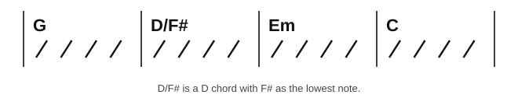
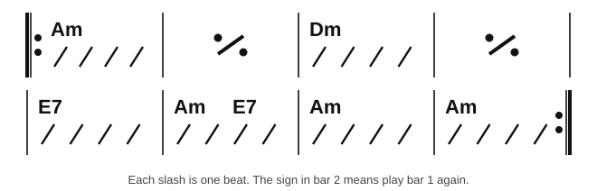
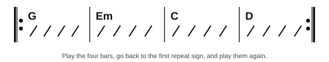

# Chord symbols and chord charts

<span class="tag tag-guitar">Guitar</span>

After this lesson you can read a chord chart, work out which chord to play on which beat from the symbols, slashes and repeat signs, and strum a chart you have not seen before.

Before this: [Chord diagrams and your first chord](../01-first-sounds/12-chord-diagrams-and-e-minor.md), [Strumming with down strokes](../02-two-hands-and-first-chords/08-strumming-down-strokes.md), [Open seventh chords](../04-intervals-and-triads/06-open-seventh-chords.md). You need: your guitar and a pick.

## The idea

### Chord symbols

A **chord symbol** is a short name for a chord, written above the music or on a chart. You have met several: Em, Am, D, E7. Each symbol has a root, the letter that names the chord, and then a quality or extra number. No suffix means major, m means minor, and 7 means a 7th chord, like the A7 and E7 shapes of stage 4, which has a fourth note.

| Symbol | Notes | Meaning |
|---|---|---|
| C | C, E, G | C major |
| Am | A, C, E | A minor |
| Dm | D, F, A | D minor |
| G7 | G, B, D, F | G 7th chord |
| E7 | E, G#, B, D | E 7th chord |
| D/F# | F#, D, A | D major with F# as the lowest note |

A symbol with a slash is a **slash chord**. The letter before the slash names the chord and the letter after it names the lowest note, the bass. You saw C/E in the lesson [Inversions](../04-intervals-and-triads/07-inversions.md). Until you can play the bass note, play the plain chord: for D/F#, play D. The F# is on string 6, fret 2.



### Chord charts and lead sheets

A **chord chart** is a page of bars with a chord symbol over each bar and no notes. Guitarists and band players read charts to accompany a song. A **lead sheet** is the same thing with the melody written on a staff above the chords; the next piano lessons use lead sheets.



Follow these rules to read it.

1. Each box between two bar lines is one bar. In 4/4 it has four beats.
2. A symbol at the left of a bar is the chord from beat 1. It stays until a new symbol appears.
3. Each slash is one beat. Four slashes in 4/4 mean four beats; strum a down stroke on each one, or play the pattern you have learned.
4. Two symbols in one bar split it. In the figure, bar 6 has Am on beat 1 and E7 on beat 3, so each chord gets two beats.
5. The sign in bar 2 and bar 4 means "play the previous bar again". Chord charts write it as a slash with a dot on each side.
6. A thick bar line with two dots is a **repeat sign**. Go back to the left-hand repeat sign and play the section again, once. The lesson [Articulation and repeat signs](../06-meter-terms-and-rhythm/04-articulation-and-repeat-signs.md) adds first and second endings and the jump signs.

Common mistake at rule 4: changing the chord late. The second chord starts on beat 3, so lift the first chord's shape and land the next one in the gap while you count 3.

Listen to the chart played with one strum per bar, so you can hear the chord changes without the rhythm. The bar with two chords gets two half notes.

```abc
%%opts tab=guitar
X:1
M:4/4
L:1/4
Q:1/4=60
K:Am clef=treble-8
"Am"[A,EAce]4 | "Am"[A,EAce]4 | "Dm"[DAdf]4 | "Dm"[DAdf]4 |
"E7"[E,B,D^GBe]4 | "Am"[A,EAce]2 "E7"[E,B,D^GBe]2 | "Am"[A,EAce]4 | "Am"[A,EAce]4 |]
```

Now play the chart for real: four down strokes in each bar, one on each slash. A bar of Am is a strum on 1, 2, 3 and 4. Count aloud and keep the arm swinging.

### A chart with a repeat

Here is a short chart in G. It has four bars and a repeat sign at each end, so you play the four bars twice. Strum a down stroke on each beat, and change the chord on beat 1 of each bar.



Listen to the loop once through, one strum per bar.

```abc
%%opts tab=guitar
X:1
M:4/4
L:1/4
Q:1/4=60
K:G clef=treble-8
"G"[G,B,DGBg]4 | "Em"[E,B,EGBe]4 | "C"[CEGce]4 | "D"[DAdf]4 |]
```

## Try it

Exercise 1. In a bar of 4/4 the symbols are "Am" at the left and "G" above the third slash. How many beats does each chord get?

<details class="solution" markdown>
<summary>Answer</summary>

Two beats each. Am is played on beats 1 and 2, and G starts on beat 3.

</details>

Exercise 2. What do the letters of G7 and D/F# tell you?

<details class="solution" markdown>
<summary>Answer</summary>

G7 is a G major triad with a flat 7th added: G, B, D, F. D/F# is a D major chord with F# as its lowest note.

</details>

Exercise 3. A chart has a thick bar line with two dots at the start of bar 1 and another at the end of bar 4. How many bars do you play in all?

<details class="solution" markdown>
<summary>Answer</summary>

Eight. You play bars 1 to 4, go back to the repeat sign at the start and play bars 1 to 4 again.

</details>

<div class="practice" markdown>

### Practice routine (30 minutes)

| Minutes | What to do | Tempo | Listen for |
|---|---|---|---|
| 5 | Warm-up: change between Am and Dm, one strum per bar | 60 bpm | Fingers landing together on beat 1 |
| 15 | New skill: strum the A minor chart, four down strokes per bar, with the repeat, then the G, Em, C, D loop | 60 bpm | Changing chords on beat 1 and the split bar landing on beat 3 |
| 5 | Reading: read the G loop aloud as "G, four beats", and so on, then name how many strums each chord gets in the A minor chart | Untimed | Reading a whole bar at a glance |
| 5 | Piano: A natural minor scale, right hand, one octave | 60 bpm | Even volume |

Repeat this routine on at least three days.

</div>

<div class="move-on" markdown>

### Move on when

- [ ] You can strum the A minor chart with four down strokes per bar and the repeat, twice through, at 60 bpm, with no stops.
- [ ] You can strum the G, Em, C, D loop four times through at 60 bpm with no stops.
- [ ] You can say the notes of Am, G7 and D/F# and what each part of the symbol means.
- [ ] You can read a new 4-bar chart and say how many beats each chord gets before you play.

</div>

## Common mistakes

Stopping the strumming arm at a bar line to change the chord. Keep the arm moving; the fingers move, the arm does not stop.

Reading the repeat bar sign as an empty bar. It means play the last bar again.

Treating a slash chord as a different chord. D/F# is still a D chord. Only the lowest note differs.

## Key terms

- **Chord symbol**: a short name such as Am or G7 that tells you which chord to play.
- **Chord chart**: a page of bars with chord symbols and slashes, and no melody.
- **Lead sheet**: a melody with chord symbols above it.
- **Slash chord**: a chord with a bass note named after the slash, such as D/F#.
- **Repeat sign**: a thick bar line with two dots that sends the player back to repeat a section.

Next: [Relative and parallel keys](05-relative-and-parallel-keys.md)
