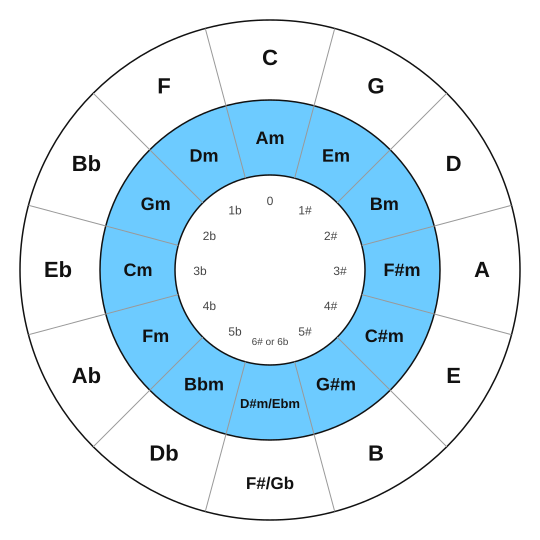

# Relative and parallel keys

<span class="tag tag-theory">Theory</span>

After this lesson you can name the relative minor and the parallel minor of a major key, give the key signature of a minor key, and use the circle of fifths to look up both.

Before this: [The natural minor scale](01-natural-minor.md), [Harmonic and melodic minor](02-harmonic-and-melodic-minor.md), [Key signatures with sharps](../03-the-major-scale-and-keys/07-sharp-key-signatures.md), [Flat keys and the circle of fifths](../03-the-major-scale-and-keys/09-flat-keys-and-the-circle-of-fifths.md). You need: your piano.

## The idea

### Relative keys

Lesson 1 showed that C major and A minor share a key signature. The same link joins every major key to one minor key. To find the relative minor of a major key, count down a minor 3rd (three half steps) from its tonic, or take the 6th note of the major scale. To go the other way, count up a minor 3rd.

| Major key | Key signature | Relative minor |
|---|---|---|
| C major | no sharps or flats | A minor |
| G major | one sharp | E minor |
| D major | two sharps | B minor |
| A major | three sharps | F# minor |
| F major | one flat | D minor |
| Bb major | two flats | G minor |
| Eb major | three flats | C minor |

So A minor has no sharps or flats. E minor has one sharp. B minor has two sharps. F# minor has three sharps. D minor has one flat. G minor has two flats (Bb, Eb). C minor has three flats (Bb, Eb, Ab). A minor key uses the signature of its relative major, written on the staff the same way. The sharps and flats come in the same order as before (F C G D A E B for sharps, B E A D G C F for flats).

Because a major key and its relative minor use the same seven notes, a signature with one sharp could mean G major or E minor. Look at the music to decide. The last note and the first chord are usually the tonic. A raised 7th note that appears as an accidental (D# in a piece with one sharp) points to E minor, because that is the leading tone from lesson 2.

### Parallel keys

Two keys with the same tonic are **parallel keys**: C major and C minor, G major and G minor. They share a name and the home note, and they differ in sound and in their key signature. The parallel minor lowers degrees 3, 6 and 7 of the major scale by a half step. C major has no sharps or flats. C minor has three flats (Bb, Eb, Ab). Moving to the parallel minor adds three flats or removes three sharps.

Here is the same melody in G major and in G minor. Listen for the 3rd note of the key, B in G major and Bb in G minor. Only that note differs, but the whole tune changes colour.

```abc
X:1
M:4/4
L:1/4
Q:1/4=70
K:G
!1!G !2!A !3!B !5!d | !4!c !3!B !2!A2 | !3!B !4!c !5!d !3!B | !1!G4 |]
```

```abc
X:1
M:4/4
L:1/4
Q:1/4=70
K:Gm
!1!G !2!A !3!B !5!d | !4!c !3!B !2!A2 | !3!B !4!c !5!d !3!B | !1!G4 |]
```

The two blocks use the same letters. The key signature in the second block makes each B a Bb, which is how the minor 3rd appears. Parallel keys are not relative keys: G major and G minor have the same tonic but different signatures (one sharp and two flats), and G major and E minor have the same signature but different tonics.

### The circle of fifths with minor keys

The circle of fifths you met in stage 3 has an inner ring for the minor keys. Each minor key sits inside its relative major.



Read the circle this way.

1. Top is C major and A minor, with no sharps and no flats.
2. Going clockwise by fifths adds one sharp for each step: G major and E minor have one sharp, D major and B minor have two.
3. Going anticlockwise adds one flat for each step: F major and D minor have one flat, Bb major and G minor have two.
4. The major key and the minor key in the same slot always share a key signature, so the circle is a lookup table from key to signature and back.
5. The keys at the bottom (F# major or Gb major) have six sharps or six flats and are written either way. This book plays in keys with up to three sharps or three flats.

## Try it

Exercise 1. What is the relative minor of D major, and how many sharps does it have?

<details class="solution" markdown>
<summary>Answer</summary>

B minor, with two sharps (F# and C#). B is a minor 3rd below D.

</details>

Exercise 2. What is the parallel minor of G major, and how many flats does it have?

<details class="solution" markdown>
<summary>Answer</summary>

G minor, with two flats (Bb and Eb).

</details>

Exercise 3. A piece has two flats. The last note is G and the melody uses F# several times. Which key is it in?

<details class="solution" markdown>
<summary>Answer</summary>

G minor. Two flats could mean Bb major or G minor. The final G supports G minor, and the F# is the raised 7th (the leading tone) that G harmonic minor adds.

</details>

<div class="practice" markdown>

### Practice routine (30 minutes)

| Minutes | What to do | Tempo | Listen for |
|---|---|---|---|
| 5 | Warm-up: A natural minor and D natural minor, right hand, one octave | 60 bpm | Even touch |
| 10 | New skill: play the G major and G minor tunes above, right hand, one after the other | 60 bpm, then 70 | The changed B between the two |
| 5 | Theory: cover the inner ring of the circle and name the relative minor of C, G, D, A, F, Bb and Eb major | Untimed | Answers in under 2 seconds each |
| 5 | Ear: play a G major triad (G, B, D), then G minor (G, Bb, D), and name each with your eyes closed | Untimed | The change in the middle note |
| 5 | Guitar: alternate A and Am, one strum per bar | 60 bpm | The C# on string 2 in A and the C in Am |

Repeat this routine on at least three days.

</div>

<div class="move-on" markdown>

### Move on when

- [ ] You can name the relative minor of C, G, D, A, F, Bb and Eb major in under 15 seconds in total.
- [ ] You can give the key signature of A, E, B, D, G and C minor in under 15 seconds in total.
- [ ] You can play the G major tune and the G minor tune at 70 bpm, three times each with no stops.
- [ ] You can explain in one sentence the difference between relative keys and parallel keys.

</div>

## Common mistakes

Mixing up relative and parallel. Relative keys share a signature; parallel keys share a tonic.

Counting a minor 3rd up when you need to go down. For the relative minor of a major key, count down: C down a minor 3rd is A.

Treating the signature as the answer. One sharp could be G major or E minor. Find the tonic from the music.

## Key terms

- **Parallel keys**: a major key and a minor key with the same tonic, such as C major and C minor.
- **Key signature**: the sharps or flats at the start of the staff that say which notes are raised or lowered throughout.

Next: [Chords from a lead sheet on piano](06-chords-from-a-lead-sheet-on-piano.md)
