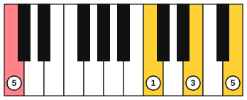

# Chords from a lead sheet on piano

<span class="tag tag-piano">Piano</span>

After this lesson you can play a lead sheet on the piano: the chords alone with the left hand on the root and the right hand on a triad, then the melody in the right hand over chords in the left.

Before this: [Chord symbols and chord charts](04-chord-symbols-and-chord-charts.md), [Triads and arpeggios on piano](../04-intervals-and-triads/05-triads-and-arpeggios-on-piano.md), [Inversions on piano](../04-intervals-and-triads/08-inversions-on-piano.md), [Hands together](../02-two-hands-and-first-chords/03-hands-together.md). You need: your piano.

## The idea

### A lead sheet gives you a melody and chord symbols

A lead sheet has the melody on a staff and a chord symbol above the bar. The pianist decides how to play the chords. This lesson gives you two methods. In method 1, you play only the chords: the left hand plays the root of each chord and the right hand plays a triad. In method 2, the right hand plays the melody and the left hand plays the chords.

The chords in this lesson are the C, G, Am and F triads from stage 4. C is C, E, G. G is G, B, D. Am is A, C, E. F is F, A, C.

### Method 1: left-hand root, right-hand triad

1. Read the symbol and say its notes.
2. Play the root with your left hand, finger 5, below middle C in the bass clef.
3. Play the triad with your right hand, thumb near middle C, fingers 1, 3 and 5.
4. Move to the next chord by the nearest inversion, so the right hand moves as little as possible. From C to G, the C and E each step down and the G stays.



The left-hand roots here sit below the bass-clef notes you read in stage 2: G2 is on the bottom line of the bass staff, A2 is in the first space, and F2 is under the staff.

```abc
X:1
M:4/4
L:1/4
Q:1/4=60
K:C
%%score {RH LH}
V:RH clef=treble
V:LH clef=bass
[V:RH] "C"[CEG]4 | "G"[B,DG]4 | "Am"[CEA]4 | "F"[CFA]4 |]
[V:LH] C,4 | G,,4 | A,,4 | F,,4 |]
```

The right hand moves by a step or stays at each change. This loop of four chords is known as I V vi IV; the lesson [The chords of a key](../09-harmony/02-diatonic-chords.md) explains the numbers.

The same four chords, starting on Am, give a minor-sounding loop: Am F C G (known as i VI III VII). Play it the same way and listen to how the home chord has changed.

```abc
X:1
M:4/4
L:1/4
Q:1/4=60
K:C
%%score {RH LH}
V:RH clef=treble
V:LH clef=bass
[V:RH] "Am"[CEA]4 | "F"[CFA]4 | "C"[CEG]4 | "G"[B,DG]4 |]
[V:LH] A,,4 | F,,4 | C,4 | G,,4 |]
```

Common mistake at step 3: lifting the whole arm to find the triad. Keep the hand shape of three fingers and let the wrist carry it to the next chord.

### Easy keys

The same method works in any key. In G major, the loop G D Em C uses the triads below. In E minor the loop Em C G D uses the same four chords in a different order.

| Chord | Notes |
|---|---|
| G | G, B, D |
| D | D, F#, A |
| Em | E, G, B |
| C | C, E, G |

### Method 2: melody on top, chords underneath

Now put a melody in the right hand and a full triad in the left hand. The left hand plays one triad per bar with its three notes together, root on the bottom, held for the bar. The right hand plays the melody, and the chord symbol over the bar tells the left hand what to play. Make the melody louder than the chords, as with the p and mf signs from stage 2.

This tune is in C position for the right hand.

```abc
X:1
M:4/4
L:1/4
Q:1/4=60
K:C
%%score {RH LH}
V:RH clef=treble
V:LH clef=bass
[V:RH] "C"E G G E | "G"D D G2 | "Am"E E C2 | "F"F F C2 |
[V:LH] [C,E,G,]4 | [G,,B,,D,]4 | [A,,C,E,]4 | [F,,A,,C,]4 |
[V:RH] "C"E G G E | "G"D D G2 | "F"G F F2 | "C"E2 C2 |]
[V:LH] [C,E,G,]4 | [G,,B,,D,]4 | [F,,A,,C,]4 | [C,E,G,]4 |]
```

Here is a minor-key tune over the Am F C G loop. The right hand uses a five-finger position on A: finger 1 on A4, then B, C, D and E.

```abc
X:1
M:4/4
L:1/4
Q:1/4=60
K:C
%%score {RH LH}
V:RH clef=treble
V:LH clef=bass
[V:RH] "Am"A c e c | "F"A A c2 | "C"e d c2 | "G"B B d2 |
[V:LH] [A,,C,E,]4 | [F,,A,,C,]4 | [C,E,G,]4 | [G,,B,,D,]4 |
[V:RH] "Am"A c e c | "F"A A c2 | "G"B d B2 | "Am"A4 |]
[V:LH] [A,,C,E,]4 | [F,,A,,C,]4 | [G,,B,,D,]4 | [A,,C,E,]4 |]
```

Learn each hand alone first, then play the chords at the speed you can keep, even if it is 40 bpm.

## Try it

Exercise 1. Name the notes of the Am and F chords, and the right-hand notes that change when you move between them.

<details class="solution" markdown>
<summary>Answer</summary>

Am: A, C, E. F: F, A, C. Playing C, E, A and then C, F, A, only the E moves, up a half step to F.

</details>

Exercise 2. What are the left-hand roots for C, G, Am and F in this lesson, with octave numbers?

<details class="solution" markdown>
<summary>Answer</summary>

C3, G2, A2 and F2.

</details>

Exercise 3. Write the chords of the G D Em C loop as notes.

<details class="solution" markdown>
<summary>Answer</summary>

G: G, B, D. D: D, F#, A. Em: E, G, B. C: C, E, G.

</details>

<div class="practice" markdown>

### Practice routine (30 minutes)

| Minutes | What to do | Tempo | Listen for |
|---|---|---|---|
| 5 | Warm-up: A natural minor scale, right hand, one octave | 60 bpm | Even volume |
| 15 | New skill: the C G Am F loop and the Am F C G loop (left-hand root, right-hand triad), then the C tune hands together | 50 bpm, then 60 | The chord changing on beat 1, with no gap |
| 5 | Reading: from the chord symbols alone, play C, G, Am, F, C with root and triad, without the notes in front of you | 50 bpm | Playing the chord names without looking at your hands |
| 5 | Guitar: the G, Em, C, D loop, four down strokes per bar | 60 bpm | A steady strum through each change |

Repeat this routine on at least three days.

</div>

<div class="move-on" markdown>

### Move on when

- [ ] You can play C G Am F with a left-hand root and a right-hand triad from the symbols alone, at 60 bpm, twice through with no stops.
- [ ] You can do the same for Am F C G.
- [ ] You can play the C tune hands together at 60 bpm, three times in a row.
- [ ] You can say the notes of the G, D, Em and C triads without looking.

</div>

## Common mistakes

Playing the melody and chords at the same volume. The melody must be louder. Play the chords with a softer touch.

Looking at your hands at each change. Learn the shape of each triad with the eyes on the page.

Holding the left-hand chord down after the change. Release it exactly on beat 1 as the new chord starts, or the two chords blur.

## Key terms

- **Lead sheet**: a melody on a staff with chord symbols above it.
- **Root position**: a triad with its root as the lowest note.

Next: [The capo and moving shapes](07-capo-and-moving-shapes.md)
