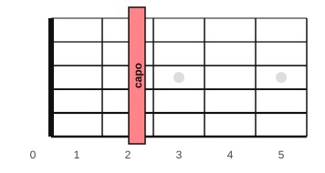

# The capo and moving shapes

<span class="tag tag-guitar">Guitar</span>

After this lesson you can put a capo on correctly, work out which chord you hear when you play a given shape with the capo on any fret, and read a capo chart.

Before this: [Chord symbols and chord charts](04-chord-symbols-and-chord-charts.md), [The C, G and D minor chords](../03-the-major-scale-and-keys/06-chords-c-g-and-d-minor.md), [Whole steps, half steps, sharps and flats](../03-the-major-scale-and-keys/01-whole-and-half-steps.md). You need: your guitar, a pick, a tuner and a capo.

## The idea

### What a capo does

A **capo** is a clamp that presses all six strings against one fret. It works as a new nut: the strings now start at that fret, so every open string sounds higher. Each fret is one half step, so a capo on fret 2 raises every note by two half steps, a whole step.



Place the capo with these steps.

1. Choose the fret. For fret 2, the capo goes in the space between fret wire 1 and fret wire 2.
2. Set the bar close behind fret wire 2, where your fretting fingers would press. Do not put it on top of the wire, or the strings buzz.
3. Clamp it so that all six strings ring when you pluck them one by one.
4. Check the tuning with the capo on. If the notes sound sharp, the capo is squeezing too hard; loosen it a little.
5. Fret the shapes as you did before, counting frets from the capo, not from the nut.

Common mistake at step 3: a capo that is not square across the neck, leaving string 1 or string 6 buzzing. Slide it straight and check each string.

### Moving shapes

Chords played with the capo on use the same shapes you know, but they sound higher. The shape is the finger pattern; the **sounding chord** is what you hear. G shape with the capo on fret 2 sounds as A major, because A is two half steps above G.

| Shape you play | Capo 2 sounds | Capo 3 sounds | Capo 5 sounds |
|---|---|---|---|
| G | A | Bb | C |
| C | D | Eb | F |
| D | E | F | G |
| Em | F#m | Gm | Am |
| Am | Bm | Cm | Dm |

Every chord in the loop moves by the same number of half steps, so the loop keeps its character in the new key. The loop G, Em, C, D played with the capo on fret 2 sounds as A, F#m, D, E. Listen to the loop with no capo, then with the capo on fret 2.

```abc
%%opts tab=guitar
X:1
M:4/4
L:1/4
Q:1/4=60
K:G clef=treble-8
"G"[G,B,DGBg]4 | "Em"[E,B,EGBe]4 | "C"[CEGce]4 | "D"[DAdf]4 |]
```

```abc
%%opts tab=guitar capo=2
X:1
M:4/4
L:1/4
Q:1/4=60
K:A clef=treble-8
"A"[A,^CEA^ca]4 | "F#m"[^F,^C^FA^c^f]4 | "D"[D^FAd^f]4 | "E"[EBe^g]4 |]
```

The tab under the second block is drawn for a capo on fret 2. The strum is the same, the shapes are the same, and the pitch is two half steps higher.

Why play it this way? The key of A is hard on an open-position guitar if you only know the open shapes: A, F#m, D and E need a barre for F#m. With the capo, you play shapes you know and get the sound of that key. A capo also lets you fit a song to a singer's range without learning new chords.

### Capo charts

A **capo chart** is a chord chart with the capo fret written at the top. Most guitar charts write the shape names, not the sounding names, so you play what you see and the capo does the rest.

| Chart says | You play | You hear |
|---|---|---|
| Capo 2: G, Em, C, D | G, Em, C, D shapes | A, F#m, D, E |
| Capo 5: Am, G, C | Am, G, C shapes | Dm, C, F |

Some charts print the sounding chords with a note such as "capo 2, play in G shapes". Read the top line before you play. Check whether a chart gives shapes or sounding chords, and in this book a capo chart always lists the shapes.

On the piano, the same idea is moving a whole passage up by a fixed number of half steps; the lesson Transposition<!-- link: ../13-capstones/01-transposition.md --> covers it.

## Try it

Exercise 1. Which chord do you hear when you play a C shape with the capo on fret 2?

<details class="solution" markdown>
<summary>Answer</summary>

D major. C is two half steps below D.

</details>

Exercise 2. A song uses A, F#m, D and E. Which capo fret and which shapes let you play it with G, Em, C and D?

<details class="solution" markdown>
<summary>Answer</summary>

Capo on fret 2. G sounds as A, Em as F#m, C as D, and D as E.

</details>

Exercise 3. You play C, Am, D and G shapes with the capo on fret 3. Which chords do you hear?

<details class="solution" markdown>
<summary>Answer</summary>

Eb, Cm, F and Bb. Each chord is three half steps higher than its shape.

</details>

<div class="practice" markdown>

### Practice routine (30 minutes)

| Minutes | What to do | Tempo | Listen for |
|---|---|---|---|
| 5 | Warm-up: change between Am, Em and Dm, one strum per bar | 60 bpm | Every string ringing |
| 15 | New skill: the G, Em, C, D loop with no capo, then with the capo on fret 2, then on fret 5; four down strokes per bar | 60 bpm | The same loop sounding higher each time, and no buzz from the capo |
| 5 | Reading: use the table to say the sounding chords for the shapes G, Em, C, D at capo 3 and capo 5 | Untimed | Answers before you check |
| 5 | Piano: the C, G, Am, F loop from the last piano lesson, left-hand root, right-hand triad | 60 bpm | Even chord changes |

Repeat this routine on at least three days.

</div>

<div class="move-on" markdown>

### Move on when

- [ ] You can place the capo on fret 2, pluck all six strings, and hear every one ring clean.
- [ ] You can play the G, Em, C, D loop with the capo on fret 2 at 60 bpm, four down strokes per bar, three times through with no stops.
- [ ] You can say the chord you hear for any of the shapes G, C, D, Em and Am with the capo on fret 2, 3 or 5, using the table or counting half steps.
- [ ] You can read a capo chart and say whether it lists shapes or sounding chords.

</div>

## Common mistakes

Counting frets from the nut, not from the capo. With the capo on fret 2, the shape's first fret is fret 3 in absolute terms.

Reading shape names as sounding chords. The chart says G; the room hears A.

Squeezing the capo too hard. The strings go sharp and the clamp tires your hand. Use the least pressure that stops the buzz.

## Key terms

- **Capo**: a clamp that presses all six strings against one fret, raising every open string by that many half steps.
- **Shape**: the finger pattern of a chord, wherever it is played.
- **Sounding chord**: the chord you hear, which with a capo is higher than the shape you play.
- **Capo chart**: a chord chart with the capo fret written on top and the shape names beneath.

Next: [Hearing major and minor](08-hearing-major-and-minor.md)
