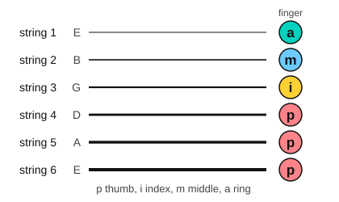

# Fingerpicking basics

<span class="tag tag-guitar">Guitar</span>

After this lesson you can play the fingers p i m a on the right strings, and fingerpick two simple patterns over the chords Am, C, G and Em.

Before this: [Chord symbols and chord charts](04-chord-symbols-and-chord-charts.md), [The C, G and D minor chords](../03-the-major-scale-and-keys/06-chords-c-g-and-d-minor.md), [Strumming with down strokes](../02-two-hands-and-first-chords/08-strumming-down-strokes.md). You need: your guitar. You do not need a pick.

## The idea

### Fingers, not a pick

Until now you have struck the strings with a pick, often several at once. In **fingerpicking** you pluck each string with a finger or thumb of your picking hand, so you choose which strings sound and when. It makes a quieter, more detailed sound, and you can play a bass note and the notes above it as separate parts.

The picking-hand fingers have letters, taken from Spanish names that classical guitarists use everywhere: p is the thumb, i the index finger, m the middle finger and a the ring finger. The little finger is not used at this stage.

### Which finger plays which string

The rule for this lesson: the thumb plays the bass strings 6, 5 and 4, and the three fingers play strings 3, 2 and 1, one finger per string. i plays string 3, m plays string 2 and a plays string 1.



The thumb chooses its string by the chord. Each chord has a root, the note that names it, and the thumb plays that root as the bass note.

| Chord | Thumb plays | i, m, a play |
|---|---|---|
| Am | string 5, open | string 3 (fret 2), string 2 (fret 1), string 1 (open) |
| C | string 5, fret 3 | string 3 (open), string 2 (fret 1), string 1 (open) |
| G | string 6, fret 3 | string 3 (open), string 2 (open), string 1 (fret 3) |
| Em | string 6, open | string 3 (open), string 2 (open), string 1 (open) |

### Setting up the picking hand

Follow these steps.

1. Hold the chord shape with the fretting hand. Fingerpicking plays the chord notes one by one, so the whole shape is held down for the bar.
2. Rest the thumb on its bass string and place i, m and a on strings 3, 2 and 1.
3. Keep the wrist relaxed and slightly arched, with the fingers curved. The fingers sit over the strings near the soundhole.
4. To pluck with a finger, curl the finger toward your palm so the string is pulled and released. Do not lift the string away from the guitar.
5. The thumb plays by moving across its string, then rests on the next string below it or hangs free.
6. Aim for even volume. The thumb tends to play louder than the fingers, so soften the thumb.

Common mistake at step 4: plucking by moving only the first knuckle and lifting the string. Curl the whole finger so the sound is round.

### Pattern 1: p i m a

The first pattern is four quarter notes in a bar: p, then i, m, a, going up the strings from the bass note. Listen to it over Am, C, G and Em. The letters under the staff are the picking fingers.

```abc
%%opts tab=guitar
X:1
M:4/4
L:1/4
Q:1/4=60
K:C clef=treble-8
"Am"A, A c e | "C"C G c e | "G"G, G B g | "Em"E, G B e |]
w: p i m a|p i m a|p i m a|p i m a
```

Play it one chord at a time. Four notes ring together, because you keep the chord shape pressed down while each string keeps sounding. Let the notes ring rather than stopping each one.

### Pattern 2: eighth notes

The second pattern doubles the speed: eight eighth notes in each bar. The fingers go p i m i, twice. The index finger plays string 3, the middle finger plays string 2, then the index plays string 3 again, so the pattern rocks. Count "1 & 2 & 3 & 4 &" and play the thumb on 1 and 3.

```abc
%%opts tab=guitar
X:1
M:4/4
L:1/8
Q:1/4=60
K:C clef=treble-8
"Am"A, A c A A, A c A | "C"C G c G C G c G | "G"G, G B G G, G B G | "Em"E, G B G E, G B G |]
w: p i m i p i m i|p i m i p i m i|p i m i p i m i|p i m i p i m i
```

The lesson [Fingerpicking patterns](../06-meter-terms-and-rhythm/07-fingerpicking-patterns.md) adds patterns that use the a finger and 3/4 and 6/8 time. If your G chord leaves string 1 open, play e where the tab shows 3 in Pattern 1.

## Try it

Exercise 1. In fingerpicking, which finger plays string 2, and which plays string 1?

<details class="solution" markdown>
<summary>Answer</summary>

The middle finger (m) plays string 2 and the ring finger (a) plays string 1.

</details>

Exercise 2. In the G chord, which string does the thumb play, and at which fret?

<details class="solution" markdown>
<summary>Answer</summary>

String 6, fret 3. That is the root, G.

</details>

Exercise 3. In Pattern 2, how many notes does the thumb play in one bar of 4/4, and on which counts?

<details class="solution" markdown>
<summary>Answer</summary>

Two notes, on counts 1 and 3.

</details>

<div class="practice" markdown>

### Practice routine (30 minutes)

| Minutes | What to do | Tempo | Listen for |
|---|---|---|---|
| 5 | Warm-up: change between Am, C, G and Em, one strum per bar | 60 bpm | Every string ringing |
| 15 | New skill: Pattern 1 on each chord alone for four bars, then the four-chord line; then Pattern 2 the same way | 50 bpm, then 60 | Even volume between the thumb and fingers |
| 5 | Reading: read the tab of Pattern 1 aloud as string and fret for each note, without playing | Untimed | Reading the whole bar at a glance |
| 5 | Piano: the C, G, Am, F loop, left-hand root, right-hand triad | 60 bpm | Clean chord changes |

Repeat this routine on at least three days.

</div>

<div class="move-on" markdown>

### Move on when

- [ ] You can name the picking finger for each of the six strings without looking.
- [ ] You can play Pattern 1 over Am, C, G and Em at 60 bpm, three times through in a row with no stops.
- [ ] You can play Pattern 2 over the same chords at 60 bpm (eighth notes), three times through with no stops.
- [ ] You can play either pattern with the thumb and fingers at the same volume, checked by recording yourself.

</div>

## Common mistakes

Letting the thumb play louder than the fingers. Practise p alone with a light touch, then p and i together.

Using the same finger for two strings. Keep i, m and a each on their own string.

Letting go of the chord shape between notes. Press the whole chord down for the whole bar.

## Film yourself

Record your picking hand from the front, close enough to see each finger. Watch it and check:

- Does each finger curl toward the palm to pluck?
- Does the wrist stay relaxed and slightly arched?
- Does the thumb stay on the bass strings?
- Do the fingers stay close to the strings between notes?

<!-- video: a close view of a beginner's picking hand playing p i m a on an Am chord, showing curved fingers, the thumb on string 5 and a relaxed wrist -->

## Key terms

- **Fingerpicking**: plucking the strings with the fingers and thumb, not a pick.
- **p i m a**: the picking-hand fingers: thumb, index, middle, ring.
- **Bass note**: the lowest note of a chord, played by the thumb.

Next: [Broken-chord accompaniment](11-broken-chord-accompaniment.md)
