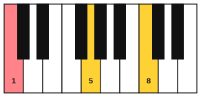
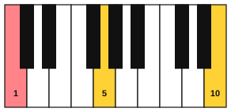

# Broken-chord accompaniment

<span class="tag tag-piano">Piano</span>

After this lesson you can play two broken-chord patterns in the left hand, 1-5-8 and 1-5-10, over the chords C, G, Am and F, and play a right-hand melody over them.

Before this: [Chords from a lead sheet on piano](06-chords-from-a-lead-sheet-on-piano.md), [Triads and arpeggios on piano](../04-intervals-and-triads/05-triads-and-arpeggios-on-piano.md), [Ties, dots and eighth notes](../02-two-hands-and-first-chords/05-ties-dots-and-eighth-notes.md). You need: your piano.

## The idea

### From blocks to broken chords

In the last piano lesson the left hand played each chord as a single block or a held root. A **broken chord** plays the notes of a chord one after another instead of together. It keeps the harmony sounding while the music moves, and it gives the left hand a steady motion under a slow melody. Playing the notes of a chord one after another in order is an arpeggio, which you met in stage 4.

The patterns here use numbers for the notes of the chord, counted up from the root: 1 is the root, 5 is the fifth, and 8 is the octave above the root. A pattern is a recipe of numbers.

### Pattern 1-5-8

The first pattern goes root, fifth, octave, and back to the fifth: 1-5-8-5. For a C chord that is C3, G3, C4, G3. Play it in eighth notes, so there are eight notes in a bar of 4/4, with the pattern twice.



Use fingers 5, 2, 1, 2 (root with finger 5, fifth with finger 2, octave with the thumb, then finger 2 again). Listen for an even flow with no bump on the thumb.

```abc
X:1
M:4/4
L:1/8
Q:1/4=60
K:C clef=bass
"C"!5!C, !2!G, !1!C !2!G, !5!C, !2!G, !1!C !2!G, | "G"G,, D, G, D, G,, D, G, D, | "Am"A,, E, A, E, A,, E, A, E, | "F"F,, C, F, C, F,, C, F, C, |]
```

The pattern keeps its shape in each chord. For G the notes are G2, D3, G3, D3. For Am they are A2, E3, A3, E3. For F they are F2, C3, F3, C3. In each chord the pattern is the root, the 5th above, the octave above the root, and the 5th again.

### Pattern 1-5-10

The second pattern replaces the octave with the 10th, the note an octave above the 3rd of the chord. For C that is E4. The notes are C3, G3, E4, G3. The 10th gives a wider, more open sound.



```abc
X:1
M:4/4
L:1/8
Q:1/4=60
K:C clef=bass
"C"C, G, E G, C, G, E G, | "G"G,, D, B, D, G,, D, B, D, | "Am"A,, E, C E, A,, E, C E, | "F"F,, C, A, C, F,, C, A, C, |]
```

A 10th is a wide reach. Use fingers 5, 2, 1, 2 and slide the whole hand to the top note rather than stretching the fingers. If the 10th hurts or your hand is too small, use 1-5-8 for now. Pain is a stop sign.

### A right-hand melody over the pattern

Add a melody in the right hand in half notes, so the left hand supplies the movement. The melody is louder than the left hand, as in the last lesson. Learn the left-hand loop first, then add the right hand a bar at a time.

```abc
X:1
M:4/4
L:1/8
Q:1/4=60
K:C
%%score {RH LH}
V:RH clef=treble
V:LH clef=bass
[V:RH] "C"!mf!E4 G4 | "G"D4 G4 | "Am"E4 A4 | "F"F4 A4 |
[V:LH] !p!C, G, C G, C, G, C G, | G,, D, G, D, G,, D, G, D, | A,, E, A, E, A,, E, A, E, | F,, C, F, C, F,, C, F, C, |
[V:RH] "C"G4 e4 | "G"d4 B4 | "F"c4 A4 | "C"c8 |]
[V:LH] C, G, C G, C, G, C G, | G,, D, G, D, G,, D, G, D, | F,, C, F, C, F,, C, F, C, | C, G, C G, C,4 |]
```

Play the loop as a lead sheet: read the chord symbol over each bar and build the pattern from the root, using the numbers.

## Try it

Exercise 1. Write the notes of the 1-5-8-5 pattern for a G chord.

<details class="solution" markdown>
<summary>Answer</summary>

G2, D3, G3, D3. The root is G, the fifth is D and the octave is the next G.

</details>

Exercise 2. Write the notes of the 1-5-10-5 pattern for an Am chord.

<details class="solution" markdown>
<summary>Answer</summary>

A2, E3, C4, E3. The root is A, the fifth is E, and the 10th is C, the 3rd of the chord an octave higher.

</details>

Exercise 3. At 60 bpm in 4/4 with eighth notes, how many left-hand notes do you play in one bar, and how long is the bar?

<details class="solution" markdown>
<summary>Answer</summary>

Eight notes in a bar, and the bar lasts 4 seconds, since each beat is one second.

</details>

<div class="practice" markdown>

### Practice routine (30 minutes)

| Minutes | What to do | Tempo | Listen for |
|---|---|---|---|
| 5 | Warm-up: C major scale and A natural minor scale, left hand alone, one octave | 60 bpm | An even flow with no bump at the thumb |
| 15 | New skill: pattern 1-5-8 on each chord alone, then the loop C G Am F, then the loop with the melody (right hand) added | 50 bpm, then 60 | The left hand soft and even under the melody |
| 5 | Reading: from the chord symbols alone, say the three notes of each chord (root, fifth, octave) before you play | Untimed | Naming notes ahead of the hand |
| 5 | Guitar: fingerpicking Pattern 1 on Am, C, G and Em | 60 bpm | Even volume between the thumb and fingers |

Repeat this routine on at least three days.

</div>

<div class="move-on" markdown>

### Move on when

- [ ] You can play the 1-5-8 pattern over C, G, Am and F with the left hand alone at 60 bpm, twice through, with no stops.
- [ ] You can play the full melody example, hands together, at 60 bpm, three times in a row.
- [ ] You can say the notes of 1-5-8 and 1-5-10 for C, G, Am and F in under 30 seconds.
- [ ] You can play 1-5-10 on C and G with the left hand alone at 50 bpm for 4 bars (or you have chosen to stay with 1-5-8 because the reach hurts).

</div>

## Common mistakes

Accenting the thumb. The note on the top of the pattern is often too loud. Keep all eight notes the same volume.

Looking at the left hand and losing the melody. Learn the left-hand pattern until you can play it while reading the right hand.

Leaving the chord late. Change to the next chord's root exactly on beat 1.

## Key terms

- **Broken chord**: a chord whose notes are played one after another.
- **1-5-8**: the pattern root, fifth, octave, fifth.
- **1-5-10**: the pattern root, fifth, tenth, fifth, where the 10th is an octave above the 3rd.

Next: [Sight-reading in new keys](12-sight-reading-in-new-keys.md)
