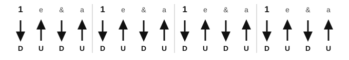
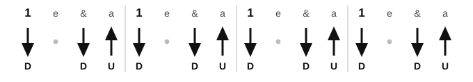
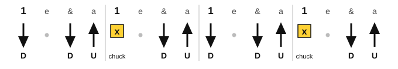

# Muting and sixteenth-note strumming

<span class="tag tag-guitar">Guitar</span>

After this lesson you can mute strings with your picking hand and your fretting hand, play a chuck, and strum three sixteenth-note patterns, counting "1 e & a".

Before this: [Eighth-note strumming](../04-intervals-and-triads/09-eighth-note-strumming.md), [Chord symbols and chord charts](04-chord-symbols-and-chord-charts.md), [Fingerpicking basics](10-fingerpicking-basics.md). You need: your guitar, a pick and a metronome.

## The idea

### Muting

To **mute** a string is to stop it ringing, or to damp it so the note is short and dull. Muting shapes the sound of a strum, and it lets you play rhythm without a chord ringing through.

There are two ways, and each uses a different hand.

**Palm muting** uses the picking hand. Rest the outside edge of your hand, near the heel of the palm, lightly on the strings where they meet the bridge saddle. The strings are damped, not pressed to the fretboard. Pick the strings and the notes sound short and thudding, but you can still hear the pitch. Move your hand a little toward or away from the bridge until you get a dull sound with a clear pitch. Too far toward the neck and the notes die; too far toward the saddle and they ring fully.

Listen to eight palm-muted eighth notes on the open low E string, then the same note open.

```abc
%%opts tab=guitar
X:1
M:4/4
L:1/8
Q:1/4=60
K:Em clef=treble-8
"^palm muted".E, .E, .E, .E, .E, .E, .E, .E, | "^open"E,8 |]
```

Common mistake: pressing the palm hard on the strings. The aim is light contact. If you cannot hear the pitch, lift your hand a little.

**Fretting-hand muting** uses the fretting hand. If you relax the pressure of your fingers on the strings without lifting them off, the strings stop ringing at once. You can also lay the fingers flat across the strings without pressing them to the frets, which deadens all of them.

### The chuck

A **chuck** is a short percussive click that comes from strumming while the strings are muted by the fretting hand. It sounds like a snare drum on a beat, and it has little pitch.

1. Fret a chord and strum it on the beat so it sounds.
2. On the next strum, relax the fingers of the fretting hand so they still touch the strings but do not press them to the frets.
3. Strum across the strings as before. You hear a click with no ringing pitch.
4. Press the chord shape again right after, ready for the next sounding strum.

Common mistake at step 2: lifting the fingers right off the strings. The result is the open strings ringing, not a chuck. Keep the fingers touching.

### Sixteenth notes

A sixteenth note is a quarter of a beat: four sixteenths fill a beat. Count them "1 e & a, 2 e & a, 3 e & a, 4 e & a", where e is pronounced "ee" and a is pronounced "ah". The numbers fall on the beat and the "&" on the half beat, as with eighth notes. The "e" and "a" fall in between.

To strum sixteenths, keep your arm moving down and up four times per beat, steadily, whether or not the pick touches the strings. You strike on some strokes and miss the strings on others. The hand moves down on the numbers and the "&", and up on the "e" and the "a". In the diagrams, D is a down stroke, U is an up stroke, a dot is a stroke where the hand moves but the pick misses, and x is a chuck.

At 60 bpm, a sixteenth note is a quarter of a second, so there are four strokes per second. Start at 50 bpm.

### Pattern 1: all sixteenths

Strum down-up on every sixteenth note: 16 strokes per bar.



```abc
%%opts tab=guitar
X:1
M:4/4
L:1/16
Q:1/4=50
K:Em clef=treble-8
"Em"[E,B,EGBe][E,B,EGBe][E,B,EGBe][E,B,EGBe] [E,B,EGBe][E,B,EGBe][E,B,EGBe][E,B,EGBe] [E,B,EGBe][E,B,EGBe][E,B,EGBe][E,B,EGBe] [E,B,EGBe][E,B,EGBe][E,B,EGBe][E,B,EGBe] |]
```

Keep it light, and make the down strokes a little louder than the up strokes.

### Pattern 2: down on the beat, down on the and, up on the a

Leave out the "e" strum on each beat, so the hand moves in the same 16-stroke rhythm but the pick misses the strings on every "e". The strums fall on the number, the "&" and the "a": D, miss, D, U.



```abc
%%opts tab=guitar
X:1
M:4/4
L:1/16
Q:1/4=50
K:Em clef=treble-8
"Em"[E,B,EGBe]z[E,B,EGBe][E,B,EGBe] [E,B,EGBe]z[E,B,EGBe][E,B,EGBe] [E,B,EGBe]z[E,B,EGBe][E,B,EGBe] [E,B,EGBe]z[E,B,EGBe][E,B,EGBe] |]
```

### Pattern 3: with a chuck on 2 and 4

Take pattern 2 and mute the first strum of beats 2 and 4, so those beats become chucks. Beats 1 and 3 ring.



The audio below plays the chuck as a short staccato strum.

```abc
%%opts tab=guitar
X:1
M:4/4
L:1/16
Q:1/4=50
K:Em clef=treble-8
"Em"[E,B,EGBe]z[E,B,EGBe][E,B,EGBe] "^chuck".[E,B,EGBe]z[E,B,EGBe][E,B,EGBe] [E,B,EGBe]z[E,B,EGBe][E,B,EGBe] "^chuck".[E,B,EGBe]z[E,B,EGBe][E,B,EGBe] |]
```

## Try it

Exercise 1. How many sixteenth notes fit in one beat, and in one bar of 4/4?

<details class="solution" markdown>
<summary>Answer</summary>

Four in one beat, so 16 in one bar of 4/4.

</details>

Exercise 2. Count Pattern 2 for one beat and say which counts are strummed.

<details class="solution" markdown>
<summary>Answer</summary>

"1 e & a". The strums fall on 1, & and a. The "e" is a miss.

</details>

Exercise 3. At 50 bpm, how many seconds does one sixteenth note last?

<details class="solution" markdown>
<summary>Answer</summary>

A beat lasts 60 / 50 = 1.2 seconds, and a sixteenth is a quarter of a beat: 0.3 seconds.

</details>

<div class="practice" markdown>

### Practice routine (30 minutes)

| Minutes | What to do | Tempo | Listen for |
|---|---|---|---|
| 5 | Warm-up: eighth-note down-up strumming on Em | 60 bpm | A steady arm, even volume |
| 15 | New skill: Pattern 1, then Pattern 2, then Pattern 3 on Em, one bar each, then Pattern 2 over Am, C, G and Em; add palm muting to Pattern 2 on the last two bars | 50 bpm | A steady arm that never stops, and chucks that click without ringing |
| 5 | Ear: clap Pattern 2 while counting "1 e & a" aloud | 60 bpm | Claps on 1, & and a only |
| 5 | Piano: the C, G, Am, F loop, left-hand pattern 1-5-8 | 60 bpm | Even eighth notes |

Repeat this routine on at least three days. Stop if your strumming arm, wrist or shoulder aches, rest, and see a teacher or doctor if it keeps coming back.

</div>

<div class="move-on" markdown>

### Move on when

- [ ] You can palm mute so that every note sounds short with a clear pitch, for 8 eighth notes in a row.
- [ ] You can play a chuck on beats 2 and 4 so that it clicks with no ringing pitch, for 4 bars.
- [ ] You can play Pattern 2 over Am, C, G and Em at 50 bpm, four bars in a row with no stops.
- [ ] You can count "1 e & a" aloud while you strum Pattern 3, at 50 bpm for 4 bars.

</div>

## Common mistakes

Stopping the arm on the misses. The arm moves on every sixteenth, even when the pick misses the strings.

Strumming too hard. At this speed the arm must be loose, with the wrist doing most of the work.

Pressing a palm mute too hard. The note loses its pitch. Rest lightly.

## Film yourself

Record your strumming arm from the front for 30 seconds while you play Pattern 3. Watch it and check:

- Does the arm keep moving on every sixteenth, including the misses?
- Is the movement small and loose, from the wrist and forearm?
- Does the fretting hand relax on the chuck without lifting off?
- Do you count aloud in time with the strums?

<!-- video: a front view of a beginner strumming a sixteenth-note pattern with a chuck on beats 2 and 4, showing a continuous down-up arm motion and the fretting hand relaxing on the chuck -->

## Key terms

- **Mute**: to stop or damp a string so it does not ring.
- **Palm muting**: damping the strings with the edge of the picking hand near the bridge.
- **Chuck**: a percussive click made by strumming while the fretting hand mutes the strings.
- **Sixteenth note**: a note a quarter of a beat long, counted "1 e & a".

Next: Compound meter<!-- link: ../06-meter-terms-and-rhythm/01-compound-meter.md -->
