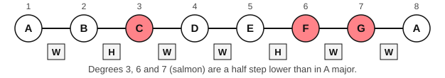
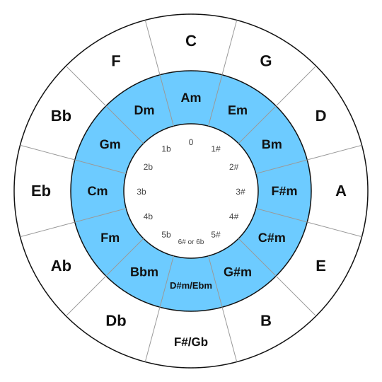
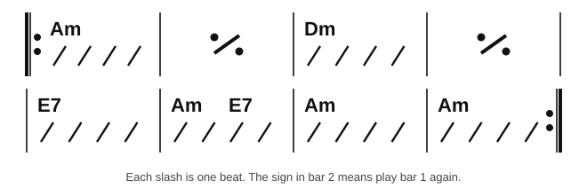
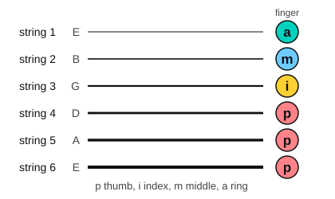
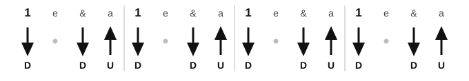

# Stage 5: Minor keys and chord charts

This stage adds the minor side of music and the chord chart. You build the three minor scales, learn how minor keys relate to major keys, and read and play chord charts and lead sheets on both instruments. You also learn the capo, fingerpicking, broken-chord accompaniment, reading in new keys, and sixteenth-note strumming with muting, and you play two short pieces by Schumann. By the end, you can play the A minor and D minor scales, strum a chart you have not seen, and play a melody over chords on the piano. It usually takes about 5 to 7 weeks at 30 minutes a day.

<!-- lessons:start -->
## Lessons

1. [The natural minor scale](01-natural-minor.md) (theory)
2. [Harmonic and melodic minor](02-harmonic-and-melodic-minor.md) (theory)
3. [The A minor and D minor scales](03-a-and-d-minor-scales.md) (piano)
4. [Chord symbols and chord charts](04-chord-symbols-and-chord-charts.md) (guitar)
5. [Relative and parallel keys](05-relative-and-parallel-keys.md) (theory)
6. [Chords from a lead sheet on piano](06-chords-from-a-lead-sheet-on-piano.md) (piano)
7. [The capo and moving shapes](07-capo-and-moving-shapes.md) (guitar)
8. [Hearing major and minor](08-hearing-major-and-minor.md) (ear)
9. [Schumann: Melody and Soldiers' March](09-schumann-album-for-the-young.md) (piano)
10. [Fingerpicking basics](10-fingerpicking-basics.md) (guitar)
11. [Broken-chord accompaniment](11-broken-chord-accompaniment.md) (piano)
12. [Sight-reading in new keys](12-sight-reading-in-new-keys.md) (reading)
13. [Muting and sixteenth-note strumming](13-muting-and-sixteenth-strumming.md) (guitar)

<!-- lessons:end -->

Download the stage 5 deck: [05-minor-keys-and-chord-charts.apkg](../downloads/anki/05-minor-keys-and-chord-charts.apkg)

## Cheat sheet

Everything to remember from this stage, on one page.

### The three minor scales

| Form | Steps | A minor, going up | Going down |
|---|---|---|---|
| Natural | W H W W H W W | A, B, C, D, E, F, G, A | Same |
| Harmonic | W H W W H W+H H | A, B, C, D, E, F, G#, A | Same |
| Melodic | W H W W W W H | A, B, C, D, E, F#, G#, A | A, G, F, E, D, C, B, A |

In numbers, natural minor is 1 2 b3 4 5 b6 b7. Harmonic minor raises the 7th. Melodic minor raises the 6th and 7th going up and uses natural minor coming down. The leading tone is the note a half step below the tonic (G# in A minor). The key signature stays the same for all three forms.

The D natural minor scale: D, E, F, G, A, Bb, C, D. The E natural minor scale: E, F#, G, A, B, C, D, E.

Piano fingering for A minor and D minor, all three forms: right hand 1 2 3 1 2 3 4 5, left hand 5 4 3 2 1 3 2 1. Going down, reverse the numbers.

### Relative and parallel keys

| Major key | Relative minor | Key signature |
|---|---|---|
| C major | A minor | none |
| G major | E minor | one sharp |
| D major | B minor | two sharps |
| A major | F# minor | three sharps |
| F major | D minor | one flat |
| Bb major | G minor | two flats |
| Eb major | C minor | three flats |

The relative minor starts a minor 3rd below its major key (the 6th note of the major scale). Relative keys share a key signature. Parallel keys share a tonic: C major and C minor. The parallel minor has three more flats or three fewer sharps than the major.

### Chord charts

| Symbol | Notes | Means |
|---|---|---|
| C | C, E, G | C major |
| Am | A, C, E | A minor |
| G7 | G, B, D, F | G 7th chord |
| D/F# | F#, D, A | D with F# in the bass |

- Each box is one bar. Each slash is one beat.
- A chord stays until the next symbol. Two symbols in a bar split it.
- A slash with a dot on each side means "play the last bar again".
- A thick bar line with two dots is a repeat sign.
- A lead sheet is a melody with chord symbols above it.
- Capo charts list the shapes you play. Each fret of the capo raises every chord by a half step.

| Shape | Capo 2 sounds | Capo 3 sounds | Capo 5 sounds |
|---|---|---|---|
| G | A | Bb | C |
| C | D | Eb | F |
| D | E | F | G |
| Em | F#m | Gm | Am |
| Am | Bm | Cm | Dm |

### Piano accompaniment

- Lead sheet, method 1: left hand plays the root, right hand plays the triad, moving by the nearest inversion.
- Lead sheet, method 2: right hand plays the melody (louder), left hand plays the chords (softer).
- Broken chords in the left hand: 1-5-8-5 (root, fifth, octave, fifth) and 1-5-10-5. For C: C3, G3, C4, G3 and C3, G3, E4, G3.
- Two plain loops, by name only: C G Am F (I V vi IV) and Am F C G (i VI III VII).

### Fingerpicking

| Finger | Letter | Strings |
|---|---|---|
| Thumb | p | 6, 5 and 4 (the bass note of the chord) |
| Index | i | 3 |
| Middle | m | 2 |
| Ring | a | 1 |

Pattern 1 is p i m a in quarter notes. Pattern 2 is p i m i p i m i in eighth notes. Hold the whole chord shape for the whole bar.

### Strumming patterns

| Pattern | Counting | Strokes |
|---|---|---|
| Pattern 1 | 1 e & a, 2 e & a, 3 e & a, 4 e & a | D U D U on every beat |
| Pattern 2 | 1 e & a | D, miss, D, U on every beat |
| Pattern 3 | 1 e & a | Pattern 2 with a chuck on the first stroke of beats 2 and 4 |

The arm keeps moving down and up four times per beat, whether or not the pick touches the strings. Palm muting: rest the edge of the picking hand lightly on the strings at the bridge. Chuck: strum while the fretting fingers touch the strings but do not press.
