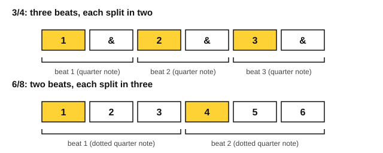

# Compound meter

<span class="tag tag-theory">Theory</span>

After this lesson you can tell simple meter from compound meter, count a bar of 6/8, 9/8 or 12/8 by its beats, and clap a 6/8 rhythm with the strong beats in the right places.

Before this: [Beat, tempo and note values](../01-first-sounds/07-beat-tempo-and-note-values.md), [Bars, time signatures and rests](../01-first-sounds/08-bars-time-signatures-and-rests.md), [Ties, dots and eighth notes](../02-two-hands-and-first-chords/05-ties-dots-and-eighth-notes.md). You need: your piano or any surface to tap on, and a metronome app.

## The idea

### Two ways to split a beat

In 4/4 and 3/4 every beat divides into two eighth notes. You count "1 & 2 & 3 &", and each number is followed by one "&". Meter that splits the beat in two is **simple meter**.

Some music splits the beat into three instead. Listen to the first example. It is two beats to a bar, and each beat has three short notes in it. It sounds like a rocking boat or a gentle skip.

```abc
X:1
M:6/8
L:1/8
Q:3/8=60
K:C
E2 F G2 E | D2 E F2 D | C2 D E2 C | D3 G3 |
E2 F G2 E | G2 F E3 | F2 E D2 C | C6 |]
```

Meter that splits the beat into three is **compound meter**. The tune above is in 6/8.

### What 6/8 says

The top number of a time signature tells you how many of a note value are in a bar, and the bottom number names the note value (8 means an eighth note, 4 means a quarter note). So 6/8 means six eighth notes in a bar.

If you counted six beats, though, you would play it too stiffly. The six eighth notes are grouped in two sets of three. Each set is one beat, and a beat that holds three eighth notes is a dotted quarter note (a quarter note plus half its length, as in the lesson on dots). 6/8 has two beats per bar, and the beat is the dotted quarter note.



The figure shows the same six eighth notes used two ways. In 3/4 they make three beats of two. In 6/8 they make two beats of three. That is the whole difference, and you hear it in where the strong notes fall.

### The family of compound meters

Each simple meter has a compound twin with the same number of beats:

| Simple meter | Beats per bar | Compound twin | Beats per bar | Eighth notes per bar |
|---|---|---|---|---|
| 2/4 | 2 | 6/8 | 2 | 6 |
| 3/4 | 3 | 9/8 | 3 | 9 |
| 4/4 | 4 | 12/8 | 4 | 12 |

The beat in every compound meter is the dotted quarter note, and it holds three eighth notes. A meter with two beats a bar is called **duple**, three beats **triple** and four beats **quadruple**. So 6/8 is compound duple, 9/8 is compound triple, and 12/8 is compound quadruple.

### Counting 6/8

There are two good ways to count, and you can use whichever you like.

1. Count all six eighth notes, "1 2 3 4 5 6", and press harder on 1 and 4. Counts 1 and 4 are the beats.
2. Count the two beats and fill in the rest, "1 la li 2 la li".

Take the first way at slow tempos, and the second at fast ones, where only the two beats matter. In tempo marks, 6/8 is usually measured in dotted quarter notes: `Q:3/8=60` means 60 dotted quarter notes a minute, so one beat per second. At that tempo the eighth notes go at 180 a minute.

Listen to this bar. The dotted quarter note holds counts 1 2 3, and the three eighth notes are counts 4, 5 and 6. Tap your foot on counts 1 and 4.

```abc
X:1
M:6/8
L:1/8
Q:3/8=60
K:C
G3 G A B | c3 G3 | E3 E F G | C6 |]
```

Watch out: a bar of 6/8 and a bar of 3/4 hold the same total time, but they do not feel the same. 3/4 leans on beat 1 and has two lighter beats after it. 6/8 leans on 1 and gives a smaller lean to 4.

## Try it

Exercise 1. Say whether each meter is simple or compound: 2/4, 6/8, 3/4, 12/8, 9/8.

<details class="solution" markdown>
<summary>Answer</summary>

2/4 simple, 6/8 compound, 3/4 simple, 12/8 compound, 9/8 compound.

</details>

Exercise 2. How many beats are in a bar of 9/8, and how many eighth notes does each beat hold?

<details class="solution" markdown>
<summary>Answer</summary>

Three beats, each a dotted quarter note holding 3 eighth notes. 3 beats times 3 eighth notes is 9.

</details>

Exercise 3. In this 6/8 bar, on which counts (1 to 6) does a note begin?

```abc
X:1
M:6/8
L:1/8
K:C
c3 c c c |]
```

<details class="solution" markdown>
<summary>Answer</summary>

Counts 1, 4, 5 and 6. The dotted quarter note starts on 1 and lasts through 2 and 3. Then three eighth notes start on 4, 5 and 6, so the bar has 3 + 1 + 1 + 1 = 6 eighth notes.

</details>

<div class="practice" markdown>

### Practice routine (30 minutes)

| Minutes | What to do | Tempo | Listen for |
|---|---|---|---|
| 5 | Warm-up: C major scale up and down, right hand, in steady eighth notes | 80 bpm (quarter note) | Even notes |
| 15 | New skill: clap and count the first example, counts 1 to 6, then clap only the beats, then play the melody with your right hand | 3/8 = 50, then 60 | A small lean on 1 and 4, nothing on the others |
| 5 | Reading: clap three bars of a piece from your own music, once in 6/8 and once as if it were 3/4, and hear the difference | 3/8 = 50 | The beat moving from three beats to two |
| 5 | Guitar: Em chord, one down strum on counts 1 and 4 of each bar, counting 1 2 3 4 5 6 aloud | 3/8 = 50 | A steady pulse with no pause at the bar line |

Repeat this routine on at least three days before you check the boxes below.

</div>

<div class="move-on" markdown>

### Move on when

- [ ] You can name 6/8, 9/8 and 12/8 as compound, and say the beats per bar for each without looking.
- [ ] You can count "1 2 3 4 5 6" aloud while tapping the beats on 1 and 4, for 8 bars at 3/8 = 50, with no stops.
- [ ] You can play the second example at 3/8 = 60, three times in a row with no stops.
- [ ] You can explain why 6/8 and 3/4 hold the same eighth notes and feel different.

</div>

## Common mistakes

Counting six equal beats. The count has six numbers but only two beats, so press harder on 1 and 4.

Thinking 6/8 is 3/4 played fast. The total length is the same, but 6/8 groups the notes in threes. Hear the example bars side by side to feel it.

Reading the dotted quarter note as two beats. It holds one beat of three eighth notes.

## Key terms

- **Simple meter**: meter where each beat divides into two (2/4, 3/4, 4/4).
- **Compound meter**: meter where each beat divides into three (6/8, 9/8, 12/8).
- **Duple, triple, quadruple**: two, three and four beats to a bar.
- **Dotted quarter note**: the beat of compound meter, holding three eighth notes.

Next: [Triplets and syncopation](02-triplets-and-syncopation.md)
