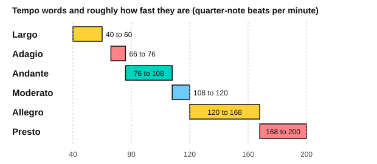

# Tempo and dynamics terms

<span class="tag tag-theory">Theory</span>

After this lesson you can read the Italian tempo and dynamics words printed on a score, set a metronome from a tempo word, and play a short passage that follows them.

Before this: [Beat, tempo and note values](../01-first-sounds/07-beat-tempo-and-note-values.md), [Legato, staccato and dynamics](../02-two-hands-and-first-chords/07-legato-staccato-and-dynamics.md). You need: your piano and a metronome app.

## The idea

### Where the words come from

Most printed music marks the speed and the loudness with Italian words, and has done for centuries. Learn them as a small vocabulary: about thirty words cover almost every score in this book, and many of them appear again and again.

### Tempo words

A **tempo word** names the speed of the beat, often above the first bar. The figure shows each word with a rough range in beats per minute (bpm) for a quarter-note beat. Sources give slightly different numbers, so treat them as a guide.



| Word | Meaning |
|---|---|
| Largo | Very slow and broad |
| Adagio | Slow |
| Andante | At a walking pace |
| Moderato | At a moderate speed |
| Allegro | Fast and lively |
| Presto | Very fast |

The speed can change inside a piece. These words mark a change:

| Word (short form) | Meaning |
|---|---|
| ritardando (rit.) | Gradually slower |
| rallentando (rall.) | Gradually slower (the same effect as rit.) |
| accelerando (accel.) | Gradually faster |
| a tempo | Back to the speed from before the change |
| rubato | Flexible tempo: the player speeds up and slows down a little for expression |

Rit. and rall. both ask for a gradual slowing, and teachers often use them for the end of a phrase or a piece. Rubato means "stolen time": a note takes a little extra time and another gives it back, so the overall pulse stays. Use it only when you can already keep a steady beat.

### Dynamics, from soft to loud

**Dynamics** are the loudness of the music. You know p, mf and f. Here is the full set in order from the softest.

| Sign | Word | Meaning |
|---|---|---|
| pp | pianissimo | Very soft |
| p | piano | Soft |
| mp | mezzo piano | Medium soft |
| mf | mezzo forte | Medium loud |
| f | forte | Loud |
| ff | fortissimo | Very loud |

These are relative signs, not fixed volumes. The reader's digital piano, the room and the piece decide what "loud" is. The point is the contrast between neighbouring signs.

Other dynamic marks:

| Mark | Meaning |
|---|---|
| sfz (sforzando) | A sudden strong accent on one note or chord |
| cresc. (crescendo) | Gradually louder |
| dim. (diminuendo) | Gradually softer |

### Small words that change the meaning

Italian words mix. A few small words appear in front of others:

| Word | Meaning | Example |
|---|---|---|
| poco | a little | poco rit.: slow down a little |
| molto | very, much | molto cresc.: grow a lot louder |
| più | more | più f: louder than before |
| meno | less | meno f: less loud than before |

You also meet words for the mood: dolce means sweetly and cantabile means in a singing style. Lesson 8 adds two tempo marks: andantino (close to andante) and allegro moderato (moderately fast).

### Reading the marks in music

Listen to this short phrase. It begins at an easy walking tempo, gets louder, slows at the end, then returns.

```abc
X:1
M:4/4
L:1/4
Q:1/4=88
K:C
!mp!"^Andante"C D E F | !crescendo(!G A B c!crescendo)! | !f!c B A G | "^rit."F E D C | "^a tempo"!p!E F G2 | !diminuendo(!G F E D!diminuendo)! | !pp!C4 |]
```

Read it as the score asks. Bar 1 is mp, bar 2 grows louder and bar 3 is f. Bar 4 slows (the playback keeps a steady tempo, so you add the slowing yourself). Bar 5 returns to the first speed at p, and the last bars die away to pp.

## Try it

Exercise 1. Put these tempo words in order from slowest to fastest: allegro, largo, andante, presto, moderato, adagio.

<details class="solution" markdown>
<summary>Answer</summary>

Largo, adagio, andante, moderato, allegro, presto.

</details>

Exercise 2. What do each of these ask you to do? "poco rit.", "molto cresc.", "più f", "a tempo".

<details class="solution" markdown>
<summary>Answer</summary>

Poco rit.: slow down a little, gradually. Molto cresc.: get a lot louder, gradually. Più f: play louder than before. A tempo: go back to the earlier speed.

</details>

Exercise 3. Write the six dynamic signs from softest to loudest.

<details class="solution" markdown>
<summary>Answer</summary>

pp, p, mp, mf, f, ff.

</details>

<div class="practice" markdown>

### Practice routine (30 minutes)

| Minutes | What to do | Tempo | Listen for |
|---|---|---|---|
| 5 | Warm-up: C major scale up and down, each hand, once at p, once at f | 80 bpm | The same evenness at both volumes |
| 15 | New skill: play the example in the lesson three ways: with every mark, then ignoring the marks, then with the marks exaggerated | 88 bpm, then 72 | A clear contrast between p and f |
| 5 | Reading: look at a page of your own music and say the meaning of every tempo and dynamic word on it | Untimed | Knowing each word without looking it up |
| 5 | Guitar: strum an Em chord at p, mf, f, then diminuendo back down | 60 bpm | A smooth change in volume |

Repeat this routine on at least three days before you check the boxes below.

</div>

<div class="move-on" markdown>

### Move on when

- [ ] You can write the six tempo words from slowest to fastest from memory.
- [ ] You can give the meaning of rit., a tempo, poco, molto, più and meno without looking.
- [ ] You can write pp to ff in order and say each word (pianissimo, piano and so on).
- [ ] You can play the example with all the marks at 88 bpm, with an audible difference between p and f.

</div>

## Common mistakes

Treating the bpm ranges as exact. They are a rough guide, and the piece, the instrument and the player affect the speed. Use them to set a metronome, then listen.

Slowing down at crescendos or speeding up at diminuendos by habit. Dynamics and tempo are separate. Keep the pulse steady unless a word says otherwise.

Playing every f at the same loudness. A piece with p, mf, f and ff needs four levels you can tell apart. Choose the softest and loudest first, then fit the others between.

## Key terms

- **Tempo word**: an Italian word for the speed (largo, adagio, andante, moderato, allegro, presto).
- **Ritardando, rallentando**: gradually slower. **Accelerando**: gradually faster. **A tempo**: back to the earlier speed.
- **Rubato**: flexible tempo, with a steady underlying pulse.
- **Dynamics**: loudness, from pp to ff.
- **Sforzando (sfz)**: a sudden strong accent.
- **Poco, molto, più, meno**: a little, very, more, less.

Next: [Articulation and repeat signs](04-articulation-and-repeat-signs.md)
