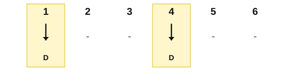
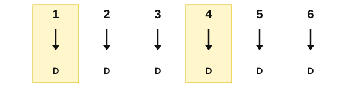
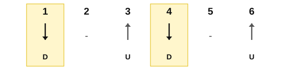

# 6/8 strumming

<span class="tag tag-guitar">Guitar</span>

After this lesson you can strum three patterns in 6/8, accent counts 1 and 4, and play a short chord piece in 6/8 while changing chords on the beat.

Before this: [Compound meter](01-compound-meter.md), [Strumming with down strokes](../02-two-hands-and-first-chords/08-strumming-down-strokes.md), [Eighth-note strumming](../04-intervals-and-triads/09-eighth-note-strumming.md), [The C, G and D minor chords](../03-the-major-scale-and-keys/06-chords-c-g-and-d-minor.md). You need: your guitar, a pick and a metronome app.

## The idea

### Six eighth notes, two beats

A bar of 6/8 has six eighth-note positions, and the strum lands on some of them. You count "1 2 3 4 5 6" and lean on counts 1 and 4. The strumming hand keeps moving the whole bar, down on each number and up between them, as in eighth-note strumming, but in 6/8 the hand makes six moves for the two beats.

Listen to a bar of Em with one down strum on each beat. It is the slowest pattern, and it has only two strums.

```abc
%%opts tab=guitar
X:1
M:6/8
L:1/8
Q:3/8=50
K:Em clef=treble-8
"Em"[E,B,EGBe]3 [E,B,EGBe]3 | "Em"[E,B,EGBe]3 [E,B,EGBe]3 |]
```

### Three patterns

Each pattern fills a bar of six counts. D is a down stroke, U is an up stroke, and a dash means the hand moves but misses the strings.

Pattern 1: down on 1 and 4, nothing on the others.



Pattern 2: a down stroke on every count, with counts 1 and 4 louder.



Pattern 3: down on 1 and 4, up on 3 and 6, nothing on 2 and 5. This is the swaying pattern. Say it as "1 (2) up 4 (5) up", or "DOWN - up DOWN - up".



Listen to pattern 3 on Em. You hear strums on counts 1, 3, 4 and 6.

```abc
%%opts tab=guitar
X:1
M:6/8
L:1/8
Q:3/8=50
K:Em clef=treble-8
"Em"[E,B,EGBe]2 [E,B,EGBe] [E,B,EGBe]2 [E,B,EGBe] | "Em"[E,B,EGBe]2 [E,B,EGBe] [E,B,EGBe]2 [E,B,EGBe] |]
```

### The steady hand

Follow these steps.

1. Count "1 2 3 4 5 6" aloud at 3/8 = 40 and tap your foot on 1 and 4.
2. Move your strumming hand down on each number and up in between, in a steady swing.
3. Let the hand touch the strings only on the counts the pattern asks for.
4. Make the strums on 1 and 4 a little louder than the others.
5. Keep the hand swinging through the counts with no strum.

Common mistake at step 3: the hand stops on the missed counts. A stopped hand loses the beat. The swing is constant, and the pattern only decides when the pick touches the strings.

### Changing chords

Change chords on count 1, as in the first chord pieces. Use the one-minute-changes habit: the fretting hand moves during the last count of the old bar, so the new chord is ready on count 1.

Here is "Tide Pool", an original piece with four chords: Em, Am, C and G. Play pattern 3 in every bar except bar 7, where the chord changes in the middle: C for counts 1 to 3 and G for counts 4 to 6, one strum for each.

```abc
%%opts tab=guitar
X:1
T:Tide Pool
M:6/8
L:1/8
Q:3/8=50
K:Em clef=treble-8
"Em"[E,B,EGBe]2 [E,B,EGBe] [E,B,EGBe]2 [E,B,EGBe] | "Em"[E,B,EGBe]2 [E,B,EGBe] [E,B,EGBe]2 [E,B,EGBe] | "C"[CEGce]2 [CEGce] [CEGce]2 [CEGce] | "G"[G,B,DGBg]2 [G,B,DGBg] [G,B,DGBg]2 [G,B,DGBg] |
"Am"[A,EAce]2 [A,EAce] [A,EAce]2 [A,EAce] | "Em"[E,B,EGBe]2 [E,B,EGBe] [E,B,EGBe]2 [E,B,EGBe] | "C"[CEGce]3 "G"[G,B,DGBg]3 | "Em"[E,B,EGBe]6 |]
```

Bars 1 and 2 are Em, bar 3 is C, bar 4 is G, bar 5 is Am, bar 6 is Em, bar 7 splits C and G, and bar 8 is Em.

## Try it

Exercise 1. In pattern 3, which counts have a strum, and which direction is each?

<details class="solution" markdown>
<summary>Answer</summary>

Counts 1 (down), 3 (up), 4 (down) and 6 (up). Counts 2 and 5 are missed.

</details>

Exercise 2. How many strums are in one bar of pattern 2, and how many are in pattern 1?

<details class="solution" markdown>
<summary>Answer</summary>

Six strums in pattern 2 and two in pattern 1.

</details>

<div class="practice" markdown>

### Practice routine (30 minutes)

| Minutes | What to do | Tempo | Listen for |
|---|---|---|---|
| 5 | Warm-up: Em chord, pattern 1, counting aloud | 3/8 = 40, then 50 | Counts 1 and 4 clear |
| 15 | New skill: patterns 2 and 3 on Em, then "Tide Pool" with pattern 3 | 3/8 = 40, then 50 | Every string ringing, the hand never stopping |
| 5 | Piano: the left-hand lilt from the last lesson on C, F and G | 3/8 = 50 | Bass on 1, chord on 4 |
| 5 | Ear: tap the beats of a 6/8 piece you know while it plays in your head | Untimed | Two beats, not six |

Repeat this routine on at least three days before you check the boxes below.

</div>

<div class="move-on" markdown>

### Move on when

- [ ] You can play pattern 3 on Em for 8 bars at 3/8 = 50 with the hand never stopping.
- [ ] You can play "Tide Pool" at 3/8 = 40, three times in a row with no stops.
- [ ] You can change chord on count 1 with no pause at the bar line.
- [ ] You can play patterns 1, 2 and 3 in turn, counting aloud, at 3/8 = 50.

</div>

## Common mistakes

Stopping the hand on missed counts. Keep swinging and miss the strings.

Strumming all six counts equally. Counts 1 and 4 need the extra weight.

Hearing 6/8 as 3/4. If you feel three beats, say the beat count aloud: 1 and 4 only.

## Film yourself

Record your strumming hand for one pattern. Watch for these.

- The hand swings steadily and does not stop on the missed counts.
- The wrist is loose.
- The hand moves from the wrist and the elbow, not the shoulder.

Watch: [The 6 : 8 Strumming Pattern You NEED](https://www.youtube.com/watch?v=bKOmcPTHYpA) by JustinGuitar (free, on YouTube).

## Key terms

- **Strum pattern**: the order of down and up strokes in a bar.
- **Lilt**: the swaying feel of 6/8, with the weight on counts 1 and 4.

Next: [Fingerpicking patterns](07-fingerpicking-patterns.md)
