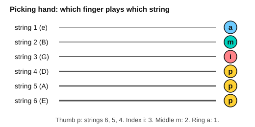
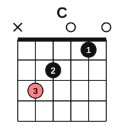
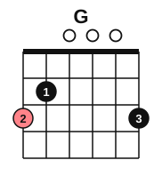

# Fingerpicking patterns

<span class="tag tag-guitar">Guitar</span>

After this lesson you can play the six-note pattern p i m a i m in 6/8, a bass-then-pairs pattern in 3/4, and a pattern that skips strings, on the chords Am, C, G and Em.

Before this: [Fingerpicking basics](../05-minor-keys-and-chord-charts/10-fingerpicking-basics.md), [Compound meter](01-compound-meter.md), [The C, G and D minor chords](../03-the-major-scale-and-keys/06-chords-c-g-and-d-minor.md). You need: your guitar and a metronome app. Trim your picking-hand nails if they catch the strings.

## The idea

### The fingers and the strings

You learned in the fingerpicking lesson that the picking-hand fingers are named p (thumb), i (index), m (middle) and a (ring). The thumb plays the thick strings 6, 5 and 4, and the fingers each take one thin string: i on string 3, m on string 2 and a on string 1. Keep the fingers resting on their strings before they play.



An **arpeggio** pattern plays the notes of a chord one at a time, over and over, instead of strumming them together. The chords for this lesson are Am, C and G, plus Em from earlier.





### Pattern 1: p i m a i m in 6/8

Six eighth notes make one bar of 6/8. The pattern is p i m a i m, with a slight lean on the thumb at count 1 and a small lean on the a at count 4. On Am the thumb plays string 5, i plays string 3, m plays string 2 and a plays string 1.

Listen to Am, C, G and Em, one bar each. The tab shows the strings and frets, the same pattern every bar. The bass note for G and Em is on string 6.

```abc
%%opts tab=guitar
X:1
M:6/8
L:1/8
Q:3/8=50
K:Am clef=treble-8
"Am"A, A c e A c | "C"C G c e G c | "G"G, G B g G B | "Em"E, G B e G B |]
```

### Pattern 2: bass then pairs in 3/4

In 3/4 the thumb plays one bass note on beat 1 (a quarter note), then i and m play a pair of eighth notes on beat 2 and again on beat 3. This is the waltz feel, "bass, pair, pair".

```abc
%%opts tab=guitar
X:1
M:3/4
L:1/8
Q:1/4=76
K:Am clef=treble-8
"Am"A,2 A c A c | "C"C2 G c G c | "G"G,2 G B G B | "Em"E,2 G B G B |]
```

Count it "1 2 & 3 &": a long bass note on 1, then two quick notes on each of beats 2 and 3.

### Pattern 3: skipping strings

To **skip** a string means to play a string and then jump past one or more strings without touching them. Here the thumb plays string 5, the middle finger jumps to string 2, then the index plays string 3 and the ring finger plays string 1.

```abc
%%opts tab=guitar
X:1
M:6/8
L:1/8
Q:3/8=50
K:Am clef=treble-8
"Am"A, c A e A c | "C"C c G e G c | "G"G, B G g G B | "Em"E, B G e G B |]
```

Listen to the difference: the skip from the thumb to m makes a wider leap, and the notes sound more spread out than pattern 1.

### Practising one pattern

Follow these steps.

1. Hold the first chord, rest p, i, m and a on their strings.
2. Play the pattern on the chord alone, six notes, with equal volume.
3. Add the next chord on the next bar and keep the pattern going.
4. Add a gentle lean on count 1.

Common mistake at step 2: the thumb is louder than the fingers. The fingers play closer to the strings than the thumb and tend to sound weak. Aim for equal volume, with the lean only on count 1.

## Try it

Exercise 1. Which finger plays string 2, and which plays string 1?

<details class="solution" markdown>
<summary>Answer</summary>

m plays string 2 and a plays string 1.

</details>

Exercise 2. In pattern 1 on Am, which strings are played in order?

<details class="solution" markdown>
<summary>Answer</summary>

5, 3, 2, 1, 3, 2 (p, i, m, a, i, m).

</details>

<div class="practice" markdown>

### Practice routine (30 minutes)

| Minutes | What to do | Tempo | Listen for |
|---|---|---|---|
| 5 | Warm-up: Am chord, p i m a i m repeated | 3/8 = 40 | Equal volume on every note |
| 15 | New skill: pattern 1 on all four chords, then pattern 2, then pattern 3 | 3/8 = 40, then 50; 3/4 at 60 bpm | Every string clear, no buzz |
| 5 | Piano: "Slow Boat" from lesson 5, hands together | 3/8 = 50 | Bass and melody together |
| 5 | Ear: sing the top note of each pattern as you play | Untimed | The melody in the top strings |

Repeat this routine on at least three days before you check the boxes below.

</div>

<div class="move-on" markdown>

### Move on when

- [ ] You can play pattern 1 on Am, C, G and Em, one bar each, at 3/8 = 50, three times in a row with no stops.
- [ ] You can play pattern 2 in 3/4 at 60 bpm with the same chords and no stops.
- [ ] You can name which finger plays which string without looking.
- [ ] You can play pattern 3 on Am for 8 bars at 3/8 = 40.

</div>

## Common mistakes

Plucking with the fingers flat. Curl the fingertip so the string is pulled across the pad and nail.

Lifting the fretting hand between bars. Keep fingers on the strings until the new chord is ready.

Rushing the first bar. Count three bars aloud before you start.

## Film yourself

Record your picking hand from above or the side. Watch for these.

- The fingers rest on their strings before they play.
- The thumb moves in a straight line to its string.
- The wrist is level, not bent.

Watch: [5 Fingerstyle Patterns You Need to Know](https://www.youtube.com/watch?v=jF0RduFSyHg) by JustinGuitar (free, on YouTube).

## Key terms

- **Arpeggio**: the notes of a chord played one after another.
- **p i m a**: the thumb, index, middle and ring fingers of the picking hand.
- **String skipping**: playing a string and jumping past one or more strings.

Next: [Burgmüller: two easy studies](08-burgmuller-easy-studies.md)
