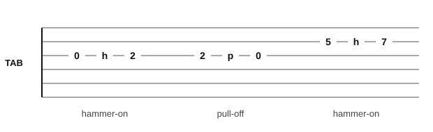

# Hammer-ons and pull-offs

<span class="tag tag-guitar">Guitar</span>

After this lesson you can play a hammer-on and a pull-off on the guitar, read the tab marks h and p, and read the slur in notation that shows them.

Before this: [Reading guitar tab](../01-first-sounds/11-reading-tab.md), [Reading notation on guitar](../03-the-major-scale-and-keys/11-reading-notation-on-guitar.md), [Articulation and repeat signs](04-articulation-and-repeat-signs.md). You need: your guitar, a pick and a metronome app.

## The idea

### One pick, two notes

Normally every note on guitar starts with a pick or a finger on the string. Two small techniques let you play a second note without picking again. Both use only the fretting hand, and the notes are on the same string.

A **hammer-on** plays a higher note by bringing a fretting finger down on the string hard and fast. You pick the first note, then hammer a finger onto a higher fret. The string keeps ringing, and the new finger changes its pitch.

A **pull-off** plays a lower note by pulling a finger off the string. You pick the higher note, then the fretting finger leaves the string sideways, and the string sounds the lower note (an open string or a lower fret held by another finger).

Listen to both. First a hammer-on from the open G string (string 3) to fret 2, then a pull-off from fret 2 back to the open string.

```abc
%%opts tab=guitar
X:1
M:4/4
L:1/4
Q:1/4=60
K:C clef=treble-8
(G A) G2 | (A G) A2 |]
```

### Reading them in tab



In tab, the letter h between two fret numbers is a hammer-on and the letter p is a pull-off. `0h2` means pick the open string, then hammer a finger on fret 2. `2p0` means pick fret 2, then pull off to the open string. Only the first number is picked.

### Reading them in notation

In notation both are shown by a **slur**: a curved line over two notes. The notes are on the same string, and you pick only the first. If the second note is higher, it is a hammer-on. If it is lower, it is a pull-off. The slur on guitar means "play the second note without picking" and does more than "connect the notes".

Watch out: a slur between notes on different strings is a legato mark, not a hammer-on or pull-off, since the second string needs its own pick or finger.

### How to play a hammer-on

Follow these steps.

1. Pick the first note and let it ring.
2. While it rings, bring your hammering finger down on the fret you want, close behind the fret wire.
3. Use the tip of the finger, and drop it with a quick, firm tap.
4. Keep the finger down and let the new note ring.

Common mistake at step 3: a weak tap, which makes a faint or dead note. Lift the finger a little higher and hit it harder.

### How to play a pull-off

1. Put the finger on the higher fret and pick the note.
2. Plant the lower finger (or leave the string open) so the next note is ready.
3. As the first finger leaves, pull the string a little toward the floor, so it plucks the string as it goes.
4. Let the second note ring.

Common mistake at step 3: lifting straight up, which gives a dull sound. The finger must flick the string on its way out.

### A short tune

"Hammer Lane" is an original tune in E minor. Each of bars 1 to 6 starts with a hammer-on or pull-off, all on one string per bar.

```abc
%%opts tab=guitar
X:1
T:Hammer Lane
M:4/4
L:1/4
Q:1/4=60
K:Em clef=treble-8
(G A) G2 | (B ^c) B2 | (e ^f) e2 | (^f e) B2 |
(^c B) G2 | (A G) E,2 |]
```

Bars 1 to 3 are hammer-ons on strings 3, 2 and 1, each from the open string to fret 2. Bars 4 and 5 are pull-offs, from fret 2 back to the open string. Bar 6 is a pull-off on string 3, then the open low E string.

## Try it

Exercise 1. Write the tab for "pick fret 3 on string 1, then pull off to the open string".

<details class="solution" markdown>
<summary>Answer</summary>

`3p0` on the top line (string 1).

</details>

Exercise 2. In `5h7p5`, which notes are picked?

<details class="solution" markdown>
<summary>Answer</summary>

Only the first 5. The hammer-on to 7 and the pull-off back to 5 both sound without picking.

</details>

Exercise 3. In notation, a slur joins two notes on the same string. The second note is lower. Which technique is it?

<details class="solution" markdown>
<summary>Answer</summary>

A pull-off.

</details>

<div class="practice" markdown>

### Practice routine (30 minutes)

| Minutes | What to do | Tempo | Listen for |
|---|---|---|---|
| 5 | Warm-up: frets 1, 2, 3, 4 on string 2, one finger per fret, picked | 60 bpm | Even volume on each finger |
| 15 | New skill: `0h2` and `2p0` on strings 3, 2 and 1, then "Hammer Lane" | 50 bpm, then 60 | The second note as loud as the first |
| 5 | Piano: "La pastorale" bars 1 to 4 or the lilt from lesson 5 | 3/8 = 44 | A quiet left hand |
| 5 | Ear: tap back test 1 from lesson 9 | 72 bpm | The foot on the beat |

Repeat this routine on at least three days before you check the boxes below. Stop if your fretting hand or wrist hurts, and see a teacher or doctor if it keeps happening.

</div>

<div class="move-on" markdown>

### Move on when

- [ ] You can play a hammer-on from fret 0 to 2 and a pull-off from 2 to 0 on strings 1, 2 and 3, with the second note as loud as the first.
- [ ] You can play "Hammer Lane" at 60 bpm, three times in a row with no stops.
- [ ] You can say what h, p and a slur mean in tab and in notation.
- [ ] You can write `0h2` and `2p0` for a string of your choice.

</div>

## Common mistakes

Picking the second note. The point is the fretting hand makes it sound.

Hammering too far behind the fret. The note buzzes. Land close behind the fret wire.

Pressing the strings so hard the tune slows down. The tap is quick; relax the hand between taps.

## Film yourself

Record your fretting hand from the side. Watch for these.

- The hammering finger comes from a small height and lands on its tip.
- The other fingers stay close to the strings.
- The thumb stays behind the neck and the wrist is relaxed.

Watch: [Hammer-ons & Pull-offs | Intermediate Guitar Lesson](https://www.youtube.com/watch?v=dYaeIXXyy1Y) by JustinGuitar (free, on YouTube).

## Key terms

- **Hammer-on**: sounding a higher note by tapping a finger onto the string, with no pick.
- **Pull-off**: sounding a lower note by pulling a finger off the string, with no pick.
- **h, p**: the tab marks for a hammer-on and a pull-off.
- **Slur**: a curved line over notes; on guitar, two notes on one string played without picking again.

Next: [Sight-reading rhythms](11-sight-reading-rhythms.md)
